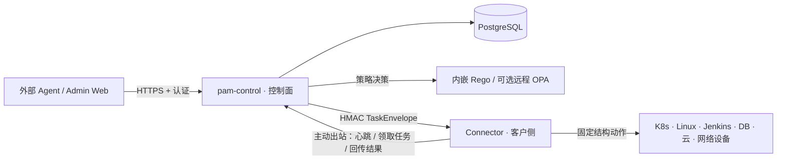

# HighTower PAM

> 面向 AI Agent 的**动作级授权与代理执行平台**。
> Agent 拿到的不是 kubeconfig、长期 Token 或数据库口令，而是一次受策略、审批、签名与审计约束的**执行**，以及一个可追溯的 `execution_id`。

| | |
|---|---|
| 定位 | 位于外部 Agent 与目标基础设施之间的授权 / 代理执行中间层 |
| 技术栈 | Go（控制面 + 多种 Connector）、React + TypeScript + Vite（管理端）、PostgreSQL |
| 隔离模型 | 共享控制面 + 逻辑多租户（`tenant_id` 为租户 slug） |
| 许可 | [Apache-2.0](LICENSE) |
| 发布状态 | 内部研发中，尚无正式 Release；变更记录见 [CHANGELOG.md](CHANGELOG.md) |

**文档入口**：[docs/README.md](docs/README.md)（按"想学 / 想做 / 想查 / 想理解"分类）。
**接口手册**：[docs/api.md](docs/api.md)。
**参与贡献**：[CONTRIBUTING.md](CONTRIBUTING.md)；**安全漏洞**：[SECURITY.md](SECURITY.md)。

---

## 30 秒理解这个项目

AI Agent 需要操作基础设施：更新 Deployment、查日志、触发构建、查数据库。传统做法是把长期凭据交给 Agent，代价是**权限无边界、泄露即全量暴露、无法审计单次操作、无法按需审批**。

HighTower 的答案是「不交凭据，只交付一次受约束的执行」：

> 谁让哪个 Agent，基于什么任务，在什么时间，对哪个资源，执行什么**受约束动作**，以及为什么被允许、怎样执行、如何追溯。

最终有效权限是多层交集，任一层拒绝即不执行：

```text
可信主体状态 ∩ 资源/动作目录 ∩ Rego 决策 ∩ AccessGrant 范围与有效期
∩ HMAC 签名信封 ∩ Connector Scope Guard ∩ 短期执行身份 ∩ 目标系统原生 RBAC
```

**明确不做**：不替代企业 IdP / MFA，不替代 Kubernetes RBAC 或云 IAM，不自研 Secret Manager 或策略语言，**不提供任意 Shell、SQL、`kubectl` 或原始 HTTP 代理**，不把 OpenBao / Teleport / Kubernetes 内部对象当业务授权主数据。

---

## 5 分钟跑起来

前置：Docker、Go（版本见 `server/go.mod`）、Node.js（版本见 `web/Dockerfile`）、`openssl`、`curl`。

```bash
# 1) 生成本地密钥（示例，详见教程）
mkdir -p .secrets
for f in task_signing_key jwt_signing_key credential_encryption_key agent_api_key; do
  printf '%s' "$(openssl rand -hex 32)" > ".secrets/$f"
done

# 2) 启动 PostgreSQL 并执行迁移
docker compose -f deploy/docker-compose.yaml up -d

# 3) 构建并启动控制面（默认 :8080）
make server-build
PAM_FOREGROUND=1 scripts/start-local-control.sh

# 4) 另一个终端启动管理端（默认 http://localhost:4173）
make web-install && make web-dev
```

完整可复制的步骤（含密钥文件、迁移、登录、第一次 API 调用与验证点）见 **[docs/quickstart.md](docs/quickstart.md)**。生产部署请读 **[docs/installation.md](docs/installation.md)**，不要照抄本地配置。

---

## 文档地图

文档按 [Diátaxis](https://diataxis.fr/) 的四类读者需求组织：**教程**带你上手、**操作指南**解决具体任务、**参考**用于查阅、**解释**帮助理解设计。同一件事不混在一篇里写。

| 我想…… | 读这篇 | 类型 |
|---|---|---|
| 第一次接触，把项目在本地跑起来 | [quickstart](docs/quickstart.md) | 教程 |
| 把系统部署到正式环境 | [installation](docs/installation.md) | 操作指南 |
| 接入企业单点登录、给 SSO 用户配权限 | [oidc-setup](docs/oidc-setup.md) | 操作指南 |
| 接入 K8s / Linux / 网络设备 / Agent | [onboarding](docs/onboarding.md) | 操作指南 |
| 做备份、升级、执行迁移、轮换密钥 | [operations](docs/operations.md) | 操作指南 |
| 排查登录失败、功能不显示、Connector 掉线 | [troubleshooting](docs/troubleshooting.md) | 操作指南 |
| 查某个环境变量 / Secret 文件 | [configuration](docs/configuration.md) | 参考 |
| 查某个 REST 接口、请求体、错误码 | [api](docs/api.md) | 参考 |
| 查系统支持哪些动作、默认策略怎么判 | [actions](docs/actions.md) | 参考 |
| 查一个术语到底指什么 | [glossary](docs/glossary.md) | 参考 |
| 理解租户 / 项目 / 资源 / 执行是什么关系 | [concepts](docs/concepts.md) | 解释 |
| 理解组件、链路、状态机与设计取舍 | [architecture](docs/architecture.md) | 解释 |
| 理解谁能做什么、权限何时生效 | [authorization](docs/authorization.md) | 解释 |
| 理解外部平台联邦身份与委托 | [federated-authorization](docs/federated-authorization.md) | 解释 |
| 了解已完成 / 未完成 / 已知设计债 | [roadmap](docs/roadmap.md) | 解释 |

**建议阅读顺序**：`quickstart` → `concepts` → `architecture` → 再按角色挑 `installation` / `configuration` / `api`。完整导航与文档规范见 [docs/README.md](docs/README.md)。

---

## 核心概念速览

| 概念 | 一句话 |
|---|---|
| **Tenant** | 一个客户 / 组织的数据隔离边界，业务表按 `tenant_id`（slug 字符串）隔离；初始租户是 `platform` |
| **Project** | 租户内部的业务线 / 环境分组，与租户是上下层级，不是并列关系 |
| **Principal** | 身份主体：用户、Agent 实例、工作负载 |
| **Connector** | 部署在目标环境、主动出站轮询任务的执行代理；控制面不主动连入客户网络 |
| **Resource / ActionDefinition** | 可被操作的目标对象，以及版本化的**结构化动作**（如 `deployment.update_image@v2`） |
| **PolicyDecision** | 一次请求不可变的策略结论：`ALLOW` / `DENY` / `REQUIRE_APPROVAL` |
| **AccessRequest / AccessGrant** | 人工审批单，以及审批通过后签发的限时、限次、限范围授权 |
| **Execution** | 一次动作的完整状态、结果与审计，状态机见 [architecture](docs/architecture.md) |
| **AuditEvent** | append-only 审计记录，串起身份、决策、授权、执行全链路 |

完整领域模型见 [docs/concepts.md](docs/concepts.md)。

---

## 架构一瞥



关键设计：**Connector 主动出站**，控制面不需要打通到客户内网的入站路径；**凭据不进入 Agent**，Connector 侧使用受限身份执行固定动作；**策略默认拒绝**，决策服务异常时同样 DENY。

组件清单、完整执行链路、状态机与代码分层见 [docs/architecture.md](docs/architecture.md)。

---

## 认证与权限

- 支持管理员密码会话、**企业 OIDC/SSO**（授权码 + PKCE S256）、Agent / Registration API Key、Connector 独立签名凭据、委托令牌与联邦断言登录。
- 认证与授权分离：**IdP 只证明"你是谁"，PAM 决定"你能做什么"**。首次 SSO 登录一律按最小权限 `user` 建档；提权只能在「平台管理 → 账号与权限」由超级管理员手工指派，且会立即撤销目标会话强制重登。
- 内置 `admin` 密码账号是 IdP 故障时的 break-glass 应急入口，保留但不应日常使用。
- 后端接口守卫与前端菜单读同一份 `capabilities` 能力清单，不再按角色名硬编码门控。

详见 [docs/authorization.md](docs/authorization.md) 与 [docs/oidc-setup.md](docs/oidc-setup.md)。

---

## 当前状态

**已具备**：多租户隔离、动作目录与策略决策、审批与限时授权、原子任务领取与 HMAC 任务信封、多种 Connector 与 Integration、审计与 Outbox、Admin Web、OIDC/SSO、统一权限模型与账号管理页。

**尚未实现**：MFA 与按 IdP claim 自动授权、Connector mTLS/SPIFFE、Rego Bundle 版本管理、完整 Execution Attempt 与取消协议、Outbox Publisher、SCIM、结果脱敏增强。OpenBao / Teleport 目前未集成。

完整清单与已知设计债见 [docs/roadmap.md](docs/roadmap.md)。

---

## 仓库结构

```text
server/
├── cmd/                      7 个可执行入口：控制面 + 各类 Connector/Operator/Helper
├── internal/{config,control,domain,policy,connector,storage}/
├── migrations/               顺序 SQL 迁移（001–097）
└── Dockerfile*               控制面/Connector 镜像
web/                          React + Vite 管理端
deploy/                       本地 compose、Helm Chart、K8s 基线、安装脚本、发布迁移清单
scripts/                      本地启动、OIDC 联调模板、Agent 客户端
docs/                         本文档体系（见 docs/README.md）
Makefile                      统一构建与验证入口
```

子项目说明：[server/README.md](server/README.md)、[web/README.md](web/README.md)。

---

## 参与与安全

- 开发流程、测试命令与提交前检查：[CONTRIBUTING.md](CONTRIBUTING.md)
- 漏洞请按 [SECURITY.md](SECURITY.md) **私下报告**，不要公开 Issue
- 文档怎么写、哪些内容不得入库：[docs/README.md](docs/README.md)
- 许可：[LICENSE](LICENSE)
