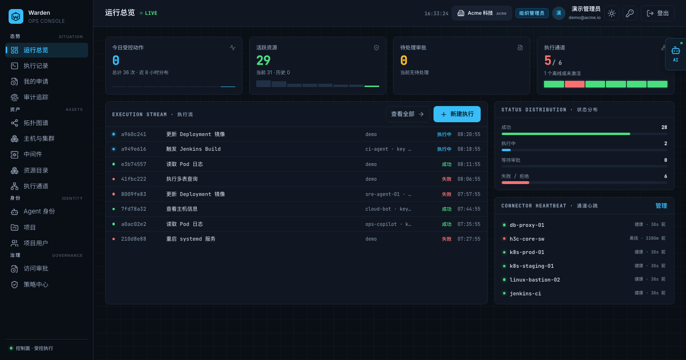
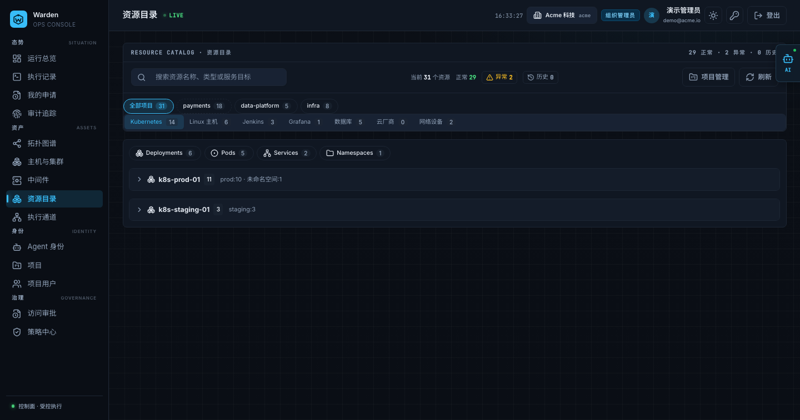
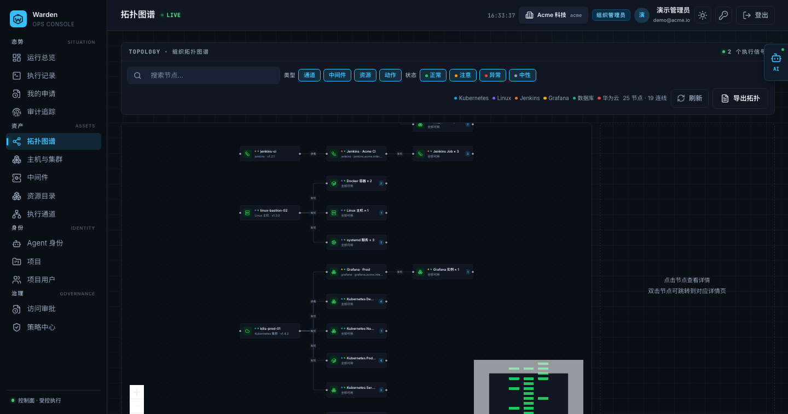
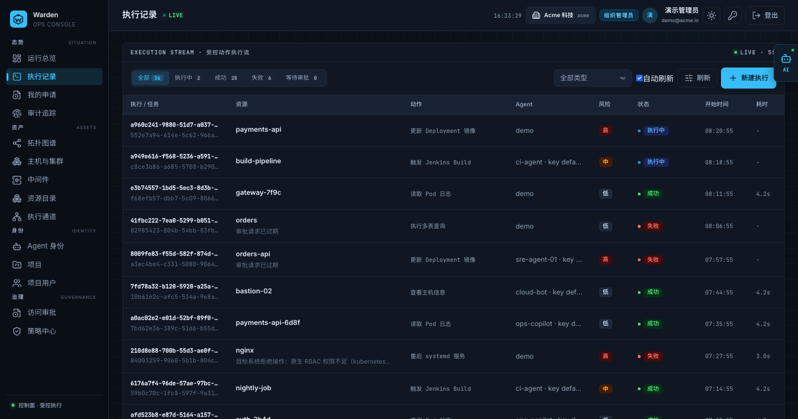
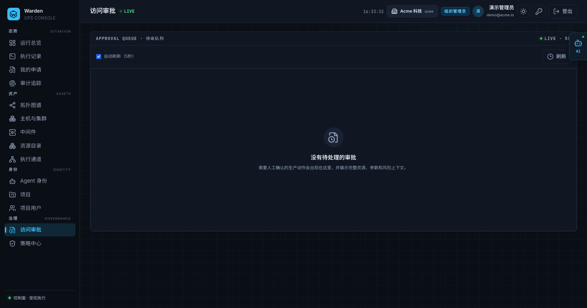
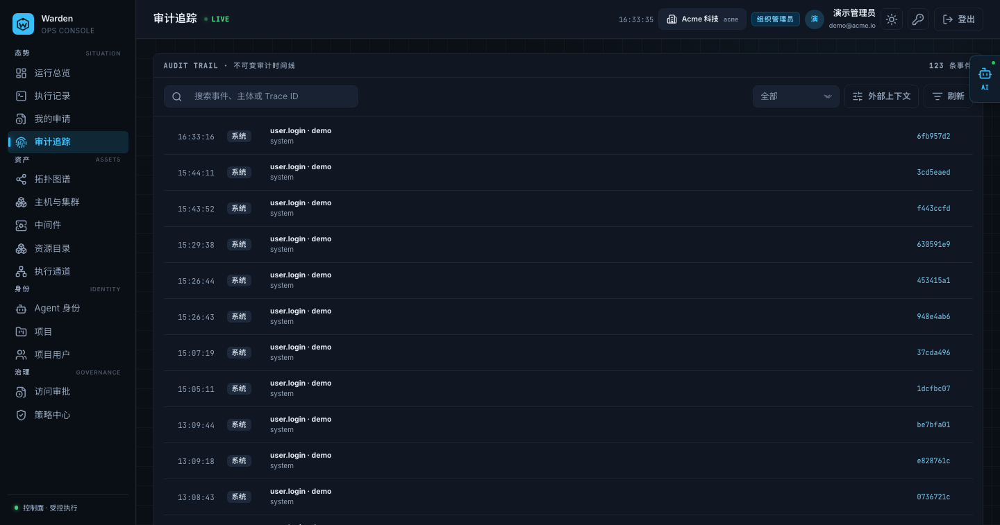
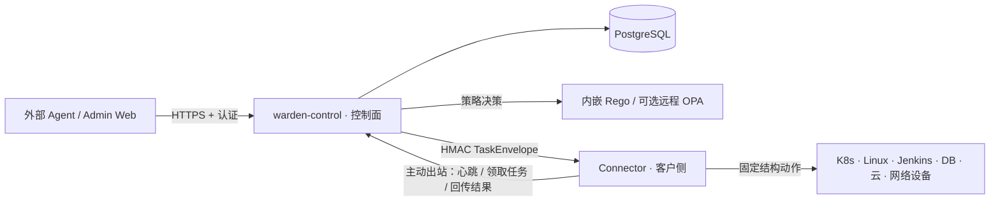

# Warden

[](https://github.com/warden-platform/warden/actions/workflows/ci.yml)
[](https://github.com/warden-platform/warden/releases)
[](LICENSE)

> **别把 kubeconfig 交给 AI Agent。**
> 给它一个被策略、审批、签名和审计约束的 `execution_id`，而不是长期凭据。

Warden 是面向 AI Agent 的**动作级授权与代理执行平台**——外部 Agent 与目标基础设施之间的中间层。Agent 每次操作都走「身份 → 动作目录 → Rego 策略 → 人工审批 → 限时授权 → HMAC 签名信封 → 内网 Connector 执行 → 审计」全链路，任一层拒绝即不执行。

## 快速体验

| | |
|---|---|
| 在线体验 | https://warden.squawksync.cloud/login（`demo@acme` / `12345678`，只读演示数据） |
| 本地一键演示 | `make demo` —— 免构建，ACR 公开镜像 + 预置演示数据，一条命令起完整环境 |

## 30 秒看懂「怎么用」

```bash
curl -X POST https://warden.example.com/api/v1/executions \
  -H "Authorization: Bearer $WARDEN_AGENT_KEY" \
  -d '{"resource":"prod/checkout-api",
       "action":"deployment.update_image@v2",
       "params":{"image":"registry.example.com/checkout:1.8.3"}}'
# → 202 {"execution_id":"...","status":"WAITING_APPROVAL"}
```

默认走审批：谁、在什么时间、对哪个资源、执行什么动作、为什么，全程可追溯。

## 和现有方案的关系

| 方案 | 它解决什么 | 还差什么 |
|---|---|---|
| 长期 Token / kubeconfig | 让 Agent 能干活 | 权限无边界、泄露即全量、无法按次审批 |
| Vault / OpenBao | 凭据集中管理、短命凭据 | 不判断「这个动作该不该发生」 |
| Teleport | 人和机器的安全接入 | 不提供动作级审批与执行编排 |
| Kubernetes RBAC | 集群内资源授权 | 管不到 Jenkins / 数据库 / 网络设备 |
| **Warden** | 动作级授权 + 审批 + 代理执行 + 审计 | 不替代以上任何一层 |

## 界面预览

| 运行总览 | 资源目录 | 拓扑图谱 |
|---|---|---|
|  |  |  |

| 执行记录 | 访问审批 | 审计追踪 |
|---|---|---|
|  |  |  |

<details><summary>项目元信息与文档入口</summary>

| | |
|---|---|
| 技术栈 | Go（控制面 + 多种 Connector）、React + TypeScript + Vite（管理端）、PostgreSQL |
| 隔离模型 | 共享控制面 + 逻辑多租户（`tenant_id` 为租户 slug） |
| 发布状态 | Release v0.4.3（2026-11-25）· [Apache-2.0](LICENSE) |

**文档入口**：[docs/README.md](docs/README.md)（按"想学 / 想做 / 想查 / 想理解"分类）· **[接口手册](docs/api.md)** · **[参与贡献](CONTRIBUTING.md)** · **[安全漏洞](SECURITY.md)**

</details>

---

## 30 秒理解这个项目

AI Agent 需要操作基础设施：更新 Deployment、查日志、触发构建、查数据库。传统做法是把长期凭据交给 Agent，代价是**权限无边界、泄露即全量暴露、无法审计单次操作、无法按需审批**。

Warden 的答案是「不交凭据，只交付一次受约束的执行」。最终有效权限是多层交集，任一层拒绝即不执行：

```text
可信主体状态 ∩ 资源/动作目录 ∩ Rego 决策 ∩ AccessGrant 范围与有效期
∩ HMAC 签名信封 ∩ Connector Scope Guard ∩ 短期执行身份 ∩ 目标系统原生 RBAC
```

**明确不做**：不替代企业 IdP / MFA，不替代 Kubernetes RBAC 或云 IAM，不自研 Secret Manager 或策略语言，**不提供任意 Shell、SQL、`kubectl` 或原始 HTTP 代理**，不把 OpenBao / Teleport / Kubernetes 内部对象当业务授权主数据。

---

## 本地开发（从源码）

> 只想体验请看上方 **快速体验**（`make demo` 免构建、一条命令）；下面是从源码跑起来，完整可复制步骤（密钥文件、迁移、登录、第一次 API 调用与验证点）见 **[docs/quickstart.md](docs/quickstart.md)**（约 15 分钟）。

前置：Docker、Go（版本见 `server/go.mod`）、Node.js（版本见 `web/Dockerfile`）、`openssl`、`curl`。

```bash
# 1) 初始化内部密钥，并准备用户配置
scripts/init-local-secrets.sh
cp .env.example .env
# 按 docs/quickstart.md 设置管理员密码和数据库凭据

# 2) 启动 PostgreSQL（Compose 映射到本机 5433）
docker compose --env-file .env -f deploy/docker-compose.yaml up -d
# 使用 Compose 数据库时，把 config.yaml 的 database.url 改为 postgres://127.0.0.1:5433/warden

# 3) 执行数据库迁移（控制面启动不会自动跑迁移；仅限全新空库）
make migrate

# 4) 构建并启动控制面（默认 :8080）
make server-build
WARDEN_FOREGROUND=1 scripts/start-local-control.sh

# 5) 另一个终端启动管理端（默认 http://localhost:4173）
make web-install && make web-dev
```

生产部署请读 **[生产部署](docs/guides.md#installation)**，不要照抄本地配置。

---

## 文档地图

文档按 [Diátaxis](https://diataxis.fr/) 的四类读者需求组织：**教程**带你上手、**操作指南**解决具体任务、**参考**用于查阅、**解释**帮助理解设计。长主题合并为**带章节锚点的单篇文档**（`文件.md#锚点`），减少散落与重复。

| 我想…… | 读这篇 | 类型 |
|---|---|---|
| 第一次接触，把项目在本地跑起来 | [quickstart](docs/quickstart.md) | 教程 |
| 部署 / 接入目标系统 / 配 SSO / 日常运维 | [guides](docs/guides.md)（`#installation` `#onboarding` `#oidc` `#operations`） | 操作指南 |
| 排查登录失败、功能不显示、Connector 掉线 | [troubleshooting](docs/troubleshooting.md) | 操作指南 |
| 查环境变量 / Secret 文件，查支持哪些动作、默认策略 | [reference](docs/reference.md)（`#configuration` `#actions`） | 参考 |
| 查某个 REST 接口、请求体、错误码 | [api](docs/api.md) | 参考 |
| 理解租户 / 项目 / 资源 / 执行关系，查术语 | [concepts](docs/concepts.md)（`#core-concepts` `#glossary`） | 解释 |
| 理解组件、链路、状态机、已完成 / 未完成 / 设计债 | [architecture](docs/architecture.md)（`#architecture` `#roadmap`） | 解释 |
| 理解谁能做什么、权限何时生效、联邦身份与委托 | [authorization](docs/authorization.md)（`#authorization` `#federation`） | 解释 |
| 要给外部 Agent 接 MCP / 看设计边界 | [mcp](docs/mcp.md) | 解释（设计稿） |

**建议阅读顺序**：`quickstart` → `concepts` → `architecture` → 再按角色挑 `guides` / `reference` / `api`。完整导航、锚点清单与文档规范见 [docs/README.md](docs/README.md)。

---

## 核心概念速览

| 概念 | 一句话 |
|---|---|
| **Tenant** | 一个客户 / 组织的数据隔离边界，业务表按 `tenant_id`（slug 字符串）隔离；初始租户是 `platform` |
| **Project** | 租户内部的业务线 / 环境分组，与租户是上下层级，不是并列关系 |
| **Principal** | 身份主体：用户、Agent 实例、工作负载 |
| **Connector** | 部署在目标环境、主动出站轮询任务的执行代理；控制面不主动连入客户网络 |
| **Resource / ActionDefinition** | 可被操作的目标对象，以及版本化的**结构化动作**（如 `deployment.update_image@v2`） |
| **PolicyDecision** | 一次请求不可变的策略结论：`ALLOW` / `DENY` / `REQUIRE_APPROVAL` |
| **AccessRequest / AccessGrant** | 人工审批单，以及审批通过后签发的限时、限次、限范围授权 |
| **Execution** | 一次动作的完整状态、结果与审计，状态机见 [architecture](docs/architecture.md) |
| **AuditEvent** | append-only 审计记录，串起身份、决策、授权、执行全链路 |

完整领域模型见 [docs/concepts.md](docs/concepts.md)。

---

## 架构一瞥



关键设计：**Connector 主动出站**，控制面不需要打通到客户内网的入站路径；**凭据不进入 Agent**，Connector 侧使用受限身份执行固定动作；**策略默认拒绝**，决策服务异常时同样 DENY。

组件清单、完整执行链路、状态机与代码分层见 [docs/architecture.md](docs/architecture.md)。

---

## 认证与权限

- 支持管理员密码会话、**企业 OIDC/SSO**（授权码 + PKCE S256）、Agent / Registration API Key、Connector 独立签名凭据、委托令牌与联邦断言登录。
- 认证与授权分离：**IdP 只证明"你是谁"，Warden 决定"你能做什么"**。首次 SSO 登录按配置的默认角色建档（生产建议 `user`）；未匹配组织的新身份进入 `unaffiliated`，只有自助资料权限。普通账号只能指派 `user` / `tenant_admin`，角色变更会立即撤销目标会话强制重登。
- 启动管理员密码账号是 IdP 故障时的 break-glass 应急入口，登录名由部署者配置，不应日常使用。
- 后端接口守卫与前端菜单读同一份 `capabilities` 能力清单，不再按角色名硬编码门控。

详见 [docs/authorization.md](docs/authorization.md) 与 [SSO 接入](docs/guides.md#oidc)。

---

## 当前状态

**已具备**：多租户隔离、组织拓扑三层图、动作目录与策略决策、审批与限时授权、原子任务领取与 HMAC 任务信封、多种 Connector 与 Integration、审计、Admin Web、OIDC/SSO、统一权限模型、身份分配与邀请、账号管理页，以及权限继承的 AI 只读助手（OpenAI 兼容、SSE 流式）。

**尚未实现**：MFA 与按 IdP claim 自动授权、Connector mTLS/SPIFFE、Rego Bundle 版本管理、协作式取消协议（已派发执行的中止；取消对已派发/终态执行诚实返回 409）、SCIM、结果脱敏增强；MCP 写工具与 Remote MCP（首期只读 stdio 适配器 `warden-mcp` 已实现，见 [docs/mcp.md](docs/mcp.md)）。OpenBao / Teleport 目前未集成。

完整清单与已知设计债见 [现状与路线](docs/architecture.md#roadmap)。

---

## 仓库结构

```text
server/
├── cmd/                      7 个可执行入口：控制面 + 各类 Connector/Operator/Helper
├── internal/{config,control,domain,policy,connector,storage}/
├── migrations/               顺序 SQL 迁移（001–114）
└── Dockerfile*               控制面/Connector 镜像
web/                          React + Vite 管理端
deploy/                       本地 compose、Helm Chart、K8s 基线、安装脚本、发布迁移清单
scripts/                      本地启动、演示数据种子、Agent 客户端
docs/                         本文档体系（见 docs/README.md）
Makefile                      统一构建与验证入口
```

子项目说明：[server/README.md](server/README.md)、[web/README.md](web/README.md)。

---

## 参与与安全

- 开发流程、测试命令与提交前检查：[CONTRIBUTING.md](CONTRIBUTING.md)
- 漏洞请按 [SECURITY.md](SECURITY.md) **私下报告**，不要公开 Issue
- 文档怎么写、哪些内容不得入库：[docs/README.md](docs/README.md)
- 许可：[LICENSE](LICENSE)
