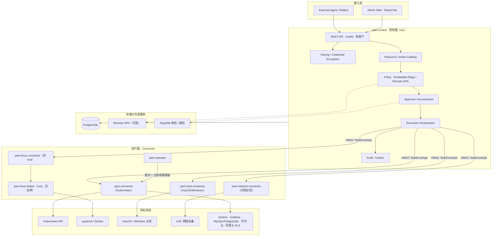
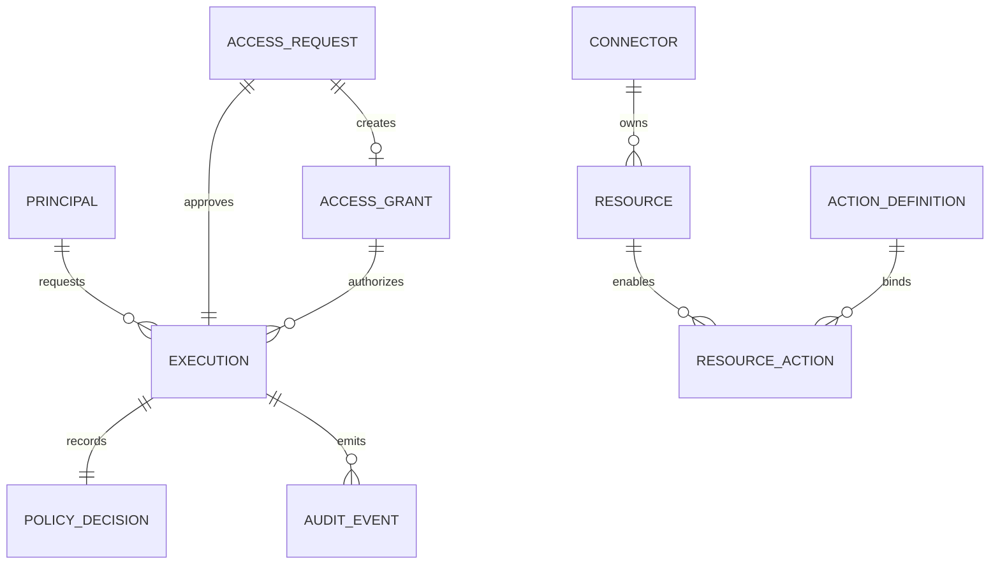
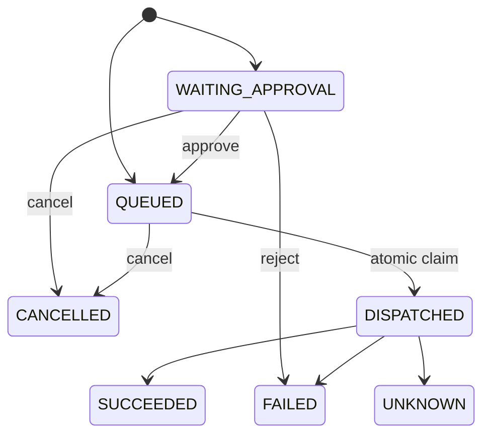
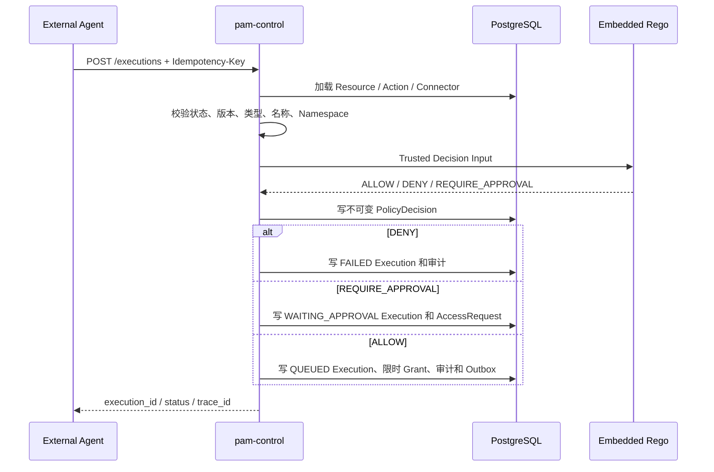
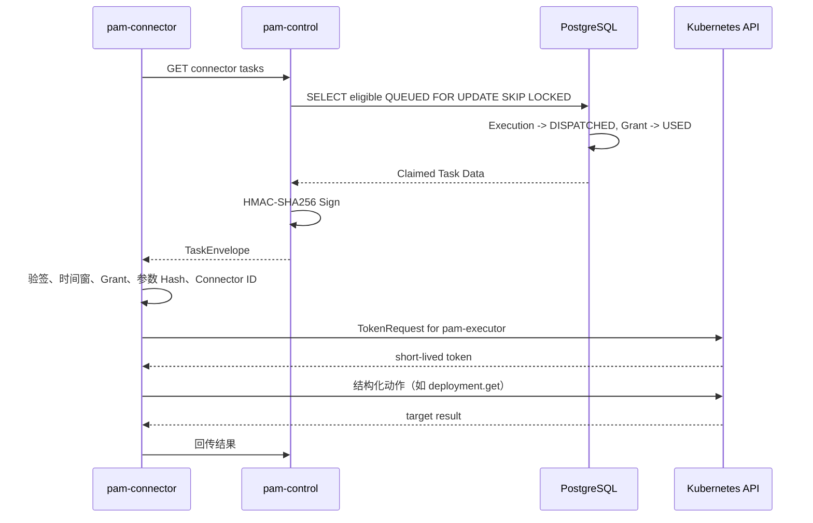

# HighTower

HighTower 是位于外部 AI Agent 与目标系统（Kubernetes、Jenkins、数据库等）之间的**动作级授权和代理执行平台**。

当前版本支持共享控制面多租户模式。企业通过独立 tenant 使用平台，Principal、API Key、Connector、Integration、Credential、Resource、Project、Policy、Execution 和 Audit 均按 tenant 隔离。初始迁移租户为 `platform`；tenant 由平台管理员创建，企业后续可通过租户管理员管理自身资源。客户端不能通过请求体自行切换 tenant，tenant 从认证身份和 Connector 凭据推导。

项目文档入口见 [`docs/README.md`](docs/README.md)，完整后端接口说明见 [`docs/api.md`](docs/api.md)。
项目采用 [Apache-2.0](LICENSE) 许可证；贡献流程见 [CONTRIBUTING.md](CONTRIBUTING.md)，安全问题请按 [SECURITY.md](SECURITY.md) 私下报告。

---

## 一、项目意义

### 要解决的问题

AI Agent 需要操作基础设施——更新 Deployment、查日志、执行构建、查询数据库。传统做法是给 Agent 一个 kubeconfig、API Key 或长期 Token，这在安全上不可接受：

- Agent 拿到凭据后可以**任意操作**，不受限
- 凭据泄露意味着**全部资产暴露**
- 无法审计单个 Agent 的**每一次具体操作**
- 无法在策略层面对动作做**按需审批和限时授权**

### 平台的核心承诺

HighTower 交付给 Agent 的不是凭据，而是一次**受约束执行**及其 `execution_id`：

> 谁让哪个 Agent，基于什么任务，在什么时间，对哪个资源，执行什么受约束动作，以及为什么被允许、怎样执行、如何追溯。

### 不做什么

- 不替代企业 IdP、SSO 和 MFA
- 不替代 Kubernetes RBAC、云 IAM 等原生权限
- 不自研 Secret Manager、SSH 代理或策略语言
- 不提供任意 Shell、SQL、`kubectl` 或原始 HTTP 代理
- 不把 OpenBao、Teleport 或 Kubernetes 内部对象当作业务授权主数据

---

## 二、系统架构

### 2.1 总体架构



### 2.2 组件

| 组件 | 形态 | 职责 | 是否必需 |
|---|---|---|---|
| `pam-control` | Go 进程，REST API (:8080) | 策略决策、审批、Grant、Execution 编排、审计、凭据加密、配对 | 是 |
| `pam-connector` | Go 进程，部署于目标集群 | 领取任务、验签、TokenRequest、执行结构化 Kubernetes 动作、资源发现 | K8s 闭环必需 |
| `pam-operator` | Go 进程，部署于目标集群 | 集群配对、Connector 生命周期调谐（SA/RBAC/Secret/Deployment）、安全下线 | Operator 接入必需 |
| `pam-linux-connector` | Go 进程，部署于目标主机 | Linux 主机配对、systemd 服务发现、主机/进程/磁盘/日志结构化动作 | Linux 接入必需 |
| `pam-linux-helper` | Go 进程，部署于目标主机 | 通过 Unix Socket 提供固定 Docker 查询和生命周期动作；不接受 Shell 或任意 Docker 参数 | Docker 受控接入必需 |
| `pam-network-connector` | Go 进程，部署于能访问设备管理网的内网主机 | H3C 交换机、AP、路由器只读发现与审计；主动出站连接控制面，校验 SSH Host Key 指纹 | H3C 网络设备接入必需 |
| `pam-host-connector` | Go 进程，部署于 macOS/Windows 主机 | 通用主机接入、固定命令白名单、心跳与配对 | macOS/Windows 主机接入必需 |
| PostgreSQL | 独立服务 | 业务主数据、审计索引、Outbox | 是 |
| Admin Web | React/Vite + Tailwind | Keep 风格管理界面（拓扑图谱 + 暗色模式 + 无演示数据） | 可选 |
| 独立 OPA | 可选服务 | 远程 Rego 决策 | 否，默认内嵌 |
| OpenBao | 可选服务 | 静态 Secret、动态账号、PKI | 否，当前未集成 |
| Teleport | 可选服务 | SSH、多集群、数据库代理 | 否，当前未集成 |

### 2.3 核心数据对象



- **Principal** — 用户、Agent 实例或工作负载
- **Connector** — 一个目标安全域的执行实例
- **Resource** — 目标 Deployment、Pod 等
- **ActionDefinition** — 版本化结构化动作（如 `deployment.update_image@v1`）
- **PolicyDecision** — 一次请求的不可变策略决策结果
- **AccessRequest** — 需要人工审批的请求
- **AccessGrant** — 限时、限次、限范围的授权能力
- **Execution** — 一次动作的完整状态和结果

### 2.4 Execution 状态机



### 2.5 执行链路

**创建 Execution：**



**任务领取与执行：**



### 2.6 权限交集

最终有效权限取**所有层级的交集**：

```
可信主体状态
∩ Resource / Action 目录
∩ Rego 决策
∩ AccessGrant 范围和有效期
∩ HMAC 签名信封
∩ Connector Namespace / Registry Guard
∩ 短期 ServiceAccount 身份
∩ Kubernetes RBAC
```

任意一层拒绝，动作不执行。

### 2.7 代码结构

```
PAM/
├── web/                          React/Vite 管理端
│   ├── src/
│   │   ├── app/App.tsx
│   │   ├── main.tsx
│   │   └── shared/               API 客户端与共享类型
│   ├── index.html
│   ├── package.json
│   └── vite.config.ts
├── server/                       Go 后端
│   ├── cmd/
│   │   ├── pam-control/          控制面入口
│   │   ├── pam-connector/        K8s Connector 入口
│   │   ├── pam-operator/         K8s Operator 入口（配对 + 生命周期调谐）
│   │   ├── pam-linux-connector/  Linux Connector 入口
│   │   ├── pam-linux-helper/     Linux root Helper 入口
│   │   ├── pam-host-connector/   macOS/Windows 主机 Connector 入口
│   │   └── pam-network-connector/ H3C 网络 Connector 入口
│   ├── internal/
│   │   ├── config/               配置与 Secret 加载
│   │   ├── control/              HTTP 路由、配对、凭据加密、下载
│   │   ├── domain/               领域对象、Hash、TaskEnvelope
│   │   ├── policy/               OPA/Rego Provider
│   │   ├── connector/            Connector Runtime、TokenRequest、各类受控 Action
│   │   └── storage/postgres/     PostgreSQL 适配器
│   ├── migrations/               顺序数据库迁移
│   ├── Dockerfile                多阶段构建（pam-control/connector/operator）
│   └── Dockerfile.release        scratch distroless 发布镜像
├── deploy/
│   ├── docker-compose.yaml       本地 PostgreSQL + 可选 OPA/OpenBao
│   ├── kubernetes/               测试集群 RBAC 和 Connector 基线
│   ├── helm/pam-operator/        Operator Helm Chart
│   ├── linux/                    Linux Connector 安装/卸载脚本
│   └── opa/                      Remote OPA 策略
├── docs/                         本文档
├── Makefile                      统一开发命令
└── README.md
```

---

## 三、使用指南

### 3.1 本地开发环境

启动 PostgreSQL：

```bash
docker compose -f deploy/docker-compose.yaml up -d
```

包含可选 OPA 和 OpenBao：

```bash
docker compose -f deploy/docker-compose.yaml --profile optional up -d
```

执行数据库迁移：

```bash
docker compose -f deploy/docker-compose.yaml exec postgresql \
  psql -U pam -d pam -f /migrations/001_initial.sql
docker compose -f deploy/docker-compose.yaml exec postgresql \
  psql -U pam -d pam -f /migrations/002_seed.sql
docker compose -f deploy/docker-compose.yaml exec postgresql \
  psql -U pam -d pam -f /migrations/003_execution_approval_link.sql
docker compose -f deploy/docker-compose.yaml exec postgresql \
  psql -U pam -d pam -f /migrations/004_bundle_hash_length.sql
docker compose -f deploy/docker-compose.yaml exec postgresql \
  psql -U pam -d pam -f /migrations/005_cluster_operator_pairing.sql
docker compose -f deploy/docker-compose.yaml exec postgresql \
  psql -U pam -d pam -f /migrations/006_pairing_cluster_options.sql
docker compose -f deploy/docker-compose.yaml exec postgresql \
  psql -U pam -d pam -f /migrations/007_connector_archival.sql
docker compose -f deploy/docker-compose.yaml exec postgresql \
  psql -U pam -d pam -f /migrations/008_resource_discovery_lifecycle.sql
docker compose -f deploy/docker-compose.yaml exec postgresql \
  psql -U pam -d pam -f /migrations/009_linux_connector.sql
docker compose -f deploy/docker-compose.yaml exec postgresql \
  psql -U pam -d pam -f /migrations/010_linux_docker_readonly.sql
docker compose -f deploy/docker-compose.yaml exec postgresql \
  psql -U pam -d pam -f /migrations/011_jenkins_adapter.sql
docker compose -f deploy/docker-compose.yaml exec postgresql \
  psql -U pam -d pam -f /migrations/012_integrations.sql
docker compose -f deploy/docker-compose.yaml exec postgresql \
  psql -U pam -d pam -f /migrations/013_agent_api_keys.sql
docker compose -f deploy/docker-compose.yaml exec postgresql \
  psql -U pam -d pam -f /migrations/014_grafana_adapter.sql
docker compose -f deploy/docker-compose.yaml exec postgresql \
  psql -U pam -d pam -f /migrations/015_admin_password_auth.sql
docker compose -f deploy/docker-compose.yaml exec postgresql \
  psql -U pam -d pam -f /migrations/016_database_adapter.sql
docker compose -f deploy/docker-compose.yaml exec postgresql \
  psql -U pam -d pam -f /migrations/017_action_parameter_schema_alignment.sql
docker compose -f deploy/docker-compose.yaml exec postgresql \
  psql -U pam -d pam -f /migrations/018_kubernetes_diagnostic_actions.sql
docker compose -f deploy/docker-compose.yaml exec postgresql \
  psql -U pam -d pam -f /migrations/019_kubernetes_diagnostic_actions_phase2to4.sql
docker compose -f deploy/docker-compose.yaml exec postgresql \
  psql -U pam -d pam -f /migrations/020_drop_external_id_unique_constraint.sql
docker compose -f deploy/docker-compose.yaml exec postgresql \
  psql -U pam -d pam -f /migrations/021_jenkins_job_actions.sql
docker compose -f deploy/docker-compose.yaml exec postgresql \
  psql -U pam -d pam -f /migrations/022_approval_rules.sql
docker compose -f deploy/docker-compose.yaml exec postgresql \
  psql -U pam -d pam -f /migrations/023_grafana_folder_delete.sql
docker compose -f deploy/docker-compose.yaml exec postgresql \
  psql -U pam -d pam -f /migrations/024_execution_dispatch_lease.sql
docker compose -f deploy/docker-compose.yaml exec postgresql \
  psql -U pam -d pam -f /migrations/025_admin_sessions.sql
docker compose -f deploy/docker-compose.yaml exec postgresql \
  psql -U pam -d pam -f /migrations/026_normalize_default_tenant.sql
docker compose -f deploy/docker-compose.yaml exec postgresql \
  psql -U pam -d pam -f /migrations/027_identity_audit_actions.sql
docker compose -f deploy/docker-compose.yaml exec postgresql \
  psql -U pam -d pam -f /migrations/028_integration_audit_actions.sql
docker compose -f deploy/docker-compose.yaml exec postgresql \
  psql -U pam -d pam -f /migrations/029_dingtalk_notification_channel.sql
docker compose -f deploy/docker-compose.yaml exec postgresql \
  psql -U pam -d pam -f /migrations/030_dingtalk_coolapp.sql
docker compose -f deploy/docker-compose.yaml exec postgresql \
  psql -U pam -d pam -f /migrations/031_projects.sql
docker compose -f deploy/docker-compose.yaml exec postgresql \
  psql -U pam -d pam -f /migrations/032_integration_consistency.sql
docker compose -f deploy/docker-compose.yaml exec postgresql \
  psql -U pam -d pam -f /migrations/033_huaweicloud_actions.sql
docker compose -f deploy/docker-compose.yaml exec postgresql \
  psql -U pam -d pam -f /migrations/034_project_resource_scope.sql
docker compose -f deploy/docker-compose.yaml exec postgresql \
  psql -U pam -d pam -f /migrations/035_integration_project_routing.sql
docker compose -f deploy/docker-compose.yaml exec postgresql \
  psql -U pam -d pam -f /migrations/036_huaweicloud_multiregion_create.sql
```

### 3.2 启动控制面

```bash
cd server
PAM_DATABASE_URL_FILE=../.secrets/database_url \
PAM_TASK_SIGNING_KEY_FILE=../.secrets/task_signing_key \
PAM_JWT_SIGNING_KEY_FILE=../.secrets/jwt_signing_key \
PAM_CREDENTIAL_ENCRYPTION_KEY_FILE=../.secrets/credential_encryption_key \
PAM_ADMIN_API_KEY_FILE=../.secrets/agent_api_key \
PAM_ADMIN_PASSWORD_FILE=../.secrets/admin_password \
go run ./cmd/pam-control
```

默认端口 `8080`，可通过 `PAM_PORT` 修改。

### 3.3 Connector 部署

Connector 只能在 Kubernetes Pod 内运行，使用 InCluster 配置。先构建镜像：

```bash
docker build -f server/Dockerfile --build-arg TARGET=pam-control \
  -t registry.example.com/pam/pam-control:0.3.2 .

docker build -f server/Dockerfile --build-arg TARGET=pam-connector \
  -t registry.example.com/pam/pam-connector:0.3.2 .
```

`deploy/kubernetes/` 包含测试基线清单，应用前必须修改：
- Namespace
- 镜像地址
- `PAM_CONTROL_URL`
- `PAM_ALLOWED_IMAGE_PREFIXES`
- Token Audience
- 签名 Key Secret

### 3.4 配置参考

**pam-control：**

| 变量 | 必需 | 说明 |
|---|---|---|
| `PAM_DATABASE_URL_FILE` | 是 | 保存 PostgreSQL DSN 的 Secret 文件 |
| `PAM_TASK_SIGNING_KEY_FILE` | 是 | 保存 32+ 字节兼容任务签名 Key 的 Secret 文件 |
| `PAM_JWT_SIGNING_KEY_FILE` | 是 | 保存 32+ 字节 Web 管理会话 JWT 专用签名 Key；不得与任务签名 Key 相同 |
| `PAM_COOKIE_SECURE` | 否 | 管理会话 Cookie 是否仅通过 HTTPS 发送；生产保持默认 `true`，仅本地 HTTP 开发可设为 `false` |
| `PAM_CREDENTIAL_ENCRYPTION_KEY_FILE` | 是 | 保存 32+ 字节独立主密钥的 Secret 文件，用于加密每 Connector 任务 Key |
| `PAM_ADMIN_API_KEY_FILE` | 是 | 保存 32+ 字节管理端引导 Bearer Key 的 Secret 文件；旧 `PAM_AGENT_API_KEY_FILE` 暂时兼容 |
| `PAM_ADMIN_PASSWORD_FILE` | Web 登录必需 | 保存 8-72 字节的 admin 登录密码（生产建议使用高熵长密码）；更新文件并重启控制面会同步轮换数据库密码哈希 |
| `PAM_DINGTALK_WEBHOOK_FILE` | 启用钉钉通知时必需 | 保存钉钉自定义机器人 Webhook；仅允许官方 HTTPS 域名，不写入数据库或日志 |
| `PAM_DINGTALK_SECRET_FILE` | 启用钉钉通知时必需 | 保存钉钉机器人加签 Secret，必须与 Webhook 同时配置 |
| `PAM_DINGTALK_APP_KEY_FILE` | 启用钉钉应用能力时必需 | 企业内部应用的 Client ID/AppKey；用于应用 AccessToken、机器人投递和 Stream 连接 |
| `PAM_DINGTALK_APP_SECRET_FILE` | 启用钉钉内审批时必需 | 企业内部应用 AppSecret；不得写入普通 ConfigMap |
| `PAM_DINGTALK_CARD_TEMPLATE_ID_FILE` | 启用互动卡片时必需 | 互动卡片搭建平台中发布后的模板 ID，不是酷应用 Schema ID |
| `PAM_DINGTALK_OPEN_CONVERSATION_ID_FILE` | 启用互动卡片时必需 | 接收审批卡片的钉钉群 `openConversationId` |
| `PAM_DINGTALK_ROBOT_CODE_FILE` | 启用互动卡片时必需 | 应用机器人的 Robot Code；必须独立配置，实际值允许与 Client ID/AppKey 相同 |
| `PAM_DECISION_MODE` | 否 | 默认 `embedded`；`remote` 启用独立 OPA |
| `OPA_ENDPOINT` | 远程模式必需 | OPA HTTPS 地址；仅 loopback 默认允许 HTTP |
| `PAM_OPA_BEARER_TOKEN_FILE` | 否 | 远程 OPA Bearer Token Secret 文件 |
| `PAM_ALLOW_INSECURE_OPA` | 否 | 仅可信私网兼容无 TLS OPA；默认 `false` |
| `PAM_TRUST_PROXY_HEADERS` | 否 | 位于受信任反向代理后时设为 `true`，用于登录/配对限流识别客户端 IP |
| `PAM_TRUSTED_PROXY_CIDRS` | 使用代理头时必需 | 允许提供 `X-Forwarded-For` 的代理 CIDR，逗号分隔；不匹配时忽略代理头 |
| `PAM_ENABLE_LEGACY_CONNECTOR_KEY` | 否 | 临时兼容共享 Connector Key；默认关闭，迁移完成后必须保持关闭 |
| `PAM_ENABLE_LEGACY_DISPATCH_RESULT` | 否 | 临时兼容不回传 dispatch token 的旧 Connector；默认关闭 |
| `PAM_OUTBOX_ENABLED` | 否 | 启用事务 Outbox 写入；默认关闭，只有部署了对应消费者时才应开启 |
| `PAM_ARTIFACT_ROOT` | 否 | Linux Connector 下载服务根目录，默认 `.` |
| `PAM_RELEASE_VERSION` | 发布环境建议设置 | UI 展示的当前发布版本 |
| `PAM_PUBLIC_CONTROL_URL` | 发布环境建议设置 | UI 安装命令中目标机器可访问的控制面公网/内网地址；未设置时按浏览器当前主机和 8080 端口推导 |
| `PAM_REGISTRATION_AUDIENCE` | 否 | Registration Key 绑定的完整 PAM API Endpoint（必须以 `/api/v1` 结尾）；默认由 `PAM_PUBLIC_CONTROL_URL` 推导，两者同时配置时必须一致 |
| `PAM_OPERATOR_CHART_REF` | 发布环境建议设置 | UI Helm 命令使用的 Chart 路径、仓库 URL 或 OCI Reference |
| `PAM_OPERATOR_IMAGE_REPOSITORY` | 发布环境建议设置 | UI Helm 命令使用的 Operator 镜像仓库 |
| `PAM_OPERATOR_IMAGE_TAG` | 发布环境建议设置 | UI Helm 命令使用的 Operator 镜像 Tag |
| `PAM_CONNECTOR_IMAGE` | 发布环境建议设置 | UI Helm 命令使用的完整 Connector 镜像及 Tag |
| `PAM_PORT` | 否 | 默认 8080 |

使用仓库内 `scripts/start-local-control.sh` 启动本地 HTTP 环境时，脚本会自动设置
`PAM_COOKIE_SECURE=false`。生产环境不要关闭该选项。

UI 默认从当前发布随附的 `deploy/helm/pam-operator/Chart.yaml` 和 `values.yaml` 读取版本与镜像，并使用控制面提供的 `/downloads/pam-operator-chart.tgz`。上述发布变量用于部署环境显式覆盖；如果发布配置或 Chart 不可用，UI 会显示错误并禁止复制安装命令，不会回退到前端写死的旧版本。

兼容的钉钉酷应用页面使用企业内部应用的“群聊酷应用 → 群快捷入口”。桌面端和移动端访问地址配置为：

```text
https://pam.example.com/dingtalk/approvals?corpId=$CORPID$&openConversationId=$ENCCID$
```

互动卡片是默认的钉钉审批方式：控制面调用 `/v1.0/card/instances/createAndDeliver` 由应用机器人向指定群投放卡片，并使用官方 Stream SDK 订阅 `/v1.0/card/instances/callback`。控制面根据按钮回调中的钉钉 User ID 调用 `/topapi/v2/user/get` 查询处理人姓名，并将 User ID 和姓名写入审计；通讯录查询失败时降级记录 User ID，不阻断审批。企业内部应用需要开通成员信息读权限 `qyapi_get_member`。同意和拒绝复用 Web 管理端的同一个数据库事务和行锁。Stream 为出站 WebSocket，因此本地调试不需要公网回调地址。Webhook 仍可作为可选的 Markdown 通知兜底；原群快捷入口页面保留为兼容备用通道，其显式身份绑定不参与互动卡片审批。

互动卡片模板需包含 `title`、`status`、`statusText`、`approvalStatus`、`requestId`、`applicant`、`resource`、`action`、`riskLevel`、`reason`、`expiresAt` 和 `approver` 数据字段。状态文案应绑定 `statusText`，不要在模板中写死“待审批”。“同意”按钮的 Action ID 支持 `approve` 或 `agree`，“拒绝”为 `reject`；控制面会从卡片 `outTrackId` 安全解析审批单 ID，不信任客户端传入的资源或动作参数。

**pam-connector：**

| 变量 | 必需 | 说明 |
|---|---|---|
| `PAM_KUBERNETES_ENABLED=true` | 是 | 显式允许 Kubernetes 调用 |
| `PAM_CONTROL_URL` | 是 | 控制面地址 |
| `PAM_TASK_SIGNING_KEY` | 是 | Operator 配对后注入的每 Connector 独立任务 Key |
| `PAM_ALLOWED_NAMESPACES` | 是 | 逗号分隔，禁止 `*` |
| `PAM_ALLOWED_IMAGE_PREFIXES` | 是 | 更新镜像允许的前缀 |
| `PAM_EXECUTION_SERVICE_ACCOUNT` | 是 | 默认 `pam-executor` |
| `PAM_KUBERNETES_TOKEN_AUDIENCE` | 是 | API Server 接受的 Audience |

**Jenkins Integration（通过 Connector 页面注册）：**

1. 先按现有流程接入 K8s 或 Linux Connector。
2. 在 Connector 详情的“Integrations”区域填写 Jenkins Endpoint、服务账号、Credential Reference 和 Job Scope。
3. 控制面以一等公民 `integrations` 表保存配置；Connector 每 10s 拉取并 diff、构建/移除 Runner，资源打上 `integration_id` 标签。
4. Token 必须提前放在目标侧，不通过前端或 pam-control DB：

```bash
# K8s Connector：Secret 与 pam-connector 位于同一 Namespace，固定 key 为 token
kubectl create secret generic jenkins-api-token -n pam-system \
  --from-literal=token='<jenkins-api-token>'

# Linux Connector：Credential Reference 对应固定凭据目录中的文件
printf '%s' '<jenkins-api-token>' | sudo install -o root -g pam-linux -m 0640 \
  /dev/stdin /etc/pam-linux/credentials/jenkins-api-token
```

K8s Connector SA 通过 `pam-secret-reader` Role 动态读取每个 Integration 的 Credential Secret；Linux Connector 读取固定凭据目录文件。这些是 Connector 的实现细节，不是控制面注册入口。

### 3.5 开发命令

```bash
make verify                      # 全量验证：测试 + Vet + 构建
make server-test                 # Go 测试
make server-vet                  # Go 静态检查
make server-build                # 构建五个二进制到 server/bin/
make server-build-linux-amd64    # 交叉编译 linux/amd64（含 Linux Connector/Helper）
make server-build-linux-arm64    # 交叉编译 linux/arm64（Linux Connector/Helper）
make web-install                 # 安装前端依赖
make web-dev                     # 启动前端开发服务器
make web-build                   # 构建前端产物
make clean                       # 清理生成产物
```

### 3.6 当前支持的 Kubernetes 动作

| 动作 | 版本 | 说明 |
|---|---|---|
| `deployment.get` | v1 | 读取 Deployment 受限摘要 |
| `deployment.update_image` | v2 | 固定目标容器和镜像仓库，校验 `expectedGeneration` 后更新镜像 |
| `deployment.restart` / `deployment.scale` | v1 | 固定目标并校验 `expectedGeneration` 后滚动重启或设置 0-1000 个副本 |
| `deployment.rollout_status` | v1 | 查询副本和 Generation 状态 |
| `statefulset.restart` / `statefulset.scale` / `statefulset.update_image` | v1 | 固定 StatefulSet、Namespace 和目标容器的结构化变更 |
| `cronjob.suspend` / `cronjob.resume` / `cronjob.trigger` | v1 | 暂停、恢复调度，或按 Execution ID 幂等创建一次性 Job |
| `pod.logs.read` | v1 | 读取 Pod 日志（尾行限制） |
| `pod.metrics` / `node.metrics` | v1 | 通过 `metrics.k8s.io` 读取单个 Pod/Node 的 CPU 与内存实时用量 |
| `namespace.dashboard_configmap.apply` | v1 | 仅创建或更新 `grafana-dashboard-*` 看板 ConfigMap（需审批） |
| `configmap.dashboard.delete` | v1 | 仅删除 `grafana-dashboard-*` 看板 ConfigMap（需审批） |
| `kubernetes.resource.get/list` | v1 | 在 Connector 与 Namespace 固定范围内读取允许的 GVK；只读免审批 |
| `kubernetes.resource.preview` | v1 | 对 create/update 执行 server-side dry-run，返回净化后的 before/after 和 `previewHash` |
| `kubernetes.resource.create/update/delete` | v1 | 对 ConfigMap、Service、Deployment、StatefulSet、DaemonSet、Job、CronJob、Ingress、NetworkPolicy、PodDisruptionBudget 执行受治理 CRUD |

通用写操作不是任意 Kubernetes API 透传：GVK 采用固定安全白名单，Secret、RBAC、CRD、Webhook 和集群级资源默认拒绝；目标 Connector、Namespace 及既有资源身份由所选 PAM 资源固定。create/update 必须先通过 server-side dry-run，提交时校验 `previewHash`；update/delete 还要求当前 `resourceVersion`，delete 要求输入 `Kind/Namespace/Name` 并选择传播策略。Manifest 最大 1 MiB，敏感字段被拒绝，结果会移除 `managedFields`、执行注解并过滤敏感值。生产写操作强制审批；超时结果进入 `UNKNOWN`，重新读取资源且禁止自动重放。

### 3.6.1 当前支持的 Linux 动作

| 动作 | 版本 | 资源类型 | 说明 |
|---|---|---|---|
| `linux.host.info` | v1 | `linux_host` | 读取操作系统、内核和运行时间 |
| `linux.process.list` | v1 | `linux_host` | 读取主机进程列表（按 CPU 排序，可限条数） |
| `linux.disk.usage` | v1 | `linux_host` | 读取文件系统容量与使用率 |
| `systemd.service.status` | v1 | `systemd_service` | 读取 systemd 服务状态属性 |
| `systemd.service.logs` | v1 | `systemd_service` | 读取 systemd journal 日志（可限行数） |
| `docker.container.list` | v1 | `linux_host` | 列出白名单内的 Docker 容器（包含已停止容器） |
| `docker.container.inspect` | v1 | `docker_container` | 读取容器 ID、名称、镜像、状态、启动时间和重启次数 |
| `docker.container.logs` | v1 | `docker_container` | 读取容器末尾日志，最多 1000 行且结果最多约 1 MiB |
| `systemd.service.start/stop/restart` | v1 | `systemd_service` | 启动、停止或重启已发现且在 Connector 白名单内的服务 |
| `docker.container.start/stop/restart` | v1 | `docker_container` | 按发现时的固定容器 ID 启动、停止或重启白名单容器 |

主机查询和 systemd 只读动作由非 root Connector 通过固定参数的 `exec.CommandContext` 执行。systemd 生命周期与 Docker 固定动作经权限为 `root:pam-linux 0660` 的 Unix Socket 交给 root Helper；Docker Socket 不授予 `pam-linux` 用户。生命周期动作只接受固定动作枚举和已发现的稳定资源标识；每次执行前后均实时读取状态并写入 `_pam_safety` 审计摘要。系统不提供任意命令、Shell、`docker run/exec/remove`、镜像拉取或参数透传入口。

### 3.6.2 当前支持的 Jenkins 动作

| 资源类型 | 查询动作 | 变更动作（均需审批） |
|---|---|---|
| `jenkins_controller` | `jenkins.controller.get` | `jenkins.job.create` |
| `jenkins_job` | `jenkins.job.get`、`jenkins.job.config.get` | `jenkins.job.update`、`jenkins.job.configure`、`jenkins.job.delete`、`jenkins.job.enable`、`jenkins.job.disable`、`jenkins.job.build` |
| `jenkins_build` | `jenkins.build.get`、`jenkins.build.logs` | `jenkins.build.stop`、`jenkins.build.retry` |
| `jenkins_queue_item` | `jenkins.queue.get` | `jenkins.queue.cancel` |
| `jenkins_node` | `jenkins.node.get` | `jenkins.node.set_offline` |
| `jenkins_credential_reference` | `jenkins.credential_reference.get` | - |

Jenkins Integration 与 K8s/Linux Runner 共享 Connector 注册、心跳、TaskEnvelope、资源同步和审计链路。`jenkins.job.create` 仅创建新 Job，同名 Job 返回 `JENKINS_JOB_CONFLICT`，不会覆盖；`jenkins.job.update` 明确更新 inline Pipeline Script 或 SCM 仓库、分支、Jenkinsfile 路径；`jenkins.job.configure` 仅修改 `description` 与 `quietPeriod`；`jenkins.job.delete` 在审批后还必须输入完整 Job 名称二次确认。所有动作都不支持 rename/move，也不暴露原始 Jenkins API。SCM 只接受 Credential ID 引用，Credential 仅同步 ID、类型和描述，任何 Secret 都不会返回。

Jenkins 连接在 **Connector 页面 → 查看详情 → Integrations** 中注册、编辑或停用；顶层 Integrations 页面提供跨 Connector 视图。控制面通过 `POST/PUT/DELETE /api/v1/connectors/{id}/integrations` 管理 Integration；资源目录只展示 Connector 随后发现并同步的业务资源，不负责建立连接。

共享 Jenkins 可在 Integration 详情的“项目归属”页配置一个默认项目、默认环境、多个允许服务项目，以及 `Folder/Job 路径前缀 → 主归属项目` 规则。资源目录的 Jenkins Job 卡片会直接显示有效项目、环境及继承来源，点击归属信息即可调整或恢复继承。Job 始终只有一个主归属项目；`consumer-projects` API 可为同一 Job 追加其他项目的查看/触发权限，不授予配置或删除治理权。Connector 和 Integration 的“覆盖项目”由其子资源有效归属自动聚合，不额外保存一份易失真的列表。

每个服务和中间件资源同时具有项目与环境两个治理维度。执行通道详情的“设置”页可同时修改通道默认项目和环境；未配置 Namespace 规则或单资源覆盖的原生资源动态继承这些设置。Integration 的项目归属与执行通道项目解耦：执行通道只决定任务在哪里执行，新建中间件必须选择项目，未显式指定时归入系统默认项目。这样多个不同项目的中间件可以共用一个 Connector，未来也可以按网络或权限边界增加多个 Connector，而不会改变业务归属。

执行通道本身也是受治理资源，可在通道详情“设置”页或资源项目管理面板中修改开发、测试、生产环境。普通资源按“单资源覆盖 → Integration 默认环境 → Connector 环境”计算；修改通道环境后，未覆盖的原生资源和选择继承通道环境的 Integration 会立即生效。数据库进一步按“表覆盖 → Schema 覆盖 → 数据库实例覆盖 → Integration → Connector”动态继承。给数据库实例设置生产环境后，现有及以后新发现的 Schema/表都会立即继承，子级仍可独立覆盖并恢复继承。资源目录直接展示最终项目、环境及来源，生产环境资源会使用更醒目的标识，策略矩阵也可按三个环境分别控制动作。

Grafana 支持 Folder、Dashboard 的结构化查询与 CRUD，以及 Datasource 列表、查询和无 Secret 的 Prometheus/Loki Datasource CRUD；所有变更进入审批。Folder、Dashboard 和 Datasource 更新会先通过只读动作获取当前配置并回填表单，更新目标 UID 固定为所选资源；Folder 更新同时携带当前 `version`，由 Grafana 乐观锁阻止覆盖并发修改。Datasource 详情只返回名称、类型、URL、访问模式、默认标记和经过过滤的 `jsonData`；`secureJsonData`、密码、Token、API Key 和 Authorization 字段不会进入普通动作、Execution 参数、审计或数据库。

数据库支持实例、Schema、Table/View 元数据读取，以及 `database.table.rows.query` 结构化单表行查询。查询必须显式选择不超过 20 个真实字段，只支持 AND 条件、有限排序、最多 100 行和 1 MiB 结果；Connector 根据实时表结构校验标识符并参数化所有值。平台不接受原始 SQL、JOIN、跨表查询、DML、DDL 或 dump，生产接入仍应使用数据库原生只读账号。该动作默认直接执行并完整审计，不进入人工审批；原始行结果仅保留 10 分钟，PAM 长期保留执行身份、目标、参数、终态和审计，不作为业务数据副本。

华为云以账号级 Integration 接入。AK/SK 只保存在 Connector 目标侧，UI 以 Integration 名称和可选 IAM 用户标识展示一个云账号概览，不再把每个 Region 误称为账号。Endpoint 仅作为种子 Region，默认发现 IAM 用户可访问的全部 Region，也可改为指定 Region或设置排除列表。资源目录将 ECS/RDS/ELB/OBS/LTS 作为平级服务；LTS 自动发现日志组和日志流，查询动作直接挂载日志流，支持任意云端历史范围、单次最多 500 条/4 MiB。ECS 支持创建、开机、软关机、软重启、治理标签/备注更新和删除，所有变更均固定账号、Region 与资源 ID 并进入审批；创建和治理更新会维护不可由调用方覆盖的 `pam-*` 标签，删除还要求完整 ECS 名称二次确认。RDS/ELB/OBS 创建暂不开放。

阿里云 SLS 以 RAM 账号级 Integration 接入，只需填写一个种子 Region（例如 `cn-hangzhou`）。`scope.regionPolicy` 与华为云一致，支持 `single`、`all`、`allowlist`；`all` 会并发探测官方公网 Region Endpoint，并通过 `ListProject` 只保留 RAM 实际有权访问的 Project。`scope.allowedProjects` 可在 RAM 权限之上进一步缩小 Project 范围。资源目录按“阿里云账号 → Region → SLS Project → Logstore”展示，日志查询动作直接挂载 Logstore。现有项目级 Endpoint（例如 `https://aipc-log.cn-hangzhou.log.aliyuncs.com`）继续按单 Project 兼容。查询支持任意云端历史范围、单次最多 500 条/4 MiB；不开放任意阿里云 API 或 CLI。SLS/LTS 原始查询结果仅用于 Agent 交付，10 分钟后从 PAM Execution 中清除，长期日志仍只保存在云平台。

### 3.7 策略行为（内置 Rego）

| 环境 | 动作 | 决策 |
|---|---|---|
| 开发/测试 | Kubernetes 已注册的查询及结构化工作负载变更 | ALLOW |
| 生产 | Kubernetes 只读动作 | ALLOW |
| 生产 | Deployment / StatefulSet / CronJob 结构化变更 | REQUIRE_APPROVAL |
| 开发/测试 | systemd / Docker 生命周期动作 | ALLOW |
| 生产 | systemd / Docker 生命周期动作 | REQUIRE_APPROVAL |
| 任意环境 | Dashboard ConfigMap 变更 | REQUIRE_APPROVAL |
| 任意环境 | Jenkins 查询动作 | ALLOW |
| 任意环境 | Jenkins 变更动作 | REQUIRE_APPROVAL |
| 任意环境 | Grafana 查询 / 变更 | ALLOW / REQUIRE_APPROVAL |
| 任意环境 | 华为云、阿里 SLS 查询 | ALLOW |
| 其他 | 任意动作 | DENY |

管理端“策略中心”提供 Rego 之上的可视化策略矩阵，可按项目、资源类型、动作、环境、风险等级和执行身份配置
自动放行、人工审批或拒绝，并提供优先级、启停、复制、冲突/遮蔽检测、命中统计和策略模拟。
矩阵不能覆盖 Rego 的 `DENY`，因此可视化配置不会绕过默认拒绝安全边界。

### 3.8 Agent 接入

每个 Multica Agent 使用自己独立的数据库凭据调用 PAM API。管理 Web 使用管理员用户名/密码登录，
由控制面签发 HttpOnly 会话 Cookie。`PAM_ADMIN_API_KEY` 只用于平台初始化和应急管理，不应注入
Multica Agent；资源接入自动化使用 audience 绑定、可轮换撤销的 Registration Key。不支持无认证开发模式。

**pam-control 侧启用认证：**

```bash
export PAM_ADMIN_API_KEY_FILE="<管理员 API Key 文件路径>"
export PAM_ADMIN_PASSWORD_FILE="<管理员密码文件路径>"
export PAM_JWT_SIGNING_KEY_FILE="<JWT 签名密钥文件路径>"
./server/bin/pam-control
```

认证规则：
- Agent Key 仅能读资源/动作，并创建、读取、取消自己的 Execution
- Registration Key 使用 `pam_rgk_` 前缀，只能读取 Connector/Project/Integration，以及创建或更新 Project、Integration 和项目范围；不能执行、审批、修改策略或删除资源
- 管理员会话或管理 Key才能审批、查看全局审计以及管理 Connector、Principal 和 Credential
- `/api/v1/health` 不需要认证
- Connector 自注册、心跳、任务领取、结果回传、资源同步和 Integration 拉取不复用 Agent Key；每个请求使用 Connector task key 对方法、路径、时间戳、nonce 和请求体做 HMAC-SHA256 签名，控制面同时校验两分钟时间窗并拒绝 nonce 重放
- Operator/Linux 配对后的 Connector 使用各自独立 task key；兼容旧部署的首次 Kubernetes 自注册必须持有控制面全局 task key，已归档 Connector 不能自行重新激活

**Multica Agent 侧配置：**

```
PAM_API_ENDPOINT=http://<pam-control-host>:8080/api/v1
PAM_AGENT_API_KEY=<通过 Principal Credential 管理 API 创建的独立 Key>
```

PAM 资源注册机器人改用：

```text
PAM_API_ENDPOINT=https://pam-admin.example.com/api/v1
PAM_REGISTRATION_API_KEY=<通过 Registration Credential 管理 API 创建的 pam_rgk_ Key>
```

管理 UI 的“Agent 身份 → 新增注册机器人”会创建 `workload` Principal，并生成默认 30 天、最长
90 天的专用 Key。Key 的 audience 必须与当前 PAM API Endpoint 一致；复制本地 Key 到线上会稳定
返回 401。有效但 Scope 不足的普通 Agent Key返回 403，并记录 Principal/Credential 拒绝审计。

可用管理员 Key 调用 `POST /api/v1/principals` 创建 Agent Principal，再调用
`POST /api/v1/principals/{id}/api-keys` 创建只显示一次的 Key。数据库只保存 SHA-256 Hash。
向 Multica 注入配置时使用 `scripts/configure-multica-agent-pam.sh`，脚本会用 `****`
保留现有 `custom_env`，不会把 Key 放入命令参数或打印到终端。

**客户端脚本：** `scripts/pam-agent.sh` 封装了常用调用，依赖 `curl` 和 `jq`：

```bash
# 按项目、环境和类型生成紧凑资源摘要
PAM_API_ENDPOINT=http://localhost:8080/api/v1 \
PAM_AGENT_API_KEY='<agent-api-key>' \
scripts/pam-agent.sh resource-summary [project] [environment] [resource_type]

# 按名称查找可执行资源，不加载整个资源目录
scripts/pam-agent.sh find-resources nginx [project] [environment] [resource_type]

# 查询某个资源当前允许的动作、版本和参数 Schema
scripts/pam-agent.sh list-actions <resource_id>

# ReadOnly Agent 创建受客户端允许表保护的只读执行
PAM_API_ENDPOINT=http://localhost:8080/api/v1 \
PAM_AGENT_API_KEY='<agent-api-key>' \
scripts/pam-agent.sh create-readonly-execution deployment.get <resource_id> \
    '{"name":"nginx","namespace":"default"}' "巡检"

# 查询执行状态
scripts/pam-agent.sh get-execution <execution_id>

# 轮询只读执行；意外进入审批会停止，不会自动继续
scripts/pam-agent.sh wait-readonly-result <execution_id> 60
```

变更动作使用版本化安全契约 `pam.change-safety@v1`：生产变更不可被策略矩阵放宽为免审批，Connector 在执行前后读取资源状态并返回 `_pam_safety` 摘要；可回滚动作标记为 `MANUAL`，不可逆动作标记为 `NOT_SUPPORTED`。`UNKNOWN` 只触发只读状态重读，不会自动重放变更。

**直接 curl 调用示例：**

```bash
# 不带 Key -> 401 (启用认证后)
curl http://localhost:8080/api/v1/resources

# 带 Key -> 200
curl -H "Authorization: Bearer <agent-api-key>" http://localhost:8080/api/v1/resources

# Connector 管理路由同样需要 PAM Key
curl -H "Authorization: Bearer <admin-api-key>" http://localhost:8080/api/v1/connectors
```

### 3.9 K8s 集群接入（Operator + Web 配对）

推荐使用 Helm 安装 `pam-operator`。Operator 自动识别集群版本和 k3s Token Audience，生成一个 10 分钟有效的配对码；管理员在 Web 中确认 Namespace 和镜像范围后，Operator 自动创建 Connector Secret、ServiceAccount、最小权限 RBAC 和 Deployment。

```bash
helm upgrade --install pam-operator ./deploy/helm/pam-operator \
  --namespace pam-system \
  --create-namespace \
  --set controlPlaneURL=http://<pam-control-host>:8080 \
  --set image.repository=swr.ap-southeast-1.myhuaweicloud.com/mazeai/pam-operator \
  --set connectorImage=swr.ap-southeast-1.myhuaweicloud.com/mazeai/pam-connector:v0.2.1
```

查看 Operator 输出的配对码：

```bash
kubectl logs -n pam-system deploy/pam-operator -f
# PAM pairing code: ABCD-2345
```

然后进入 Admin Web 的 `Connector` 页面，点击“接入集群”，输入配对码、集群名、环境、允许 Namespace 和镜像前缀。确认后 Web 会等待 Connector 从 `DRAFT` 进入 `ACTIVE`。

安全行为：

- 配对码和 bootstrap token 在数据库中只保存 SHA-256 Hash，10 分钟后失效。
- 每个新 Connector 使用独立的 32 字节任务 Key，不再共享全局 HMAC Key。
- 控制面必须通过 `PAM_CREDENTIAL_ENCRYPTION_KEY` 或对应的 `*_FILE` 提供独立主密钥，并使用 AES-GCM 加密每个 Connector 的任务 Key。
- 独立任务 Key只通过带 bootstrap token 的配对通道交付给 Operator，并写入目标集群 Secret。
- kubeconfig 和 Kubernetes Token 不进入 pam-control 数据库。
- Operator 为每个 Connector 创建独立 ServiceAccount，并按该 Connector 的 Integration `credential_ref` 生成 Secret `resourceNames` 白名单。
- Executor/Discoverer 不拥有 `secrets:list`；平台不再提供 `secret.list` 动作，因为 Kubernetes List Secret 会返回 Secret 数据。

新增控制面配置：

| 变量 | 必需 | 说明 |
|---|---|---|
| `PAM_CREDENTIAL_ENCRYPTION_KEY_FILE` | 是 | 保存至少 32 字节独立主密钥的 Secret 文件 |

### 3.10 旧版清单接入 API（仅迁移兼容）

`POST /api/v1/connectors/onboard` 默认返回 `410 LEGACY_ONBOARDING_DISABLED`。只有显式设置
`PAM_ENABLE_LEGACY_CONNECTOR_KEY=true` 才会启用共享签名 Key 的旧流程。该开关仅用于迁移已有部署；
新集群必须使用 Operator 配对，迁移完成后必须关闭并轮换全局任务 Key。

**流程：**

1. 打开 Admin Web -> `Connector` 页面 -> 点击右上角"接入集群"。
2. 填写表单：集群名、环境（testing/production）、Connector Namespace（默认 `pam-system`）、允许 Namespaces（逗号分隔，禁止 `*`）、允许镜像前缀、pam-control URL、Token Audience、Executor ServiceAccount。
3. 提交后系统生成完整 YAML 清单（Namespace + ServiceAccount + 每个允许 namespace 的 RBAC + pam-connector Deployment），同时在 `connectors` 表写入一条 `status=DRAFT` 记录，`config` 字段保存表单 JSON。
4. **签名 Key 不走表单**：清单中 `PAM_TASK_SIGNING_KEY` 通过 `secretKeyRef` 引用 K8s Secret `pam-task-signing`，需要管理员单独创建：

   ```bash
   kubectl create secret generic pam-task-signing -n <connectorNamespace> \
     --from-literal=key=<与 pam-control 的 PAM_TASK_SIGNING_KEY 一致的 32+ 字节 Key>
   ```

5. `kubectl apply -f manifest.yaml`。
6. pam-connector 启动后自注册到 `POST /api/v1/connectors/register`，upsert 时保留 onboarding 写入的 `config`（不覆盖），状态自动从 `DRAFT` 翻转为 `ACTIVE`。
7. connector 立即执行一次 `syncResources`，随后每 60 秒重复：遍历 `allowedNamespaces`，用 bootstrap client（绑定 `pam-resource-discoverer` Role）list deployments，POST 到 `/api/v1/resources/sync`。
8. `SyncResources` 校验 connector 状态为 ACTIVE 且心跳在 5 分钟内，对每个 resource 调 `ResourceRepo.UpsertFromSync`，**不覆盖 `status` 和 `owner_team`**（保留 admin 禁用 / 指派操作），将 `status=ACTIVE` 用于新发现的资源。
9. Web 的"资源目录"页面按域（Kubernetes / Linux 主机 / Jenkins）分 Tab 展示同步过来的资源：K8s 按 namespace 分组、Linux 按主机分组、Jenkins 以 Job 为主实体（Build 不进主列表，点击 Job 展开最近 10 次构建）。归档 Connector 的资源自动隐藏；ORPHANED 单独归入“历史资源”，默认不进入当前/异常统计且不能发起执行。
10. ORPHANED 历史按同步周期自动清理：Pod、ReplicaSet、Event 保留 7 天，其他资源保留 30 天；被策略决策、审批或执行记录引用的资源永久保留，以维持审计关系。

**安全约束：**

- DB 不存 kubeconfig/Token；Connector 只接受 InCluster 配置。
- 签名 Key 不在 Web 表单中传输或写入 manifest 明文，只通过 Secret 引用。
- Connector 资源发现使用 bootstrap SA，仅绑定 `pam-resource-discoverer` Role（list/get deployments、pods），不持有任何写权限。

**直接调用 onboarding API（不使用 Web）：**

```bash
curl -X POST http://localhost:8080/api/v1/connectors/onboard \
  -H 'Content-Type: application/json' \
  -d '{"name":"test-cluster","environment":"testing","connectorNamespace":"pam-system","allowedNamespaces":["default"],"allowedImagePrefixes":["registry.example.com/"],"controlURL":"http://pam-control.pam-system.svc:8080"}'
# 返回 { "connectorId": "...", "manifest": "...", "secretName": "pam-task-signing", "instructions": "..." }
```

### 3.11 Linux 主机接入

Linux Connector 以 systemd 服务形式部署在目标主机上，通过配对码与 pam-control 建立信任后执行结构化只读动作。

**安装（在目标主机以 root 执行）：**

```bash
curl -fsSL http://<pam-control-host>:8080/downloads/install-linux.sh | bash -s -- --control-url http://<pam-control-host>:8080
```

生产环境必须使用 HTTPS。仅可信私网临时使用 HTTP 时，需要显式追加 `--allow-insecure-http`。

安装脚本会：
1. 下载 `pam-linux-connector`、`pam-linux-helper` 二进制（自动识别 amd64/arm64）、卸载脚本和 `SHA256SUMS`，校验成功后才安装
2. 创建 `pam-linux` 系统用户和 `/var/lib/pam-linux` 状态目录
3. 将 `pam-linux` 加入 `systemd-journal` 组以读取 journal 日志
4. 注册并启动 `pam-linux-helper.service` 和 `pam-linux-connector.service`（启用 `ProtectSystem=strict`、`NoNewPrivileges`、`PrivateTmp`）
5. 重复执行安装器时先完整下载临时文件，再停服务并原子替换，保留原配对状态

**配对流程：**

1. Connector 首次启动时读取 `/etc/machine-id` 作为机器标识，发现所有 enabled 的 systemd service，向 `POST /api/v1/linux/pairings` 发起配对请求。
2. pam-control 生成 10 分钟有效的配对码和独立任务 Key（AES-GCM 加密存储），Connector 日志输出配对码。
3. 管理员在 Admin Web 的 Connector 页面选择"接入 Linux 主机"，输入配对码后查看主机信息和可管理服务列表，确认名称、环境和允许管理的服务子集。
4. `POST /api/v1/linux-pairings/confirm` 创建 `connector_type='linux'` 的 Connector 记录（status=DRAFT）。
5. Connector 轮询 `GET /api/v1/operator/pairings/{id}`，获得确认后取回任务 Key 写入 `/var/lib/pam-linux/state.json`，标记 `READY`，开始注册和资源同步。
6. Connector 发现三类资源：`linux_host`、允许管理的 `systemd_service`，以及 Helper 返回的运行中 `docker_container`。

**卸载：**

```bash
sudo pam-linux-uninstall
```

卸载脚本停止并删除 systemd 服务、二进制文件和状态目录。

### 3.12 Connector 生命周期管理

Operator 管理的 Connector 支持完整的生命周期，全部通过 Web UI 或 API 操作：

| 操作 | API | 说明 |
|---|---|---|
| 健康检查 | `POST /api/v1/connectors/{id}/check` | 校验状态为 ACTIVE 且心跳在 90 秒内 |
| 更新 Namespace | `PUT /api/v1/connectors/{id}/namespaces` | 修改允许的 Namespace 范围，Operator 下次调谐自动增删 RBAC |
| 安全下线 | `DELETE /api/v1/connectors/{id}` | 标记 DISABLED + DELETE_REQUESTED，Operator/Linux Connector 清理目标集群资源 |
| 归档 | `POST /api/v1/connectors/{id}/archive` | 目标资源清理完成后从列表隐藏，审计记录保留 |

**安全下线流程：**

1. 管理员发起删除，Connector 进入 `DISABLED`，对应 Pairing 进入 `DELETE_REQUESTED`，关联资源标记 `DISABLED`。
2. Operator（K8s）或 Linux Connector 轮询发现 `DELETE_REQUESTED` 后，清理目标集群/主机上的 Deployment、Secret、SA、RoleBinding 等资源，标记 Pairing 为 `DELETED`。
3. 管理员确认目标侧清理完成后，点击归档，Connector 设置 `archived_at` 从列表隐藏。

Connector 注册和心跳时如果发现 Pairing 处于 `DELETE_REQUESTED`，会自动拒绝激活，防止已下线的 Connector 重新上线。

---

## 四、当前实现状态

### 已完成

- 控制面：Resource/Action 查询、Execution 创建和查询、幂等、嵌入式 Rego、远程 OPA、PolicyDecision 审计、AccessRequest 审批、AccessGrant、原子任务领取、HMAC TaskEnvelope
- Connector：注册/心跳/轮询、信封验签、多 Runner 路由、Namespace/Registry/Job Scope Guard、TokenRequest、Kubernetes 与 Jenkins 结构化动作、非幂等 UNKNOWN 处理、60s 同步循环
- Linux Connector/Helper：主机、systemd 和运行中 Docker 容器发现；8 个结构化只读动作；非 root Connector/root Helper 分权；配对、热更新、原子升级和安全卸载
- H3C Network Connector：H3C 设备、接口和 VLAN 发现；设备健康、LLDP、链路聚合、STP、端口、MAC/ARP 查询；`network.device.audit` 支持按设备角色执行固定的 core/router/ac/aggregation/switch/poe/security 只读审计 Profile，并对结果做敏感行净化
- 集群接入：Web 表单驱动的 onboarding（兼容）、Operator + Helm Chart 配对向导、短期配对码、Web 三步配对、k3s Audience 自动识别、独立 Connector 任务 Key、自动 Secret/SA/RBAC/Deployment 调谐
- Connector 生命周期：健康检查（90s 心跳窗口）、Namespace 范围热更新、安全下线（DELETE_REQUESTED → 目标清理 → DELETED → 归档）、已下线 Connector 自动拒绝激活
- 凭据安全：每 Connector 独立 32 字节任务 Key、AES-GCM 加密存储、配对码和 bootstrap token 仅存 SHA-256 Hash、10 分钟过期
- 资源发现生命周期：`sync_generation` + `last_seen_at` 跟踪、未同步资源标记 ORPHANED 并归入历史视图、临时对象保留 7 天/其他对象保留 30 天（审计引用除外）、资源目录（`ResourceRepo.List`）JOIN connectors 过滤 `archived_at IS NULL` 隐藏归档 Connector 的残留资源、执行目录只展示活跃 Connector 上 90 秒内心跳的资源、Action 目录按活跃资源动态过滤
- 部署：Docker Compose、Kubernetes 基线清单（含 `pam-resource-discoverer` Role）、Dockerfile（多阶段）、Dockerfile.release（scratch distroless）、Helm Chart、Linux 安装/卸载脚本
- Admin Web：内置 History Router、管理员密码登录和 HttpOnly 会话、Tailwind v3 + Keep 风格设计系统、API 客户端（`web/src/shared/api.ts`）、Overview/Topology/Integrations/Connectors/Resources/Executions/Approvals/Audit/Policies 全量接入真实 API（无演示/Mock 数据）、拓扑图谱、分类资源目录、结构化 Action 面板以及 Kubernetes/Linux 配对向导
- Multica Agent：`pam-readonly` 用于纯只读巡检，`pam-aiops` 用于一体化诊断和经审批的 Grafana/看板 ConfigMap 治理；均按 PAM 项目/环境及继承来源工作，`scripts/pam-agent.sh` 提供紧凑摘要、精确查找、客户端动作允许表、请求级幂等键及完整终态处理
- Agent 身份：每 Agent 独立 Hash 存储 API Key、Principal/Credential归属、Scope最小权限、Execution所有权隔离、撤销/轮换和 Multica `custom_env` 安全注入脚本
- Agent 身份 UI：`/agents` 管理 Principal和独立 Key，支持 Scope、有效期、轮换、撤销及明文只展示一次；执行与审计列表展示 Principal/Credential归属

### 未完成（按优先级排序）

1. **企业 OIDC/SSO 与 MFA** - 本地管理员密码和 HttpOnly 会话已完成；企业身份源尚未接入
2. **Connector mTLS/SPIFFE 强认证** - 当前只信任 Connector ID + bootstrap token
3. **完整 Rego 策略版本管理** - 可视化策略矩阵、冲突检测和模拟已完成；Rego Bundle 的草稿、发布和回滚尚未实现
4. **Execution Attempt、RUNNING、超时回收和取消协议**
5. **结果脱敏和日志敏感信息检测** - Docker/systemd 日志目前仅做行数和大小限制
6. **Docker 已停止容器发现** - 当前 `docker.container.list` 只返回运行中容器，不等同于 `docker ps -a`
7. **Outbox Publisher 后台循环**

### 推荐扩展路线

```text
现有 K8s/Linux Connector 多 Runner Runtime（Scope/Credential/限流/脱敏）
  -> Grafana 全量结构化管理 Integration
  -> Jenkins Integration 生产环境联调与故障注入
  -> PostgreSQL 参数化只读查询
  -> 云厂商范围与权限决策（实现暂定）
  -> MySQL 只读
  -> 阿里云、AWS/腾讯云只读
  -> 各系统受控变更动作
  -> 生产化安全与故障验收
```

当前权限口径：Jenkins/Grafana 提供全量结构化管理动作，数据库仅提供参数化只读查询，云厂商范围暂定。全量管理不等于原始代理：仍禁止任意脚本、任意 URL、任意 SQL、任意 API 和凭据外泄，变更动作继续受 PAM 策略、审批和审计。后续工作通过公开仓库 Issue 跟踪。

Jenkins、Grafana 等服务的部署位置与业务协议分开建模：Kubernetes/Linux Runner 管理 Pod、进程和 systemd；Jenkins/Grafana/Prometheus/Loki Runner 管理业务对象。协议 Runner 必须挂载在已接入的 Connector Runtime 中，复用配对、身份、心跳、TaskEnvelope、审计、升级和下线，不为每种服务重复创建 Connector 或 Operator。

---

## 五、安全原则

- 数据库不保存 kubeconfig、Token、密码或私钥明文
- 每 Connector 使用独立 32 字节任务 Key，AES-GCM 加密后存储，配对码和 bootstrap token 仅存 SHA-256 Hash
- Token 只存在于 Connector 内存，不返回 Agent，不写普通日志
- Connector 不读取本机 kubeconfig，只接受 InCluster 配置
- Linux Connector 以 `pam-linux` 用户运行；Docker Socket 仅由 root Helper 访问，Connector 通过受限 Unix Socket 调用固定只读协议
- 没有任意命令、原始 JSON Patch 或 shell 入口
- 决策 Provider 异常时默认 DENY，不回退硬编码允许
- 数据库不可用时业务 API 返回 503

---

## 六、与外部组件的关系

| 组件 | 角色 | 当前状态 |
|---|---|---|
| PostgreSQL | 唯一必需外部服务，业务主数据 | 已实现 |
| 独立 OPA | 远程策略决策，可选 | Provider 已实现，Bundle 发布未实现 |
| OpenBao | 静态/动态凭据签发，可选 | 未集成 |
| Teleport | 基础设施身份和代理，可选 | 未集成 |
| Jenkins | 构建执行，可选 | 已实现结构化 Integration（一等公民模型），待真实环境生产验收 |

---

## 七、文档维护规则

- 使用业务对象名：Principal、Resource、Action、PolicyDecision、AccessGrant、Execution、Connector
- OpenBao Path、Teleport Role、Kubernetes Role 等执行层名称不成为上层业务模型
- 每个专题必须区分"已实现""设计中""暂不采用"
- 代码行为或目录边界改变后先更新本文档
