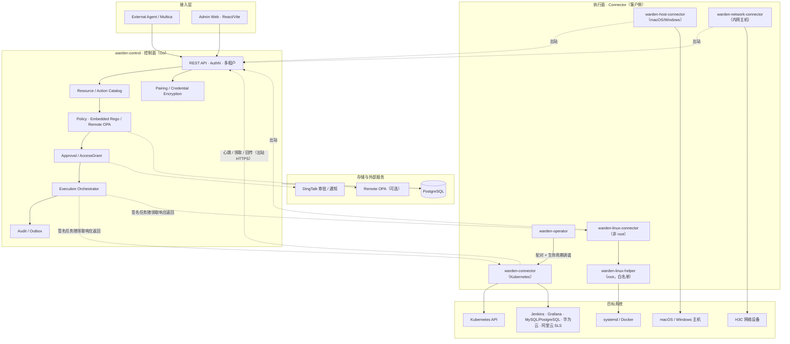
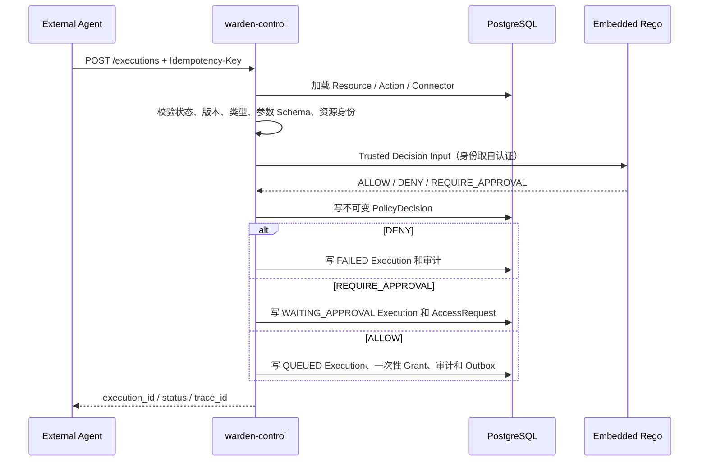
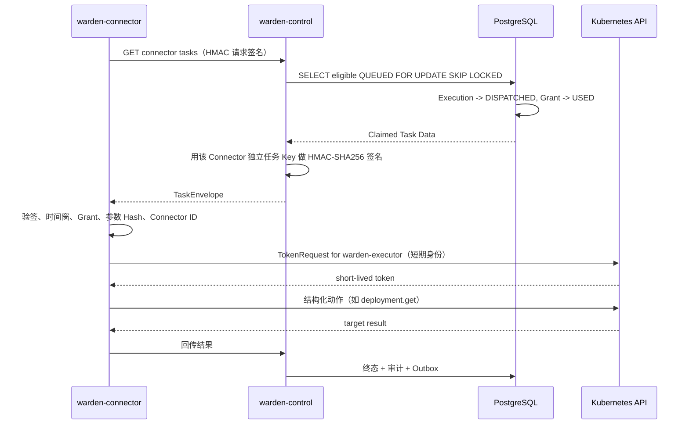
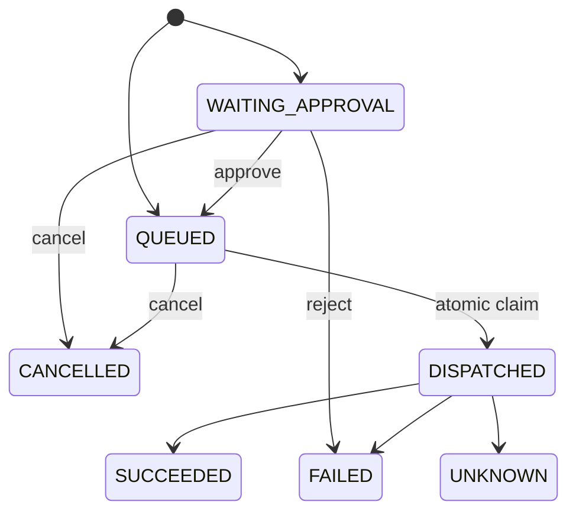

# 架构设计与现状路线

> **面向**：要改代码、做评审、排查跨模块问题的人，以及做技术决策的人。
> **读完你会**：知道有哪些进程、一次执行如何流过全链路、数据怎么落库、哪些能力已实现/未实现、有哪些设计取舍与已知债务。
> 对象含义见 [concepts.md](concepts.md)，配置见 [reference.md#configuration](reference.md#configuration)，接口见 [api.md](api.md)。

## 本篇导航

- [架构设计](#architecture)：设计约束、组件、链路、状态机、权限交集、安全设计
- [现状、边界与路线](#roadmap)：已实现/未完成、设计债、与外部组件关系、扩展路线

<a id="architecture"></a>

## 架构设计

> **面向**：要改代码、做评审或排查跨模块问题的人。
> **读完你会**：知道有哪些进程、一次执行如何流过全链路、数据怎么落库、以及几个关键设计为什么这样选。
> 本文讲「为什么这样设计」。对象含义见 [concepts.md](concepts.md)，具体配置见 [配置参考](reference.md#configuration)，接口见 [api.md](api.md)。

### 设计目标与硬约束

| 目标 | 落到设计上的约束 |
|---|---|
| Agent 绝不拿到基础设施长期凭据 | 凭据只存在于控制面加密存储与 Connector 侧；交给 Agent 的只有 `execution_id` |
| 动作必须可枚举、可审计 | 版本化 ActionDefinition + 参数 Schema + 内嵌 Rego 白名单，默认 DENY；不开放任意 Shell / SQL / 原始 API |
| 客户网络不暴露入站端口 | Connector **主动出站**轮询控制面；控制面不主动连入客户环境 |
| 每次执行可追溯 | PolicyDecision、AccessGrant、TaskEnvelope、Execution、AuditEvent 全链路落库 |
| 多租户共享一套控制面 | 业务表带 `tenant_id`，默认只从认证身份推导，请求体无法切换；`warden:admin` 特权身份仅可通过受服务端校验的 `X-Warden-Tenant` 切换组织视野 |
| 策略服务不可用时不能"放水" | Decision Provider 异常 → 默认 DENY |

### 总体架构



> 图上虚线强调方向：**请求由 Connector 发起**，控制面把签好名的 TaskEnvelope 放在领取响应里返回，而不是反向建立连接。

### 组件

| 组件 | 形态 | 职责 | 是否必需 |
|---|---|---|---|
| `warden-control` | Go 进程，REST API（默认 `:8080`） | 认证授权、策略决策、审批、Grant、Execution 编排、审计、凭据加密、配对 | 是 |
| `warden-connector` | Go 进程，目标 K8s 集群内 | 领取任务、验签、TokenRequest、结构化 K8s 动作、资源发现 | K8s 闭环必需 |
| `warden-operator` | Go 进程，目标 K8s 集群内 | 集群配对、Connector 生命周期调谐（SA/RBAC/Secret/Deployment）、安全下线 | Operator 接入必需 |
| `warden-linux-connector` | Go 进程，目标主机，非 root | Linux 配对、systemd 服务发现、主机/进程/磁盘/日志结构化动作 | Linux 接入必需 |
| `warden-linux-helper` | Go 进程，root | 通过 Unix Socket 提供固定 Docker / systemd 动作，不接受 Shell 或任意参数 | Docker 受控接入必需 |
| `warden-network-connector` | Go 进程，内网主机 | H3C 设备只读发现与审计，主动出站，校验 SSH Host Key 指纹 | 网络设备接入必需 |
| `warden-host-connector` | Go 进程，macOS/Windows | 通用主机接入、固定命令白名单、心跳与配对 | 主机接入必需 |
| PostgreSQL | 独立服务 | 业务主数据、审计、Outbox | 是 |
| Admin Web | React/Vite + Tailwind | 管理界面，全部数据来自真实 API，无 Mock | 可选 |
| 独立 OPA | 可选服务 | 远程 Rego 决策 | 否，默认内嵌 |
| OpenBao / Teleport | 可选服务 | 凭据签发 / 基础设施代理 | **未集成** |

七个入口在 `server/cmd/`，交叉编译目标见 `Makefile`。子项目速查：[server/README.md](../server/README.md)、[web/README.md](../web/README.md)。

### 代码分层

```text
server/
├── cmd/                       可执行入口（只做装配与启动）
├── internal/
│   ├── config/                文件型 Secret 加载（Secret / RequiredSecret）
│   ├── domain/                领域对象、Hash、TaskEnvelope、Capability（叶子包）
│   ├── policy/                Embedded / Remote OPA Provider + policy.rego
│   ├── connector/             Connector Runtime、请求签名、各目标系统 Runner
│   ├── storage/postgres/      pgx 仓储、Outbox、租户过滤
│   └── control/               HTTP 路由、认证授权、配对、凭据加密、编排
└── migrations/                顺序 SQL 迁移
web/src/
├── app/                       路由、页面、组件、样式
└── shared/                    API 客户端、类型、路由封装
```

依赖方向：`domain` 是叶子；`policy` / `connector` / `storage` 依赖 `domain`；`control` 聚合上述包；`cmd` 只装配 `control` 与 `storage`。`internal/` 保证包不被外部模块直接引用。

前端所有请求走 `web/src/shared/api.ts`（`credentials: 'include'`、`/api/v1` 前缀），菜单与路由通过 `capabilities` 决定可见性，不按角色名硬编码。

### 一次执行怎么流过全链路

**创建 Execution：**



**领取与执行：**



Connector Runtime 的默认节奏：心跳 15s、任务轮询 2s、资源同步 5min。审批通过 / 拒绝复用同一个数据库事务与行锁，Web 与钉钉入口一致。

### Execution 状态机



领域常量里还有 `RUNNING / CANCELLING / EXPIRED`，但完整 Attempt 模型、超时回收与取消协议仍未完成，见 [现状与路线](#roadmap)。控制面自身的 `credential.*` 动作是 inline 执行，不创建 Grant，直接落终态。

### 权限是多层交集

```text
可信主体状态
∩ Resource / Action 目录与参数 Schema
∩ Rego 决策（DENY 为不可覆盖下限）
∩ AccessGrant 范围和有效期
∩ HMAC 签名信封（版本 / 时间窗 / 参数哈希 / Connector ID）
∩ Connector Namespace / Registry / Job Scope Guard
∩ 短期 ServiceAccount 身份
∩ Kubernetes RBAC
```

任意一层拒绝，动作不执行。平台级角色与 Scope 的判定见 [authorization.md](authorization.md)。

### 多租户怎么落地

- `tenant_id` 存的是 **slug 字符串**，外键指向 `tenants(slug)`；用 slug 而非 UUID 是为了兼容既有 API。
- 仓储层通过 `domain.TenantIDFromContext(ctx)` 注入过滤条件，业务层不从请求体推断租户。
- 平台级接口（租户管理、账号与权限）额外叠加 `RequirePlatformTenant`，要求身份属于 `platform` 租户。
- **当前没有统一 RLS**，过滤靠各仓储 SQL 自己写 `WHERE tenant_id = $n`。这是已知设计债，开多租户前应做一轮覆盖审计。

### 存储与迁移

- `server/migrations/` 是按编号排序的 SQL（001–106，其中 068–071 无文件），编号唯一性有单测保障。
- **启动不跑迁移**：全新库按文件名顺序手工执行；发布流水线按 `deploy/release/migrations.txt` 重放编号 ≥ 035 的幂等迁移。新增此类迁移必须登记清单，否则单测失败。
- `002_seed.sql` 写入固定权限锚点；运行时 `EnsureAdminPassword` 将登录名与 `WARDEN_ADMIN_USERNAME`、密码哈希与 `WARDEN_ADMIN_PASSWORD_FILE` 同步。
- `audit_events.action` 是 PostgreSQL 枚举，新增动作名必须补 `ALTER TYPE audit_action ADD VALUE` 迁移。
- Outbox 写入可开关（`WARDEN_OUTBOX_ENABLED`），Publisher 后台循环尚未实现。

### 安全设计要点

| 机制 | 实现 |
|---|---|
| 默认拒绝 | 内嵌 Rego 显式动作集合，未命中即 DENY；Provider 异常也 DENY |
| 四个独立密钥 | 任务签名 / JWT 签名 / 凭据加密 / Admin API Key，各 ≥32 字节且两两不得相同，否则启动失败 |
| 凭据保护 | AES-GCM 加密存储；明文不序列化、不返回 Agent、不写日志；目标侧凭据由 Connector 读取 |
| 每 Connector 独立任务 Key | 配对时生成 32 字节 Key，加密存 `task_key_ciphertext`；配对码与 bootstrap token 只存 SHA-256、10 分钟有效 |
| 请求与任务防重放 | Connector 请求 HMAC 覆盖 method/path/timestamp/nonce/body（±2min + nonce 缓存）；TaskEnvelope 校验时间窗、Grant、参数哈希与 DispatchToken |
| Web 会话 | HttpOnly + Secure + SameSite=Strict Cookie；JWT 默认 8h；登录响应不下发可用 token；写操作校验 Origin |
| SSO | 授权码 + PKCE S256 + state/nonce（HttpOnly Cookie）+ id_token 校验 + RP-initiated logout |
| AI 只读助手 | OpenAI 兼容模型 + SSE；资源 / 执行 / 审计工具在服务端重新校验 Scope 并继承租户、Principal 与项目范围，模型不能创建 Execution、审批或变更资源 |
| 最小权限 | 默认 `user` 只有 4 个 Scope；OIDC 默认角色禁止配置成 `platform_admin` |
| 应急入口 | 启动管理员按固定 ID 判定，登录名由部署者配置，日常不用，IdP 故障时兜底 |

### 关键设计取舍

| 取舍 | 原因 | 代价 |
|---|---|---|
| 控制面是 Go 模块化单体，而非微服务 | 决策、Grant、Execution 需要强一致事务；单体便于原子领取与审计 | 单进程是瓶颈点，需要水平扩展时再拆 |
| 默认内嵌 Rego，远程 OPA 可选 | 减少部署依赖，避免策略服务不可用时放水 | Rego Bundle 版本管理尚未完成 |
| Connector 主动出站轮询 | 客户网络无需开入站、无需公网 IP | 任务有轮询延迟（默认 2s） |
| 用 slug 作 `tenant_id` | 兼容既有 API 路径 `/tenants/{slug}` | 重命名租户成本高，需要数据迁移 |
| JWT 里冻结 scopes | 认证中间件无需每请求读库 | 改角色必须撤销会话 / 重新登录才生效，账号接口已强制处理 |
| 手工执行迁移 | 迁移清单可幂等重放，发布可控 | 新人容易忘记跑迁移，教程里专门强调 |

### 尚未完成 / 已知限制

MFA、按 IdP claim 自动授权、Connector mTLS/SPIFFE、Rego Bundle 版本管理、完整 Execution Attempt 与取消协议、Outbox Publisher、SCIM、细粒度 RLS、静态 Admin Key 轮换；以及非内置 `platform_admin` 的 JWT 兼容识别、钉钉审批链路缺租户上下文、联邦断言短 JWT 未写 `admin_sessions`、项目权限三套并行判定等设计债。完整列表见 [现状与路线](#roadmap)。


---

<a id="roadmap"></a>

## 现状、边界与路线

> **面向**：维护者与做技术决策的人。
> **目标**：一眼看清哪些已经实现、哪些只是设计、哪些是明知道有债但暂时不动。
> 能力细节见本页[架构设计](#architecture)与[动作参考](reference.md#actions)，变更记录见 [CHANGELOG.md](../CHANGELOG.md)。

**状态口径**（全项目文档统一）：`已实现` 指代码里有且可用；`设计中 / 规划` 指文档里写了但没落地；`未实现` 指明确不做或尚未开始；`已知限制` 指能用但有边界。不要把规划写成现状。

---

### 已实现

| 领域 | 能力 |
|---|---|
| 控制面 | Resource / Action 查询、Execution 创建与查询、幂等键、内嵌 Rego、远程 OPA、不可变 PolicyDecision、AccessRequest 审批、一次性 AccessGrant、原子任务领取、HMAC TaskEnvelope |
| Connector Runtime | 注册 / 心跳 / 轮询、信封验签、多 Runner 路由、Namespace / Registry / Job Scope Guard、TokenRequest、非幂等 `UNKNOWN` 处理、60s 资源同步 |
| Linux / Helper | 主机、systemd、运行中 Docker 容器发现；结构化只读与生命周期动作；非 root Connector + root Helper 分权；配对、热更新、原子升级、安全卸载 |
| H3C 网络设备 | 设备 / 接口 / VLAN 发现；健康、LLDP、链路聚合、STP、端口、MAC/ARP 查询；按角色的固定只读审计 Profile 与敏感行净化 |
| 集群接入 | Web 表单 onboarding（兼容）、Operator + Helm Chart 配对向导、短期配对码、k3s Audience 自动识别、独立任务 Key、自动 Secret/SA/RBAC/Deployment 调谐 |
| Connector 生命周期 | 健康检查（90s 心跳）、Namespace 热更新、安全下线（`DELETE_REQUESTED → 清理 → DELETED → 归档`）、拒绝已下线 Connector 重新激活 |
| 凭据安全 | 每 Connector 独立 32 字节任务 Key、AES-GCM 加密存储、配对码与 bootstrap token 仅存 SHA-256、10 分钟过期 |
| 资源治理 | `sync_generation` + `last_seen_at`、ORPHANED 历史视图与保留期、归档 Connector 资源隐藏、执行目录按活跃心跳过滤、项目与环境继承链 |
| 部署与发布 | 本地 Docker Compose、K8s 基线清单、多阶段 Dockerfile / distroless 发布镜像、Helm Chart、Linux / Host / Network 安装脚本、发布迁移清单 |
| Admin Web | 管理员密码登录与 HttpOnly 会话、全量页面接真实 API（无 Mock）、拓扑图谱、分类资源目录、结构化 Action 面板、配对向导 |
| Agent 接入 | 每 Agent 独立 Hash 存储 API Key、Scope 最小权限、Execution 所有权隔离、撤销 / 轮换、`scripts/warden-agent.sh` 只读巡检脚本、Agent 身份管理页 |
| 多租户 | 租户 slug 隔离、`tenant_id` 上下文注入、租户管理接口与并发保护、平台级接口的 `RequirePlatformTenant` 守卫 |
| **OIDC / SSO** | 授权码 + PKCE S256、state/nonce 校验、联邦身份自动建档（稳定内部标识 + IdP 展示名 / 邮箱 / 头像）、RP-initiated logout；未配置 issuer 时行为与旧版完全一致 |
| **统一权限模型** | 角色 / Scope / `capabilities` 集中在 `authorization.go`；后端守卫与前端菜单读同一份能力清单；OIDC 默认角色禁止配成 `platform_admin` |
| **账号与权限** | 管理入口只指派 `user` / `tenant_admin`；内置应急超管不可改、每个租户至少保留一个租户管理员、审计与变更同事务、立即撤销目标会话；非内置 `platform_admin` 的 JWT 兼容识别仍是已知限制 |
| **身份与组织闭环** | SSO 邮箱域名路由、默认 `unaffiliated` 待分配状态、管理员分配、邀请与接受、账号移出/恢复、组织视野切换 |
| **AI 只读助手** | OpenAI 兼容模型、SSE 流式回答；资源 / 执行 / 审计三个只读工具在服务端重新校验 Scope，并继承租户、Principal 与项目范围 |

### 未完成（按优先级）

1. **MFA 与 IdP claim 细粒度角色映射**：当前默认角色由 `WARDEN_OIDC_DEFAULT_ROLE` 静态配置（生产保持 `user`），尚未按 IdP claim 动态授权，MFA 未接入。
2. **Connector mTLS / SPIFFE 强认证**：当前只信任 Connector ID + bootstrap token。
3. **完整 Rego 策略版本管理**：可视化矩阵、冲突检测与模拟已完成；Rego Bundle 的草稿、发布、回滚未实现。
4. **Execution Attempt、`RUNNING`、超时回收与取消协议**：状态常量已在领域模型中，但完整协议未落地。
5. **结果脱敏与日志敏感信息检测**：Docker / systemd 日志目前只有行数与大小限制。
6. **Docker 已停止容器发现**：`docker.container.list` 当前只返回运行中容器。
7. **Outbox Publisher 后台循环**：Outbox 写入可开关，发布消费者未实现。

#### 授权与身份的第二阶段（规划）

- 优先级约定：**手工指派 > IdP claim 同步 > 默认 `user`**。目前只实现了首尾两级。
- 按飞书 / IdP 组织架构自动分配角色与租户：等上游能稳定提供部门 / 组信息再接。
- **SCIM 2.0**（入职自动开通、离职即时停用）、细粒度 RLS、静态 `WARDEN_ADMIN_API_KEY` 在线轮换。
- 项目层 `PROJECT_ADMIN / OPERATOR / VIEWER` 合并进同一份能力清单，消除三套并行判定。

### 已知设计债

| 债 | 影响 | 现状 |
|---|---|---|
| 钉钉审批链路缺少租户上下文 | 多租户下审批可能 404、审计 `tenant_id` 为空 | 单租户下不触发 |
| 联邦断言登录签发的短 JWT 未写 `admin_sessions` | 该 token 暂不能调用 `/api/v1/` | 已在文档登记，见 [联邦授权](authorization.md#federation) |
| 项目权限存在 `projectAccess` / `principalProjectAccess` / `project_scope` 三套并行判定 | 同一账号在不同页面可能被当成不同级别；成员强制开关默认关闭 | 第二阶段合并 |
| `admin_sessions` 无 `tenant_id` 列 | 会话维度不是租户感知的 | 已知，未改 |
| 租户过滤靠各仓储 SQL，没有统一 RLS | 新增接口容易漏 `WHERE tenant_id` | 开第二个租户前应做覆盖审计 |
| `audit_events.action` 是 PostgreSQL 枚举 | 每个新审计动作名都必须配套迁移，否则审计静默丢失 | 已有单测约束迁移清单，但枚举仍需手工补 |
| 非内置 `platform_admin` 仍被 JWT 签发兼容识别 | 直接改库或遗留数据仍可能获得 `warden:admin`，严格单超管尚未形成运行时硬约束 | 管理入口与迁移 `099` 已限制；后续需收敛 `issueJWTWithTTL` 分支及既有测试 |
| 静态 `WARDEN_ADMIN_API_KEY` 是全局共享、不可在线轮换的超管凭据 | 泄露影响面大 | 限制存放范围，登记风险；认证时映射到内置启动管理员 |

### 与外部组件的关系

| 组件 | 角色 | 状态 |
|---|---|---|
| PostgreSQL | 唯一必需外部服务，业务主数据与审计 | 已实现 |
| 独立 OPA | 远程策略决策 | Provider 已实现，Bundle 发布未实现 |
| OpenBao | 静态 / 动态凭据签发 | 未集成 |
| Teleport | 基础设施身份与代理 | 未集成 |
| Jenkins | 构建执行 | 已实现结构化 Integration，待真实环境生产验收 |
| 通用 MCP Plugin / Remote MCP | 目标架构中的插件化接入 | 尚未实现（属目标架构文档） |

> 历史架构文档（如 `warden-target-plugin-identity-risk-orchestration-architecture.md`）描述的是**目标架构**，不代表当前实现；阅读时务必看文档里的基线日期与状态标注。

### 推荐扩展路线

```text
现有 K8s / Linux Connector 多 Runner Runtime（Scope / Credential / 限流 / 脱敏）
  -> Grafana 全量结构化管理 Integration
  -> Jenkins Integration 生产环境联调与故障注入
  -> PostgreSQL 参数化只读查询
  -> 云厂商范围与权限决策
  -> MySQL 只读
  -> 其他云厂商只读
  -> 各系统受控变更动作
  -> 生产化安全与故障验收
```

口径提醒：Jenkins / Grafana 提供全量结构化管理动作，数据库仅提供参数化只读查询。**全量管理不等于原始代理**：仍禁止任意脚本、任意 URL、任意 SQL、任意 API 和凭据外泄，变更动作继续受策略、审批与审计约束。

### 发布状态

Warden 改名后尚未单独发布正式版本，仓库仍保留改名前的历史 tag；`CHANGELOG.md` 记录当前阶段性变更。生产部署以具体镜像 tag 与迁移清单为准，不要假设某个版本号对应哪次提交。生产编排文件不在本仓库内，见 [生产部署](guides.md#installation)。
