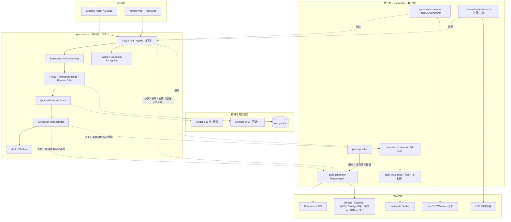
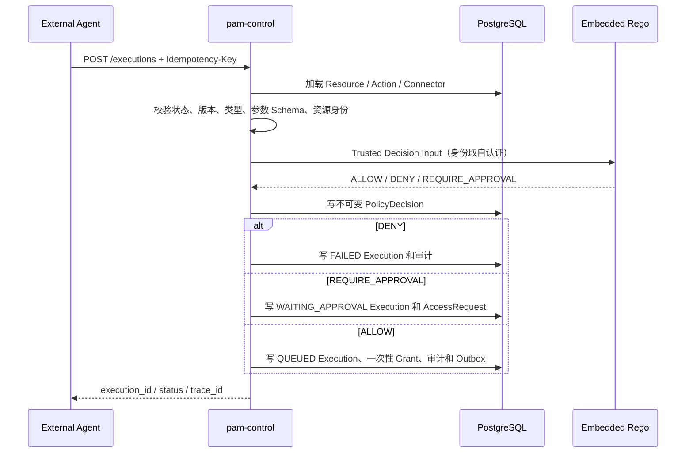
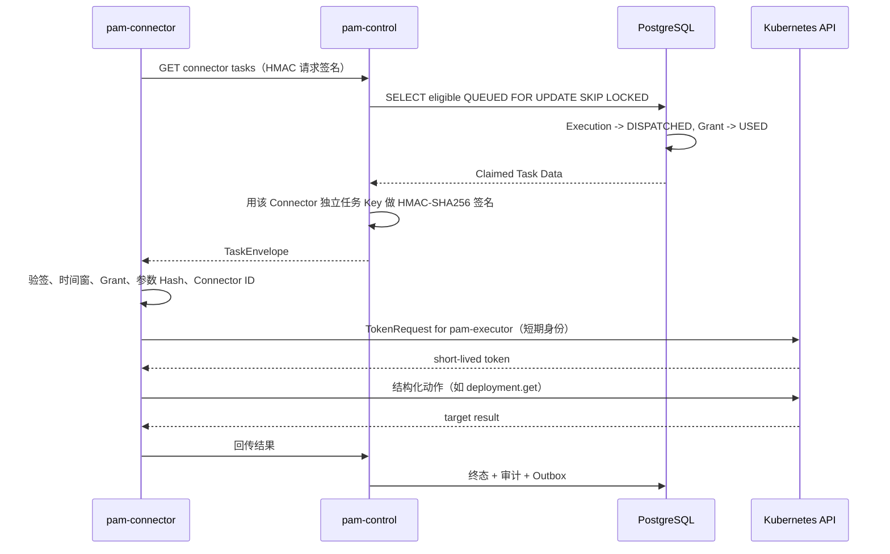
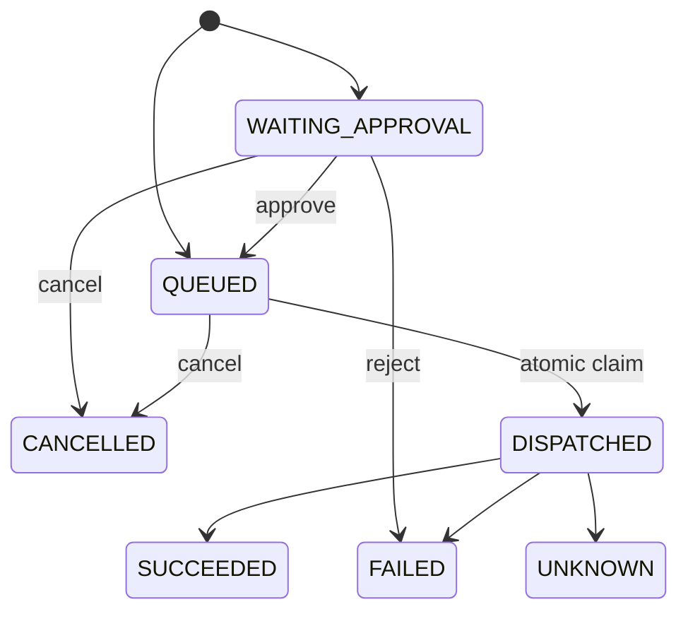

# 架构设计

> **面向**：要改代码、做评审或排查跨模块问题的人。
> **读完你会**：知道有哪些进程、一次执行如何流过全链路、数据怎么落库、以及几个关键设计为什么这样选。
> 本文讲「为什么这样设计」。对象含义见 [concepts.md](concepts.md)，具体配置见 [configuration.md](configuration.md)，接口见 [api.md](api.md)。

## 设计目标与硬约束

| 目标 | 落到设计上的约束 |
|---|---|
| Agent 绝不拿到基础设施长期凭据 | 凭据只存在于控制面加密存储与 Connector 侧；交给 Agent 的只有 `execution_id` |
| 动作必须可枚举、可审计 | 版本化 ActionDefinition + 参数 Schema + 内嵌 Rego 白名单，默认 DENY；不开放任意 Shell / SQL / 原始 API |
| 客户网络不暴露入站端口 | Connector **主动出站**轮询控制面；控制面不主动连入客户环境 |
| 每次执行可追溯 | PolicyDecision、AccessGrant、TaskEnvelope、Execution、AuditEvent 全链路落库 |
| 多租户共享一套控制面 | 业务表带 `tenant_id`，且只从认证身份推导，请求体无法切换 |
| 策略服务不可用时不能"放水" | Decision Provider 异常 → 默认 DENY |

## 总体架构



> 图上虚线强调方向：**请求由 Connector 发起**，控制面把签好名的 TaskEnvelope 放在领取响应里返回，而不是反向建立连接。

## 组件

| 组件 | 形态 | 职责 | 是否必需 |
|---|---|---|---|
| `pam-control` | Go 进程，REST API（默认 `:8080`） | 认证授权、策略决策、审批、Grant、Execution 编排、审计、凭据加密、配对 | 是 |
| `pam-connector` | Go 进程，目标 K8s 集群内 | 领取任务、验签、TokenRequest、结构化 K8s 动作、资源发现 | K8s 闭环必需 |
| `pam-operator` | Go 进程，目标 K8s 集群内 | 集群配对、Connector 生命周期调谐（SA/RBAC/Secret/Deployment）、安全下线 | Operator 接入必需 |
| `pam-linux-connector` | Go 进程，目标主机，非 root | Linux 配对、systemd 服务发现、主机/进程/磁盘/日志结构化动作 | Linux 接入必需 |
| `pam-linux-helper` | Go 进程，root | 通过 Unix Socket 提供固定 Docker / systemd 动作，不接受 Shell 或任意参数 | Docker 受控接入必需 |
| `pam-network-connector` | Go 进程，内网主机 | H3C 设备只读发现与审计，主动出站，校验 SSH Host Key 指纹 | 网络设备接入必需 |
| `pam-host-connector` | Go 进程，macOS/Windows | 通用主机接入、固定命令白名单、心跳与配对 | 主机接入必需 |
| PostgreSQL | 独立服务 | 业务主数据、审计、Outbox | 是 |
| Admin Web | React/Vite + Tailwind | 管理界面，全部数据来自真实 API，无 Mock | 可选 |
| 独立 OPA | 可选服务 | 远程 Rego 决策 | 否，默认内嵌 |
| OpenBao / Teleport | 可选服务 | 凭据签发 / 基础设施代理 | **未集成** |

七个入口在 `server/cmd/`，交叉编译目标见 `Makefile`。子项目速查：[server/README.md](../server/README.md)、[web/README.md](../web/README.md)。

## 代码分层

```text
server/
├── cmd/                       可执行入口（只做装配与启动）
├── internal/
│   ├── config/                文件型 Secret 加载（Secret / RequiredSecret）
│   ├── domain/                领域对象、Hash、TaskEnvelope、Capability（叶子包）
│   ├── policy/                Embedded / Remote OPA Provider + policy.rego
│   ├── connector/             Connector Runtime、请求签名、各目标系统 Runner
│   ├── storage/postgres/      pgx 仓储、Outbox、租户过滤
│   └── control/               HTTP 路由、认证授权、配对、凭据加密、编排
└── migrations/                顺序 SQL 迁移
web/src/
├── app/                       路由、页面、组件、样式
└── shared/                    API 客户端、类型、路由封装
```

依赖方向：`domain` 是叶子；`policy` / `connector` / `storage` 依赖 `domain`；`control` 聚合上述包；`cmd` 只装配 `control` 与 `storage`。`internal/` 保证包不被外部模块直接引用。

前端所有请求走 `web/src/shared/api.ts`（`credentials: 'include'`、`/api/v1` 前缀），菜单与路由通过 `capabilities` 决定可见性，不按角色名硬编码。

## 一次执行怎么流过全链路

**创建 Execution：**



**领取与执行：**



Connector Runtime 的默认节奏：心跳 15s、任务轮询 2s、资源同步 5min。审批通过 / 拒绝复用同一个数据库事务与行锁，Web 与钉钉入口一致。

## Execution 状态机



领域常量里还有 `RUNNING / CANCELLING / EXPIRED`，但完整 Attempt 模型、超时回收与取消协议仍未完成，见 [roadmap.md](roadmap.md)。控制面自身的 `credential.*` 动作是 inline 执行，不创建 Grant，直接落终态。

## 权限是多层交集

```text
可信主体状态
∩ Resource / Action 目录与参数 Schema
∩ Rego 决策（DENY 为不可覆盖下限）
∩ AccessGrant 范围和有效期
∩ HMAC 签名信封（版本 / 时间窗 / 参数哈希 / Connector ID）
∩ Connector Namespace / Registry / Job Scope Guard
∩ 短期 ServiceAccount 身份
∩ Kubernetes RBAC
```

任意一层拒绝，动作不执行。平台级角色与 Scope 的判定见 [authorization.md](authorization.md)。

## 多租户怎么落地

- `tenant_id` 存的是 **slug 字符串**，外键指向 `tenants(slug)`；用 slug 而非 UUID 是为了兼容既有 API。
- 仓储层通过 `domain.TenantIDFromContext(ctx)` 注入过滤条件，业务层不从请求体推断租户。
- 平台级接口（租户管理、账号与权限）额外叠加 `RequirePlatformTenant`，要求身份属于 `platform` 租户。
- **当前没有统一 RLS**，过滤靠各仓储 SQL 自己写 `WHERE tenant_id = $n`。这是已知设计债，开多租户前应做一轮覆盖审计。

## 存储与迁移

- `server/migrations/` 是按编号排序的 SQL（001–097，其中 068–071 无文件），编号唯一性有单测保障。
- **启动不跑迁移**：全新库按文件名顺序手工执行；发布流水线按 `deploy/release/migrations.txt` 重放编号 ≥ 035 的幂等迁移。新增此类迁移必须登记清单，否则单测失败。
- 内置 `admin` 由 `002_seed.sql` 写入固定 ID；运行时 `EnsureAdminPassword` 只把密码哈希与 `PAM_ADMIN_PASSWORD_FILE` 同步。
- `audit_events.action` 是 PostgreSQL 枚举，新增动作名必须补 `ALTER TYPE audit_action ADD VALUE` 迁移。
- Outbox 写入可开关（`PAM_OUTBOX_ENABLED`），Publisher 后台循环尚未实现。

## 安全设计要点

| 机制 | 实现 |
|---|---|
| 默认拒绝 | 内嵌 Rego 显式动作集合，未命中即 DENY；Provider 异常也 DENY |
| 四个独立密钥 | 任务签名 / JWT 签名 / 凭据加密 / Admin API Key，各 ≥32 字节且两两不得相同，否则启动失败 |
| 凭据保护 | AES-GCM 加密存储；明文不序列化、不返回 Agent、不写日志；目标侧凭据由 Connector 读取 |
| 每 Connector 独立任务 Key | 配对时生成 32 字节 Key，加密存 `task_key_ciphertext`；配对码与 bootstrap token 只存 SHA-256、10 分钟有效 |
| 请求与任务防重放 | Connector 请求 HMAC 覆盖 method/path/timestamp/nonce/body（±2min + nonce 缓存）；TaskEnvelope 校验时间窗、Grant、参数哈希与 DispatchToken |
| Web 会话 | HttpOnly + Secure + SameSite=Strict Cookie；JWT 默认 8h；登录响应不下发可用 token；写操作校验 Origin |
| SSO | 授权码 + PKCE S256 + state/nonce（HttpOnly Cookie）+ id_token 校验 + RP-initiated logout |
| 最小权限 | 默认 `user` 只有 4 个 Scope；OIDC 默认角色禁止配置成 `platform_admin` |
| 应急入口 | 内置 `admin` 按固定 ID 判定，日常不用，IdP 故障时兜底 |

## 关键设计取舍

| 取舍 | 原因 | 代价 |
|---|---|---|
| 控制面是 Go 模块化单体，而非微服务 | 决策、Grant、Execution 需要强一致事务；单体便于原子领取与审计 | 单进程是瓶颈点，需要水平扩展时再拆 |
| 默认内嵌 Rego，远程 OPA 可选 | 减少部署依赖，避免策略服务不可用时放水 | Rego Bundle 版本管理尚未完成 |
| Connector 主动出站轮询 | 客户网络无需开入站、无需公网 IP | 任务有轮询延迟（默认 2s） |
| 用 slug 作 `tenant_id` | 兼容既有 API 路径 `/tenants/{slug}` | 重命名租户成本高，需要数据迁移 |
| JWT 里冻结 scopes | 认证中间件无需每请求读库 | 改角色必须撤销会话 / 重新登录才生效，账号接口已强制处理 |
| 手工执行迁移 | 迁移清单可幂等重放，发布可控 | 新人容易忘记跑迁移，教程里专门强调 |

## 尚未完成 / 已知限制

MFA、按 IdP claim 自动授权、Connector mTLS/SPIFFE、Rego Bundle 版本管理、完整 Execution Attempt 与取消协议、Outbox Publisher、SCIM、细粒度 RLS、静态 Admin Key 轮换；以及钉钉审批链路缺租户上下文、联邦断言短 JWT 未写 `admin_sessions`、项目权限三套并行判定等设计债。完整列表见 [roadmap.md](roadmap.md)。

## 下一步

- [concepts.md](concepts.md)：对象含义
- [authorization.md](authorization.md)：权限模型
- [api.md](api.md)：接口与错误码
- [operations.md](operations.md)：迁移、备份、升级
- [CONTRIBUTING.md](../CONTRIBUTING.md)：改代码前必读的验证命令
