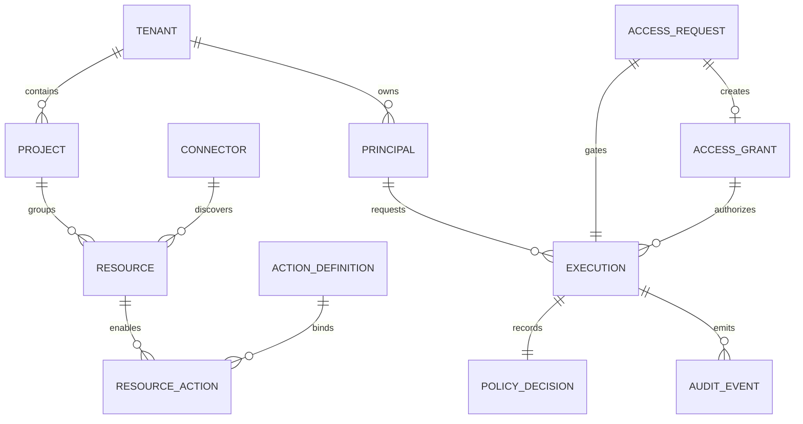

# 核心概念

> **面向**：刚接手项目、需要先建立心智模型的人。
> **读完你会**：能说清租户/项目/资源/动作/执行之间的关系，知道一次执行到底经过哪些对象，以及几个最容易混淆的概念边界。
> 本文解释「是什么、为什么」，不教操作步骤；动手请看 [quickstart.md](quickstart.md) 与 [onboarding.md](onboarding.md)。

## 先建立一句话模型

**HighTower 把「谁能对哪个东西做什么」拆成一串可审计的对象**：身份（Principal）发起一次动作（ActionDefinition），系统先做策略结论（PolicyDecision），必要时生成审批单（AccessRequest）与限时授权（AccessGrant），再由 Connector 领取一个签名任务（TaskEnvelope）去执行，全过程记录为 Execution 与 AuditEvent。

Agent 始终拿不到目标系统的长期凭据，只拿到一个 `execution_id`。

## 对象关系图



## 隔离与组织：租户、项目、资源

### Tenant（租户）

**一个客户 / 组织的数据隔离边界**。一套 Go 服务、一个 PostgreSQL 库，按 `tenant_id` 把数据隔开——这是**逻辑隔离**，不是每个客户单独部署一套。

- `tenants` 表存 `id`（UUID）、`slug`、`name`、`status`、`settings`；真正用于隔离的是 **slug 字符串**（如 `platform`），不是 UUID（`088_multitenancy_foundation.sql`）。
- Principal、API Key、Connector、Integration、Credential、Resource、Project、Policy、Execution、Audit 等绝大多数业务表都带 `tenant_id`。
- **租户不能由请求方指定**：`TenantID` 只从认证后的身份或 Connector 凭据推导，请求体传 `tenant_id` 无效。这是防止越权读别的客户数据的关键设计。
- 初始迁移只 seed 一个 `platform` 租户；平台管理员可以通过「租户管理」创建新租户及首个租户管理员。

### Project（项目）

**租户内部的业务线 / 环境分组**。层级是 `租户 → 项目 → 资源/成员`。项目共享同一套策略、凭据与审计，只是把资源归属和可见范围再切一层。每个租户还有限制一个默认项目。

项目层还有 `PROJECT_ADMIN / OPERATOR / VIEWER` 成员角色，但它们与平台级角色是**两个维度**；当前项目成员强制开关默认关闭，详见 [authorization.md](authorization.md) 与 [roadmap.md](roadmap.md)。

### Resource（资源）与 ActionDefinition（动作）

- **Resource**：目标系统里可被操作的对象，例如一个 Deployment、一个 systemd 服务、一个 Jenkins Job、一张数据库表。它由 Connector 发现并同步，带状态（`ACTIVE / DISCOVERED / ORPHANED / DISABLED`）、项目与环境归属、访问级别（`READ_ONLY / CHANGE / RESTRICTED_CHANGE`）。
- **ActionDefinition**：版本化的**结构化动作**，例如 `deployment.update_image@v2`、`pod.logs.read@v1`。动作有参数 Schema、风险等级、执行模式与超时。

关键约束：**动作是白名单，不是任意命令**。系统不提供任意 Shell、原始 SQL、任意 `kubectl` 或 HTTP 代理。数据库查询是强类型 AST + 参数化渲染，云与网络设备动作也是固定集合。完整清单见 [actions.md](actions.md)。

> 一个容易忽略的例外：macOS/Windows `pam-host-connector` 的 `host.command.run` 允许调用方提供参数，但程序名必须落在固定白名单、参数有长度与数量限制、环境被裁剪，且强制审批。它仍然不是 `sh -c`。

## 身份与授权：Principal、PolicyDecision、Grant

### Principal（主体）

用户、Agent 实例、Agent 类型或工作负载的统一身份。内置 `admin`、SSO 用户、Agent 机器账号都是 Principal，但**来源不同、特权来源也不同**：

| 来源 | 角色怎么来 | 说明 |
|---|---|---|
| 内置 `admin` | 固定 ID 判定，直接获得 `pam:admin` | IdP 故障时的应急入口，`metadata.role` 反而是空的 |
| OIDC/SSO 用户 | 首次登录按 `PAM_OIDC_DEFAULT_ROLE` 建档，默认 `user` | 之后由超级管理员在页面手工指派；登录不会覆盖已指派的角色 |
| 本地密码用户 | 管理员创建 | 常规账号 |
| Agent / 机器人 | 独立 API Key，Scope 最小权限 | 不走 Web 会话，不算员工账号 |

认证与授权分离的规则、能力清单与生效时机见 [authorization.md](authorization.md)。

### PolicyDecision（策略决策）

一次请求产生的**不可变**结论，只有三种：`ALLOW` / `DENY` / `REQUIRE_APPROVAL`。它连同 OPA 输入/输出、Bundle Hash 一起落库，用于回答"为什么被允许"。默认策略内嵌 Rego，也可切到远程 OPA；Provider 异常时默认 DENY。

`DENY` 是**下限**：管理端可视化的策略矩阵只能收紧，不能把 Rego 拒绝的动作放宽为放行。

### AccessRequest / AccessGrant（审批与授权）

- `REQUIRE_APPROVAL` → 生成 `AccessRequest`（有过期时间），Execution 进入 `WAITING_APPROVAL`。
- 审批通过 → 在同一事务里把 Execution 置为 `QUEUED`，并创建 `AccessGrant`：**一次性（MaxUses=1）、限时、绑定资源/动作/参数哈希**。
- 拒绝 → Execution 置为 `FAILED`。

Grant 是"能不能执行"的最后一环凭证，随后才允许生成签名任务。

## 执行与追溯：Execution、TaskEnvelope、AuditEvent

### Execution（执行）

一次动作的完整状态与结果。状态流转见 [architecture.md](architecture.md) 的状态机；日常最常遇到的是：

```text
QUEUED（等待领取） → DISPATCHED（已交付 Connector） → SUCCEEDED / FAILED / UNKNOWN
WAITING_APPROVAL → QUEUED（批准）或 FAILED（拒绝）
```

`UNKNOWN` 表示执行结果不确定（例如超时），系统只做**只读状态重读**，不会自动重放变更动作。

### TaskEnvelope（任务信封）

控制面把任务交给 Connector 时的签名数据结构：包含 ConnectorID、资源、动作、参数哈希、Grant、TraceID、签发时间、签名等。用**每个 Connector 独立的任务 Key**做 HMAC-SHA256 签名；Connector 验签时同时校验版本、DispatchToken、Grant 过期、时间窗与参数哈希。

这保证"任务只能被指定 Connector 在有效期内按原参数执行一次"。

### AuditEvent（审计）

append-only 记录，串起身份、策略决策、授权、执行与结果。审计表的 `action` 是 PostgreSQL **枚举**，新增动作名必须配套迁移，否则写入会静默失败——见 [operations.md](operations.md)。

## 执行侧：Connector、Integration、Credential

- **Connector**：部署在目标环境（K8s 集群、Linux 主机、内网主机）的执行代理。它**主动出站**轮询控制面：心跳、领任务、回传结果、同步资源。控制面不需要打通到客户内网的入站路径。
- **Integration**：挂在 Connector 上的一等公民连接配置，例如 Jenkins、Grafana、MySQL、华为云、阿里云 SLS。协议 Runner 复用 Connector 的配对、身份、心跳、签名、审计与下线，不为每种服务单独造一个 Connector。
- **Credential**：目标系统凭据。明文不进入控制面数据库（AES-GCM 加密存储）、不返回给 Agent、不写普通日志；Connector 侧以受限身份读取。

接入方式见 [onboarding.md](onboarding.md)。

## 三个最容易混的边界

| 容易混 | 正确理解 |
|---|---|
| **租户 vs 项目** | 租户是客户间的数据隔离边界；项目是租户内部的分组。同一家公司按"生产/测试"或业务线分开，用项目就够；不同公司、要求互不可见才建租户 |
| **租户 vs 角色** | 角色是平台级权限级别，租户是数据范围。实际可见范围 ≈ 角色级别 × 身份上的 `tenant_id` |
| **认证 vs 授权** | IdP / 密码 / API Key 解决"你是谁"；PAM 的角色、策略、Grant 解决"你能做什么"。SSO 登录成功不等于有管理权限 |

关于 OIDC：当前所有 SSO 用户默认落到 `PAM_OIDC_DEFAULT_TENANT_ID`（通常是 `platform`），**没有**"按 IdP 部门自动分配到不同租户"的能力；这是第二阶段的方向。

## 下一步

- [architecture.md](architecture.md)：组件、链路、状态机与设计取舍
- [authorization.md](authorization.md)：谁能做什么、权限何时生效
- [actions.md](actions.md)：具体支持哪些动作、默认策略怎么判
- [glossary.md](glossary.md)：术语速查
- [quickstart.md](quickstart.md)：动手跑一遍
