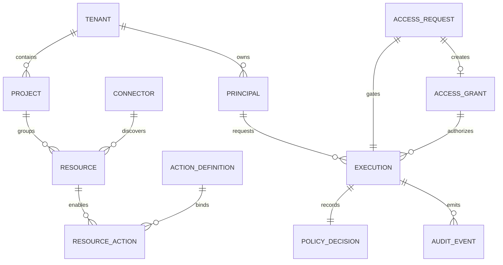

# 核心概念与术语

> **面向**：刚接手项目、需要先建立心智模型的人，以及需要快速查术语的任何人。
> **读完你会**：能说清租户/项目/资源/动作/执行之间的关系，知道一次执行经过哪些对象，并能查到每个术语的确切定义。
> 本文解释「是什么、为什么」，不教操作步骤；动手见 [quickstart.md](quickstart.md) 与 [guides.md#onboarding](guides.md#onboarding)。

## 本篇导航

- [核心概念](#core-concepts)：对象关系、隔离模型、身份授权、执行追溯
- [术语表](#glossary)：按主题分组的确切定义与出处

<a id="core-concepts"></a>

## 核心概念

> **面向**：刚接手项目、需要先建立心智模型的人。
> **读完你会**：能说清租户/项目/资源/动作/执行之间的关系，知道一次执行到底经过哪些对象，以及几个最容易混淆的概念边界。
> 本文解释「是什么、为什么」，不教操作步骤；动手请看 [quickstart.md](quickstart.md) 与 [接入指南](guides.md#onboarding)。

### 先建立一句话模型

**Warden 把「谁能对哪个东西做什么」拆成一串可审计的对象**：身份（Principal）发起一次动作（ActionDefinition），系统先做策略结论（PolicyDecision），必要时生成审批单（AccessRequest）与限时授权（AccessGrant），再由 Connector 领取一个签名任务（TaskEnvelope）去执行，全过程记录为 Execution 与 AuditEvent。

Agent 始终拿不到目标系统的长期凭据，只拿到一个 `execution_id`。

### 对象关系图



### 隔离与组织：租户、项目、资源

#### Tenant（租户）

**一个客户 / 组织的数据隔离边界**。一套 Go 服务、一个 PostgreSQL 库，按 `tenant_id` 把数据隔开——这是**逻辑隔离**，不是每个客户单独部署一套。

- `tenants` 表存 `id`（UUID）、`slug`、`name`、`status`、`settings`；真正用于隔离的是 **slug 字符串**（如 `platform`），不是 UUID（`088_multitenancy_foundation.sql`）。
- Principal、API Key、Connector、Integration、Credential、Resource、Project、Policy、Execution、Audit 等绝大多数业务表都带 `tenant_id`。
- **普通请求不能指定租户**：`TenantID` 默认只从认证后的身份或 Connector 凭据推导，请求体传 `tenant_id` 无效。`warden:admin` 特权身份可以通过 `X-Warden-Tenant` 切换组织视野，但服务端会校验目标为真实、活跃的业务租户，其他身份不能借此越权。
- 初始迁移只 seed 一个 `platform` 租户；平台管理员可以通过「租户管理」创建新租户及首个租户管理员。

#### Project（项目）

**租户内部的业务线 / 环境分组**。层级是 `租户 → 项目 → 资源/成员`。项目共享同一套策略、凭据与审计，只是把资源归属和可见范围再切一层。每个租户还有限制一个默认项目。

项目层还有 `PROJECT_ADMIN / OPERATOR / VIEWER` 成员角色，但它们与平台级角色是**两个维度**；当前项目成员强制开关默认关闭，详见 [authorization.md](authorization.md) 与 [现状与路线](architecture.md#roadmap)。

#### Resource（资源）与 ActionDefinition（动作）

- **Resource**：目标系统里可被操作的对象，例如一个 Deployment、一个 systemd 服务、一个 Jenkins Job、一张数据库表。它由 Connector 发现并同步，带状态（`ACTIVE / DISCOVERED / ORPHANED / DISABLED`）、项目与环境归属、访问级别（`READ_ONLY / CHANGE / RESTRICTED_CHANGE`）。
- **ActionDefinition**：版本化的**结构化动作**，例如 `deployment.update_image@v2`、`pod.logs.read@v1`。动作有参数 Schema、风险等级、执行模式与超时。

关键约束：**动作是白名单，不是任意命令**。系统不提供任意 Shell、原始 SQL、任意 `kubectl` 或 HTTP 代理。数据库查询是强类型 AST + 参数化渲染，云与网络设备动作也是固定集合。完整清单见 [动作参考](reference.md#actions)。

> 一个容易忽略的例外：macOS/Windows `warden-host-connector` 的 `host.command.run` 允许调用方提供参数，但程序名必须落在固定白名单、参数有长度与数量限制、环境被裁剪，且强制审批。它仍然不是 `sh -c`。

### 身份与授权：Principal、PolicyDecision、Grant

#### Principal（主体）

用户、Agent 实例、Agent 类型或工作负载的统一身份。启动管理员、SSO 用户、Agent 机器账号都是 Principal，但**来源不同、特权来源也不同**：

| 来源 | 角色怎么来 | 说明 |
|---|---|---|
| 启动管理员 | 固定 ID 判定，直接获得 `warden:admin` | IdP 故障时的应急入口，登录名由部署者配置 |
| OIDC/SSO 用户 | 首次登录按 `WARDEN_OIDC_DEFAULT_ROLE` 建档，默认 `user` | 未匹配组织时进入 `unaffiliated`，只有自助资料权限；管理员分配或邀请接受可改变组织归属，后续登录不会覆盖已指派的角色 |
| 本地密码用户 | 管理员创建 | 常规账号 |
| Agent / 机器人 | 独立 API Key，Scope 最小权限 | 不走 Web 会话，不算员工账号 |

认证与授权分离的规则、能力清单与生效时机见 [authorization.md](authorization.md)。

#### PolicyDecision（策略决策）

一次请求产生的**不可变**结论，只有三种：`ALLOW` / `DENY` / `REQUIRE_APPROVAL`。它连同 OPA 输入/输出、Bundle Hash 一起落库，用于回答"为什么被允许"。默认策略内嵌 Rego，也可切到远程 OPA；Provider 异常时默认 DENY。

`DENY` 是**下限**：管理端可视化的策略矩阵只能收紧，不能把 Rego 拒绝的动作放宽为放行。

#### AccessRequest / AccessGrant（审批与授权）

- `REQUIRE_APPROVAL` → 生成 `AccessRequest`（有过期时间），Execution 进入 `WAITING_APPROVAL`。
- 审批通过 → 在同一事务里把 Execution 置为 `QUEUED`，并创建 `AccessGrant`：**一次性（MaxUses=1）、限时、绑定资源/动作/参数哈希**。
- 拒绝 → Execution 置为 `FAILED`。

Grant 是"能不能执行"的最后一环凭证，随后才允许生成签名任务。

### 执行与追溯：Execution、TaskEnvelope、AuditEvent

#### Execution（执行）

一次动作的完整状态与结果。状态流转见 [architecture.md](architecture.md) 的状态机；日常最常遇到的是：

```text
QUEUED（等待领取） → DISPATCHED（已交付 Connector） → SUCCEEDED / FAILED / UNKNOWN
WAITING_APPROVAL → QUEUED（批准）或 FAILED（拒绝）
```

`UNKNOWN` 表示执行结果不确定（例如超时），系统只做**只读状态重读**，不会自动重放变更动作。

#### TaskEnvelope（任务信封）

控制面把任务交给 Connector 时的签名数据结构：包含 ConnectorID、资源、动作、参数哈希、Grant、TraceID、签发时间、签名等。用**每个 Connector 独立的任务 Key**做 HMAC-SHA256 签名；Connector 验签时同时校验版本、DispatchToken、Grant 过期、时间窗与参数哈希。

这保证"任务只能被指定 Connector 在有效期内按原参数执行一次"。

#### AuditEvent（审计）

append-only 记录，串起身份、策略决策、授权、执行与结果。审计表的 `action` 是 PostgreSQL **枚举**，新增动作名必须配套迁移，否则写入会静默失败——见 [日常运维](guides.md#operations)。

### 执行侧：Connector、Integration、Credential

- **Connector**：部署在目标环境（K8s 集群、Linux 主机、内网主机）的执行代理。它**主动出站**轮询控制面：心跳、领任务、回传结果、同步资源。控制面不需要打通到客户内网的入站路径。
- **Integration**：挂在 Connector 上的一等公民连接配置，例如 Jenkins、Grafana、MySQL、华为云、阿里云 SLS。协议 Runner 复用 Connector 的配对、身份、心跳、签名、审计与下线，不为每种服务单独造一个 Connector。
- **Credential**：目标系统凭据。明文不进入控制面数据库（AES-GCM 加密存储）、不返回给 Agent、不写普通日志；Connector 侧以受限身份读取。

接入方式见 [接入指南](guides.md#onboarding)。

### 三个最容易混的边界

| 容易混 | 正确理解 |
|---|---|
| **租户 vs 项目** | 租户是客户间的数据隔离边界；项目是租户内部的分组。同一家公司按"生产/测试"或业务线分开，用项目就够；不同公司、要求互不可见才建租户 |
| **租户 vs 角色** | 角色是平台级权限级别，租户是数据范围。实际可见范围 ≈ 角色级别 × 身份上的 `tenant_id` |
| **认证 vs 授权** | IdP / 密码 / API Key 解决"你是谁"；Warden 的角色、策略、Grant 解决"你能做什么"。SSO 登录成功不等于有管理权限 |

关于 OIDC：首次登录支持按 IdP 签发的邮箱域名唯一匹配 ACTIVE 租户；未匹配时，只有显式配置 `WARDEN_OIDC_DEFAULT_TENANT_ID` 才进入默认租户，否则保持 `unaffiliated`。当前仍没有按 IdP 部门或用户组自动分配组织与角色的能力，这是后续方向。


---

<a id="glossary"></a>

## 术语表

> **面向**：所有人。用于快速查一个词在 Warden 里**确切**指什么。
> 本部分是参考，只给定义与出处；背景与设计理由见本页[核心概念](#core-concepts)、[architecture.md](architecture.md)。

### 身份与权限

| 术语 | 含义 |
|---|---|
| **Principal** | 身份主体。类型有 `user` / `agent_type` / `agent_instance` / `workload`。用户、SSO 账号、Agent 机器账号都是 Principal |
| **启动管理员** | 固定 ID `00000000-0000-0000-0000-000000000003` 的应急超管，登录名由启动配置提供。特权来自固定 ID 判定，不来自 `metadata.role` |
| **break-glass** | IdP 故障或配置错误时的应急登录通道，即启动管理员密码登录。日常不建议使用 |
| **Tenant / 租户** | 客户 / 组织级数据隔离边界。业务表带 `tenant_id`，值为租户 slug |
| **Tenant slug** | 租户的字符串标识（如 `platform`），是 `tenant_id` 实际存的值，也是 `/tenants/{slug}` 的路径参数 |
| **Platform tenant** | 初始租户 `platform`。平台级接口额外要求身份属于该租户 |
| **Project / 项目** | 租户内部的业务线 / 环境分组，层级在租户之下 |
| **ProjectRole** | 项目成员角色：`PROJECT_ADMIN` / `OPERATOR` / `VIEWER`，与平台角色是两个维度 |
| **Role** | 平台级角色：`user`（默认）/ `tenant_admin` / `platform_admin`。普通管理入口只能指派前两种；非内置 `platform_admin` 的 JWT 兼容识别是已知限制 |
| **Unaffiliated** | 已认证但尚未加入业务组织的 SSO 身份状态，只有 `warden:self:profile`；可由管理员分配或接受邀请后加入组织 |
| **Scope** | 权限点字符串，如 `warden:resources:read`、`warden:approve`、`warden:admin`（通配） |
| **Capability / capabilities** | `/auth/me` 下发的能力清单，由 scopes 规范化而来；`warden:admin` 展开为全量。前端菜单与路由只按它判断 |
| **RequirePlatformTenant** | 平台级接口的租户守卫：身份不属于 `platform` 时返回 403 `PLATFORM_TENANT_REQUIRED` |
| **Agent API Key** | 每个 Agent Principal 独立的 `warden_agk_` 凭据，数据库只存 SHA-256，明文仅创建/轮换时返回一次 |
| **Registration Key** | `warden_rgk_` 前缀的资源注册机器人专用 Key，绑定 Warden API audience，Scope 受限 |
| **Admin API Key** | `WARDEN_ADMIN_API_KEY`（兼容旧 `WARDEN_AGENT_API_KEY`），静态引导用超管凭据，仅用于平台初始化与应急 |
| **Delegation Token** | `warden_dtk_` 短期委托令牌，绑定外部上下文、acting project 与归因主体 |
| **OIDC / SSO** | 企业 IdP 单点登录。Warden 作为 RP，授权码 + PKCE S256 |
| **FederatedIdentity** | `(issuer, subject)` → Warden Principal 的映射记录，含展示名、邮箱、头像 |
| **Assertion 登录** | 外部后端用非对称私钥签短期 JWT，Warden 用公钥验签后换取短期 Bearer Token |
| **JIT 建档** | 首次 SSO 登录时自动创建本地账号（默认 `user`），权限后续由管理员指派 |

### 资源与动作

| 术语 | 含义 |
|---|---|
| **Resource / 资源** | 目标系统里可操作的对象：Deployment、systemd 服务、Jenkins Job、数据库表等 |
| **ActionDefinition / 动作** | 版本化结构化动作，如 `deployment.update_image@v2`。带参数 Schema、风险等级、超时 |
| **ResourceAction** | 资源与动作的绑定关系（某资源上允许哪些动作） |
| **Capabilities（Connector）** | Connector 声明自己支持的动作与版本；控制面用 `SupportsAction` 精确匹配 `name@vN` |
| **Connector** | 部署在目标环境、主动出站轮询控制面的执行代理 |
| **Integration** | 挂在 Connector 上的一等公民连接配置（Jenkins / Grafana / DB / 云厂商 / SLS） |
| **Runner** | Connector 内部执行某类目标动作的适配器 |
| **Operator** | `warden-operator`，负责 K8s 集群配对与 Connector 生命周期调谐 |
| **Helper** | `warden-linux-helper`，root 权限的固定动作代理，通过 Unix Socket 提供 Docker/systemd 动作 |
| **Pairing / 配对** | Connector 与控制面建立信任的流程；配对码与 bootstrap token 只存 SHA-256，10 分钟有效 |
| **Task Key** | 每个 Connector 独立的 32 字节任务签名密钥，控制面 AES-GCM 加密存储 |
| **Credential / 凭据** | 目标系统凭据。明文不入库、不返回 Agent、不写普通日志 |
| **Credential Reference** | 目标侧凭据位置的引用（K8s Secret 名或 Connector 固定凭据目录中的文件名） |
| **Project Scope / 项目归属** | 资源、Integration、Connector 上的项目与环境归属，可继承或单资源覆盖 |

### 决策与执行

| 术语 | 含义 |
|---|---|
| **PolicyDecision** | 一次请求不可变的策略结论：`ALLOW` / `DENY` / `REQUIRE_APPROVAL` |
| **Embedded Rego** | 默认内嵌的 OPA 策略，显式动作白名单、默认 DENY |
| **Remote OPA** | `WARDEN_DECISION_MODE=remote` 时使用的独立策略服务，强制 HTTPS（回环可 HTTP） |
| **Policy Matrix / 策略矩阵** | 管理端可视化规则层，可收紧策略但不能覆盖 Rego 的 DENY |
| **ApprovalRule** | 按风险等级 + 环境 + 优先级决定是否需审批的规则 |
| **AccessRequest** | 人工审批单，状态 `PENDING / APPROVED / REJECTED / EXPIRED / CANCELLED` |
| **AccessGrant** | 一次性、限时、绑定资源/动作/参数哈希的授权，状态 `ACTIVE / USED / REVOKED / EXPIRED` |
| **Execution** | 一次动作的完整状态与结果 |
| **Execution 状态** | `WAITING_APPROVAL / QUEUED / DISPATCHED / RUNNING / SUCCEEDED / FAILED / UNKNOWN / CANCELLING / CANCELLED / EXPIRED` |
| **UNKNOWN** | 结果不确定的终态。只触发只读状态重读，**不自动重放**变更动作 |
| **TaskEnvelope** | 控制面交给 Connector 的签名任务数据结构（HMAC-SHA256），含 Grant、参数哈希、时间窗、TraceID |
| **DispatchToken** | 单次任务领取凭证，防止同一任务被重复执行 |
| **Idempotency-Key** | 创建 Execution 的请求头，按当前 Principal 幂等 |
| **AuditEvent** | append-only 审计记录，`action` 为 PostgreSQL 枚举 |

### 部署与运维

| 术语 | 含义 |
|---|---|
| **warden-control** | 控制面主进程，REST API，默认 `:8080` |
| **`*_FILE` Secret** | 文件型 Secret 约定：同名明文变量与 `_FILE` 不可同时设置，文件内容 trim 后非空 |
| **Migration / 迁移** | `server/migrations/*.sql` 按编号顺序执行的 SQL；启动不自动执行 |
| **Release migration manifest** | `deploy/release/migrations.txt`，发布流水线重放的幂等迁移清单（编号 ≥ 035 必须登记） |
| **`WARDEN_COOKIE_SECURE`** | 会话 Cookie 的 Secure 标记，默认 `true`；仅本地 HTTP 开发可设 `false` |
| **`WARDEN_PUBLIC_CONTROL_URL`** | 对外可访问控制面地址，用于安装命令、audience 推导与审批链接 |
| **`/livez` `/readyz`** | 控制面存活 / 就绪探针；`/api/v1/health` 为兼容端点。前端 nginx 另有 `/healthz` |
| **Admin Web** | React/Vite 管理端，开发默认 `:4173`，容器 nginx 暴露 `:8080` |
| **RP** | OIDC 里的 Relying Party，此处指 Warden 控制面 |
| **IdP** | Identity Provider；本地联调常用 `unauth`，上游可接飞书等企业身份源 |
| **PKCE S256** | 授权码流防截获机制，Warden 强制要求，缺失 verifier 时拒绝降级 |

### 索引

按主题深入：[核心概念](#core-concepts) · [architecture.md](architecture.md) · [authorization.md](authorization.md) · [api.md](api.md) · [配置参考](reference.md#configuration) · [动作参考](reference.md#actions)
