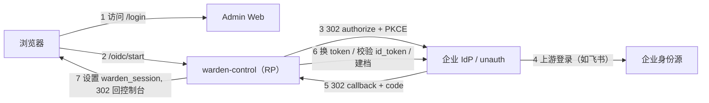

# 操作指南合集

> **面向**：要部署、接入、配置 SSO 或日常运维 Warden 的工程师与管理员。
> 这是操作指南合集，按任务分四部分，用下方目录定位；变量取值见 [reference.md#configuration](reference.md#configuration)，故障排查见 [troubleshooting.md](troubleshooting.md)。

## 本篇导航

- [部署到正式环境](#installation)：制品、Secret、迁移、反代 TLS、上线检查、回滚
- [接入目标系统与 Agent](#onboarding)：K8s / Linux / 网络 / 主机 / Integration / Agent
- [接入企业单点登录](#oidc)：OIDC 注册、配置、验证、SSO 用户授权、故障速查
- [日常运维](#operations)：健康检查、备份、迁移、升级、密钥轮换、会话权限

<a id="installation"></a>

## 部署到正式环境

> **面向**：要把 Warden 部署到生产 / 预发布环境的工程师。
> **目标**：搭出一套 HTTPS、最小权限、可回滚的运行环境。
> 变量含义查 [配置参考](reference.md#configuration)，SSO 接入查 [SSO 接入](#oidc)，日常运维查 [日常运维](#operations)。

> **先读这一句**：仓库里的 `deploy/docker-compose.yaml` **只用于本地开发**（PostgreSQL + 可选 OPA/OpenBao）。生产编排参考脱敏示例 **`deploy/docker-compose.prod.example.yaml`**（单机 Compose 形态：PostgreSQL + 控制面 + 管理端，全 `*_FILE` Secret 挂载）与 **`deploy/nginx.prod.example.conf`**（容器内 SPA + `/api`、`/downloads` 反代）；复制为 `deploy/docker-compose.prod.yaml`（已 gitignore）后按环境修改。Kubernetes 形态见 `deploy/helm/`。不要拿本地 compose 直接上生产。

### 1. 准备制品

**推荐：直接拉取阿里云 ACR 发布镜像，免本地构建**（每个版本发布时由 `scripts/publish-acr.sh` 推送）：

```bash
# 官方仓库已公开，可匿名直接拉取。
docker pull registry.cn-hangzhou.aliyuncs.com/warden-stable/warden:v0.4.0          # 控制面
docker pull registry.cn-hangzhou.aliyuncs.com/warden-stable/warden-web:v0.4.0      # 管理端
# Kubernetes 形态另需：
docker pull registry.cn-hangzhou.aliyuncs.com/warden-stable/warden-operator:v0.4.0
docker pull registry.cn-hangzhou.aliyuncs.com/warden-stable/warden-connector:v0.4.0
```

> 拉取私有仓库（如企业内网自建镜像）时才需要 `docker login <registry>`；
> Kubernetes 对应配置 `imagePullSecret`。

`deploy/docker-compose.prod.example.yaml` 与 Helm Chart 默认即指向这些镜像。升级时把 tag 换成新版本重新 pull 即可。

需要定制（改代码、换基础镜像、内网离线）时自建：

| 制品 | 构建方式 | 说明 |
|---|---|---|
| 控制面镜像 | `docker build -f server/Dockerfile --build-arg TARGET=warden-control -t <registry>/warden-control:<tag> .` | 多阶段构建，运行阶段为 distroless nonroot；`TARGET` 换 `warden-operator` / `warden-connector` 即构建对应镜像 |
| 预编译发布镜像 | `server/Dockerfile.release` | 需先 `make server-build-linux-amd64` 产出 `server/bin/linux-amd64/` |
| 管理端 | `web/Dockerfile`（构建 `web/dist` 并用 nginx 托管） | 也可自行用任意静态服务器托管 `web/dist` |
| 随镜像打包的目录 | `deploy/`、`server/migrations/` | 控制面的 `/downloads/*`、Helm Chart、安装脚本都从 `WARDEN_ARTIFACT_ROOT` 读取，缺了会导致接入向导不可用 |
| Connector / Helper 二进制 | `make server-build-linux-amd64` / `server-build-linux-arm64` / `server-build-hosts` | 同上，供目标机器下载 |

镜像必须自包含：`server/Dockerfile` 会把 `deploy/` 与 `server/migrations/` 复制到 `/app-artifacts` 并设置 `WARDEN_ARTIFACT_ROOT`。

### 2. 准备 Secret

生产环境**全部使用 `*_FILE`**。单机 Compose 形态一条命令初始化全套 `.secrets/`（文件名与 `deploy/docker-compose.prod.example.yaml` 一一对应）：

```bash
make init-prod-secrets
# 可覆盖：WARDEN_SECRETS_DIR / WARDEN_DB_HOST / WARDEN_DB_PORT / WARDEN_DB_NAME / WARDEN_DB_USER
```

脚本生成 10 个文件：4 个内部密钥（hex 32，两两不同）、`postgres_password`（superuser `warden`，仅迁移用）、`warden_app_password` 与 `warden_privileged_password`（hex 24，应用普通角色与特权角色）、`warden_admin_password`（hex 24），以及拼好的 `warden_database_url`（`warden_app` 角色）与 `warden_privileged_database_url`（`warden_privileged` 角色）；全部 `600` 权限，任一文件已存在即整体拒绝、绝不覆盖，**不打印任何 Secret 值**。`warden_admin_password` 请自行存入密码管理器。接入自有密钥管理系统（Vault/KMS）的部署可跳过脚本，按同名文件自行准备——原理即 `openssl rand -hex 32`（内部密钥）与 `openssl rand -hex 24`（口令），在受保护系统中生成，不要写进仓库或命令历史。

**数据库角色拆分（RLS 地基）**：应用运行时连普通角色 `warden_app`（非 owner、非 superuser，受行级安全约束），合法跨租户旁路（认证引导/超管全局/后台清理）连特权角色 `warden_privileged`（BYPASSRLS），superuser `warden` 仅跑迁移。这样数据库层才能强制租户隔离，而不只靠应用手写过滤。生成 Secret 后须执行 `make init-db-roles` 建角色并注入密码（见 §4）。

红线：

- 4 个必需 Secret 两两不得相同，否则控制面启动失败。
- 文件权限 `600`，仅控制面进程可读。
- `WARDEN_ADMIN_USERNAME` 与 `WARDEN_ADMIN_PASSWORD_FILE` 是启动管理员的同步源；改文件并重启会轮换哈希，妥善保管。
- OIDC client secret 与 AI API key 由外部服务提供，脚本不生成；单独存放为 `.secrets/oidc_client_secret`、`.secrets/ai_api_key` 并在 compose 取消注释，见 [SSO 接入](#oidc)。

### 3. 准备 PostgreSQL

- 使用独立实例，开启 TLS 或置于可信网络；创建专用数据库与账号。
- 用 `WARDEN_DATABASE_URL_FILE` 提供 DSN，不要把 DSN 写进 compose 的 `environment`。
- **先备份、后变更**：任何升级前执行一次 `pg_dump`，见 [日常运维](#operations)。

### 4. 执行数据库迁移

**控制面启动不会自动执行迁移**，必须先跑：

```bash
# 全新空库：按文件名顺序执行全部迁移（001–034 不幂等，仅限空库）
make migrate

# 已有数据的库：只按发布清单重放幂等迁移（不要重放 001–034）
make migrate-release
```

两个目标默认走 `deploy/docker-compose.yaml` 的 `postgresql` 服务；非 Compose 部署可覆盖连接方式，例如直接对 DSN 执行同款循环：

```bash
# 全新空库
for f in server/migrations/*.sql; do
  psql -v ON_ERROR_STOP=1 "<dsn>" -f "$f" >/dev/null || exit 1
done

# 已有数据的库
while read -r f; do
  psql -v ON_ERROR_STOP=1 "<dsn>" -f "server/migrations/$f" >/dev/null || exit 1
done < deploy/release/migrations.txt
```

要点：

- `002_seed.sql` 保留固定权限锚点，运行时同步用户提供的管理员登录名和密码哈希。
- `deploy/release/migrations.txt` 收录编号 ≥ 035 的幂等迁移；**新增此类迁移必须登记**，否则 `internal/control` 的单测会失败。编号 068–071 为历史空洞（刻意跳号），不是缺文件。
- `audit_events.action` 是 PostgreSQL 枚举，新增审计动作名必须配套 `ALTER TYPE audit_action ADD VALUE` 迁移。

迁移完成后初始化应用数据库角色（RLS 地基，见 §2）：

```bash
make init-db-roles
```

以 superuser 执行 `deploy/db/roles.sql`（建 `warden_app`/`warden_privileged` + 逐表授权 + 默认 privileges，无密钥可重放），再从 `.secrets/warden_app_password`、`warden_privileged_password` 注入密码并启用登录（密码经 stdin 进 psql，不进命令行、不回显）。非 Compose 部署可直接对 superuser DSN 执行 `deploy/db/roles.sql` 后自行 `ALTER ROLE ... LOGIN PASSWORD`。角色就绪后控制面才能以 `warden_app` 连接启动。

### 5. 反向代理与 TLS

前端是 SPA，需要把 `/api` 反代到控制面，静态资源走 fallback 到 `index.html`。容器内反代直接用 `deploy/nginx.prod.example.conf`（含 `/api` 与 `/downloads` 代理、安全响应头与 CSP）；`web/nginx.conf` 是纯静态版（仅 SPA fallback）。外层反代示意：

```nginx
server {
    listen 443 ssl http2;
    server_name <warden.example.com>;

    # ssl_certificate / ssl_certificate_key 指向真实证书

    location /api/ {
        proxy_pass http://<warden-control-upstream>:8080;
        proxy_set_header Host $host;
        proxy_set_header X-Forwarded-Proto $scheme;
        proxy_set_header X-Forwarded-For $proxy_add_x_forwarded_for;
    }

    location / {
        root /var/www/warden/dist;
        try_files $uri $uri/ /index.html;
    }
}
```

配套控制面配置：

| 变量 | 生产值 |
|---|---|
| `WARDEN_COOKIE_SECURE` | `true`（默认，不要改） |
| `WARDEN_PUBLIC_CONTROL_URL` | `https://<warden.example.com>` |
| `WARDEN_CORS_ORIGIN` | 与前端同源的绝对 origin（若前后端分离） |
| `WARDEN_TRUST_PROXY_HEADERS` | `true` |
| `WARDEN_TRUSTED_PROXY_CIDRS` | 反向代理所在 CIDR，逗号分隔 |
| `WARDEN_REGISTRATION_AUDIENCE` | 与 `WARDEN_PUBLIC_CONTROL_URL` 一致（`.../api/v1`），或省略让它自动推导 |

> 全站 HTTPS 是硬性要求：非本地 HTTP 会被安装脚本、注册脚本与会话 Cookie 策略拒绝。

### 6. 启动控制面

最小必需变量（全部用 `_FILE`）：

```text
WARDEN_DATABASE_URL_FILE
WARDEN_TASK_SIGNING_KEY_FILE
WARDEN_JWT_SIGNING_KEY_FILE
WARDEN_CREDENTIAL_ENCRYPTION_KEY_FILE
WARDEN_ADMIN_API_KEY_FILE
WARDEN_ADMIN_USERNAME
WARDEN_ADMIN_PASSWORD_FILE
WARDEN_PUBLIC_CONTROL_URL
WARDEN_COOKIE_SECURE=true
```

其余按需配置，见 [配置参考](reference.md#configuration)。启动顺序：

本地开发用的 `config.yaml` 与 `.env` 不参与生产启动。生产部署应在容器 / Kubernetes 的环境配置中设置
`WARDEN_AI_MODEL`、`WARDEN_AI_BASE_URL` 等值，并通过 Secret 挂载设置 `WARDEN_AI_API_KEY_FILE`。

1. 校验所有 Secret 文件存在且非空、权限正确；
2. 启动控制面容器；
3. 确认 `GET /api/v1/health`、`/livez`、`/readyz` 返回 200；
4. 部署前端静态产物；
5. 用配置的启动管理员登录一次，确认会话与 `/auth/me` 正常。

> **注意**：`/healthz` 是前端 nginx 容器的探针，后端没有这个路由。健康检查请用 `/api/v1/health` 或 `/readyz`。

### 7. 可选：启用 SSO

按 [SSO 接入](#oidc) 配置 `WARDEN_OIDC_*`。生产务必保持 `WARDEN_OIDC_DEFAULT_ROLE=user`；普通账号只能通过管理入口指派为 `user` / `tenant_admin`，不能指派 `platform_admin`。未匹配组织的新身份默认进入 `unaffiliated`，只有自助资料权限。SSO 未配置时登录页自动隐藏 SSO 入口，密码登录仍可用。

### 8. 上线前检查清单

- [ ] HTTPS 证书有效，`http` 正确跳转到 `https`
- [ ] `WARDEN_COOKIE_SECURE=true`，浏览器会话 Cookie 带 `Secure; HttpOnly; SameSite=Strict`
- [ ] 4 个必需 Secret 独立且互不相同，权限 600，未进入镜像层或日志
- [ ] 数据库已备份、迁移已按正确清单执行
- [ ] `/api/v1/health`、`/livez`、`/readyz` 返回 200
- [ ] `WARDEN_PUBLIC_CONTROL_URL` 与实际访问地址一致；安装命令里的地址可被目标机器访问
- [ ] `/downloads/SHA256SUMS`、Helm Chart、各平台 Connector 二进制可下载
- [ ] `GET /api/v1/auth/oidc/config` 返回预期的 `enabled` 与绝对 URL
- [ ] 启动管理员密码可用（break-glass），但日常不使用
- [ ] `WARDEN_OIDC_DEFAULT_ROLE=user`，`WARDEN_ENABLE_LEGACY_*` 保持关闭
- [ ] 反向代理 CIDR 白名单已收紧，未对公网开放数据库与 OPA
- [ ] 保留上一版镜像 ID、前端产物目录、数据库备份，随时可回滚

### 9. 回滚

1. 停止并切回上一版控制面镜像 ID（无需重建）。
2. 把上一版前端 `dist` 目录移回静态站点根路径。
3. 若本次包含数据库迁移，先确认迁移是幂等的、不需要反向 DDL；确需回退时用备份恢复。
4. 用启动管理员密码登录验证，密码登录链路独立于 IdP，不会把人锁在外面。

详细运维流程见 [日常运维](#operations)。


---

<a id="onboarding"></a>

## 接入目标系统与 Agent

> **面向**：要把 Kubernetes / Linux / 网络设备接入 Warden，或让外部 Agent 调用 Warden 的管理员。
> **目标**：Connector 状态变为 `ACTIVE`，资源目录出现目标资源，Agent 能创建只读 Execution。
> 动作清单见 [动作参考](reference.md#actions)，接口见 [api.md](api.md)，变量见 [配置参考](reference.md#configuration)。

### 通用原则

- **Connector 主动出站**：心跳 15s、任务轮询 2s、资源同步 5min；控制面不需要打通到客户内网的入站路径。
- **配对码 + bootstrap token 只存 SHA-256，10 分钟有效**；每个 Connector 拿到独立的 32 字节任务 Key，控制面用 AES-GCM 加密存储。
- **凭据不进控制面**：kubeconfig、Kubernetes Token、云 AK/SK 等留在目标侧；控制面只保存引用。
- 接入后资源由 Connector 发现并同步；`ORPHANED` 资源进入历史视图，默认不参与统计、不能发起执行。

---

### 路径 A：Kubernetes 集群（Operator + Web 配对，推荐）

#### 1. 安装 Operator

```bash
helm upgrade --install warden-operator ./deploy/helm/warden-operator \
  --namespace warden-system \
  --create-namespace \
  --set controlPlaneURL=https://<warden.example.com> \
  --set image.repository=<registry>/warden-operator \
  --set image.tag=<tag> \
  --set connectorImage=<registry>/warden-connector:<tag>
```

`controlPlaneURL` 是 Chart 的必填值（模板会 `fail` 校验）。Operator 容器读取 `WARDEN_CONTROL_URL`、`WARDEN_CONNECTOR_IMAGE`、`WARDEN_OPERATOR_NAMESPACE`、`WARDEN_OPERATOR_ID` 等变量。

#### 2. 取配对码并在 Web 确认

```bash
kubectl logs -n warden-system deploy/warden-operator -f
# Warden pairing code: ABCD-2345
```

进入 Admin Web `Connector → 接入集群`，输入配对码、集群名、环境、允许 Namespace 和镜像前缀。确认后 Operator 自动创建 Connector Secret、ServiceAccount、最小权限 RBAC 与 Deployment，Web 等待状态从 `DRAFT` 变为 `ACTIVE`。

#### 3. 安全行为

- 配对码与 bootstrap token 在数据库中只存哈希，10 分钟失效。
- 独立任务 Key 只通过带 bootstrap token 的配对通道交付，并写入目标集群 Secret。
- Operator 会自动识别集群版本与 k3s Token Audience。
- Executor / Discoverer 不拥有 `secrets:list`；平台不提供 `secret.list` 动作（K8s List Secret 会返回 Secret 数据）。
- 应用 `deploy/kubernetes/` 里的测试基线清单前，必须修改 Namespace、镜像地址、`WARDEN_CONTROL_URL`、`WARDEN_ALLOWED_IMAGE_PREFIXES`、Token Audience 与签名 Key Secret。

---

### 路径 B：Linux 主机

#### 1. 安装（目标主机 root）

```bash
curl -fsSL https://<warden.example.com>/downloads/install-linux.sh \
  | bash -s -- --control-url https://<warden.example.com>
```

生产必须 HTTPS；仅可信私网临时用 HTTP 时需显式追加 `--allow-insecure-http`。安装脚本会：

1. 下载 `warden-linux-connector` 与 `warden-linux-helper`（自动识别 amd64/arm64）、卸载脚本和 `SHA256SUMS`，校验通过才安装；
2. 创建 `warden-linux` 系统用户与 `/var/lib/warden-linux` 状态目录；
3. 把 `warden-linux` 加入 `systemd-journal` 组以读 journal；
4. 注册并启动 `warden-linux-helper.service` 与 `warden-linux-connector.service`（`ProtectSystem=strict`、`NoNewPrivileges`、`PrivateTmp`）；
5. 重复安装时先完整下载临时文件，再停服并原子替换，保留原配对状态。

#### 2. 配对

1. Connector 首次启动读取 `/etc/machine-id`，发现 enabled 的 systemd 服务，向 `POST /api/v1/linux/pairings` 发起配对；
2. 控制面生成 10 分钟配对码与独立任务 Key，Connector 日志输出配对码；
3. 管理员在 Web `Connector → 接入 Linux 主机` 输入配对码，查看主机信息与可管理服务列表，确认名称、环境和允许的服务子集；
4. `POST /api/v1/linux-pairings/confirm` 创建 `connector_type='linux'` 的记录（`DRAFT`）；
5. Connector 轮询确认结果，取回任务 Key 写入 `/var/lib/warden-linux/state.json`，标记 `READY`，开始注册与资源同步；
6. 发现三类资源：`linux_host`、允许管理的 `systemd_service`、Helper 返回的运行中 `docker_container`。

#### 3. 卸载

```bash
sudo warden-linux-uninstall
```

---

### 路径 C：H3C 网络设备（Network Connector）

先在控制面预置 Connector（`POST /api/v1/connectors/network`），把一次性 `taskSigningKey` 写入受保护文件，然后在能访问设备管理网的内网主机执行安装器：

```bash
curl -fsSL https://<warden.example.com>/downloads/install-network.sh \
  | bash -s -- --control-url https://<warden.example.com> \
             --name <connector-name> \
             --environment production \
             --task-key-file /etc/warden-network/task-signing-key
```

systemd 注入 `WARDEN_CONTROL_URL`、`WARDEN_CONNECTOR_NAME`、`WARDEN_CONNECTOR_ENVIRONMENT`、`WARDEN_TASK_SIGNING_KEY_FILE`、`WARDEN_NETWORK_CREDENTIAL_DIR`。凭据引用只能指向 `warden:` 托管凭据或本地凭据目录中的文件名，并校验预登记的 Host Key SHA256 指纹。设备发现与审计使用固定 SSH 只读命令，不开放任意 CLI。

### 路径 D：macOS / Windows 主机

`deploy/host/install.sh` 强制 HTTPS，分别用 LaunchDaemon（macOS）与计划任务（Windows）注入 `WARDEN_CONTROL_URL` / `WARDEN_HOST_STATE_FILE`。二进制从 `/downloads/warden-host-connector/{platform}/{arch}` 获取。该 Connector 的 `host.command.run` 有严格白名单与强制审批，见 [动作参考](reference.md#actions)。

### 旧版清单接入（仅迁移兼容）

`POST /api/v1/connectors/onboard` 默认返回 `410 LEGACY_ONBOARDING_DISABLED`。只有显式设置 `WARDEN_ENABLE_LEGACY_CONNECTOR_KEY=true` 才启用共享签名 Key 的旧流程；**仅用于迁移已有部署**，完成后必须关闭并轮换全局任务 Key。新集群一律用 Operator 配对。

---

### 注册 Integration（以 Jenkins 为例）

1. 先按上面任一路径接入 K8s 或 Linux Connector。
2. 在 Connector 详情的 `Integrations` 区域填写 Jenkins Endpoint、服务账号、Credential Reference 与 Job Scope。
3. 控制面以一等公民 `integrations` 表保存配置；Connector 每 10s 拉取并 diff、构建/移除 Runner，资源打上 `integration_id` 标签。
4. Token 必须提前放在目标侧，不通过前端或 warden-control 数据库：

```bash
# K8s Connector：Secret 与 warden-connector 同 Namespace，固定 key 为 token
kubectl create secret generic jenkins-api-token -n warden-system \
  --from-literal=token='<jenkins-api-token>'

# Linux Connector：Credential Reference 对应固定凭据目录中的文件
printf '%s' '<jenkins-api-token>' | sudo install -o root -g warden-linux -m 0640 \
  /dev/stdin /etc/warden-linux/credentials/jenkins-api-token
```

Grafana、数据库、华为云、阿里云 SLS 等同理：Integration 挂在已有 Connector 上，复用配对、身份、心跳、TaskEnvelope、审计与下线，不为每种服务重复创建 Connector。

### Connector 生命周期

| 操作 | API | 说明 |
|---|---|---|
| 健康检查 | `POST /api/v1/connectors/{id}/check` | 状态 ACTIVE 且心跳在 90 秒内 |
| 更新 Namespace | `PUT /api/v1/connectors/{id}/namespaces` | Operator 下次调谐自动增删 RBAC |
| 安全下线 | `DELETE /api/v1/connectors/{id}` | 标记 `DISABLED` + `DELETE_REQUESTED`，目标侧清理资源 |
| 归档 | `POST /api/v1/connectors/{id}/archive` | 目标资源清理完成后从列表隐藏，审计保留 |

下线流程：管理员发起删除 → Connector 禁用、关联资源禁用 → Operator / Linux Connector 轮询到 `DELETE_REQUESTED` 后清理目标侧 Deployment/Secret/SA/RoleBinding 并标记 `DELETED` → 管理员确认后归档。注册与心跳若发现 `DELETE_REQUESTED` 会拒绝激活，防止已下线 Connector 重新上线。

---

### 接入外部 Agent

#### 1. 创建身份与凭据

```bash
# 管理员 Key 创建 Agent Principal
POST /api/v1/principals
POST /api/v1/principals/{id}/api-keys     # 明文只返回一次，DB 只存 SHA-256
```

每个 Agent 用自己独立的 Key；`WARDEN_ADMIN_API_KEY` 只用于平台初始化与应急，**不要注入 Agent**。资源注册机器人使用 audience 绑定、可轮换撤销的 Registration Key（`warden_rgk_` 前缀），由「Agent 身份 → 新增注册机器人」创建。

#### 2. 配置客户端

```text
WARDEN_API_ENDPOINT=https://<warden.example.com>/api/v1
WARDEN_AGENT_API_KEY=<该 Agent 的独立 Key>
```

Registration Key 的 audience 必须与当前 Warden API Endpoint 一致，复制本地 Key 到线上会稳定返回 401；有效但 Scope 不足返回 403 并记审计。

#### 3. 常用调用（`scripts/warden-agent.sh`，依赖 `curl` + `jq`）

```bash
# 生成紧凑资源摘要
scripts/warden-agent.sh resource-summary [project] [environment] [resource_type]

# 按名称精确查找资源
scripts/warden-agent.sh find-resources nginx [project] [environment] [resource_type]

# 查某资源允许的动作与参数 Schema
scripts/warden-agent.sh list-actions <resource_id>

# 创建只读执行（客户端侧还有一层允许表保护）
scripts/warden-agent.sh create-readonly-execution deployment.get <resource_id> \
  '{"name":"nginx","namespace":"default"}' "巡检"

# 查询 / 轮询结果（意外进入审批会停止，不自动继续）
scripts/warden-agent.sh get-execution <execution_id>
scripts/warden-agent.sh wait-readonly-result <execution_id> 60
```

Agent Key 默认只能读资源、创建 / 读取 / 取消自己的 Execution；审批、全局审计、Connector 与 Principal 管理需要管理员会话或管理 Key。`/api/v1/health` 不需要认证。

### 验收清单

- [ ] Connector 状态 `ACTIVE`，心跳在 90 秒内
- [ ] 资源目录出现目标资源，且项目 / 环境归属正确
- [ ] `list-actions <resource_id>` 返回预期动作与参数 Schema
- [ ] 只读动作能创建 Execution 并进入终态 `SUCCEEDED`
- [ ] 生产变更动作按预期进入 `WAITING_APPROVAL`
- [ ] 执行与审计列表能看到 Principal / Credential 归属与 `trace_id`
- [ ] Agent Key 权限收敛：越权调用返回 403 且留下拒绝审计
- [ ] 下线 / 归档流程验证过，已下线 Connector 无法自行重新激活


---

<a id="oidc"></a>

## 接入企业单点登录（OIDC/SSO）

> **面向**：要启用飞书 / 企业 IdP 登录并给 SSO 用户配权限的管理员。
> **目标**：登录页出现 SSO 入口，用户能完成登录，管理员能在页面上指派权限。
> 变量取值查 [配置参考](reference.md#configuration)，权限规则查 [authorization.md](authorization.md)，接口细节查 [api.md](api.md)。

### 前置条件

- IdP 可访问 `/.well-known/openid-configuration`，且能给 Warden 注册 RP client。
- 如果 IdP 上游还接了飞书等企业身份源，**上游回调地址也必须加入该平台的白名单**（见「故障速查」）。
- 已有一套可用的 HTTPS 部署（本地 HTTP 联调除外），见 [生产部署](#installation)。
- 保留启动管理员密码登录作为 break-glass 通道。

### 拓扑与地址一致性



**最容易踩的坑是地址不一致**。OIDC 的 state / nonce / PKCE verifier 都是 host-only 的 HttpOnly Cookie：

- 浏览器访问、回调地址、`WARDEN_OIDC_REDIRECT_URL`、`WARDEN_PUBLIC_CONTROL_URL` 必须使用**同一个 host**（不要混用 `localhost` 与 `127.0.0.1`）；
- 回调 URI 必须与 IdP 注册值**逐字符一致**（协议、host、端口、路径、结尾斜杠）；
- 生产环境反向代理必须传 `X-Forwarded-Proto`，否则 Secure Cookie 在 HTTPS 站点上会异常。

本地联调推荐三端口拓扑（普通配置写入根目录 `config.yaml`）：

| 服务 | 地址 | 说明 |
|---|---|---|
| IdP（如 unauth） | `http://127.0.0.1:8080` | `OIDC_ISSUER` |
| warden-control | `http://127.0.0.1:8090` | `WARDEN_PORT=8090` |
| Vite / 浏览器入口 | `http://127.0.0.1:8081` | `WARDEN_WEB_PORT=8081`、`WARDEN_WEB_HOST=127.0.0.1`、`WARDEN_CONTROL_TARGET=http://127.0.0.1:8090` |

此时回调必须是 `http://127.0.0.1:8081/api/v1/auth/oidc/callback`，且 `WARDEN_PUBLIC_CONTROL_URL=http://127.0.0.1:8081`、`WARDEN_CORS_ORIGIN=http://127.0.0.1:8081`。

### 步骤 1：在 IdP 注册 RP client

| 项 | 值 |
|---|---|
| 授权模式 | Authorization Code |
| PKCE | **必须支持 S256**（Warden 强制，不提供降级） |
| redirect_uri | `https://<warden.example.com>/api/v1/auth/oidc/callback`（生产示例；本地见上表） |
| post_logout_redirect_uri | `https://<warden.example.com>/` |
| scope | `openid profile email` |
| id_token claims | 必须包含稳定的 `sub`；建议提供 `name` / `email` / `picture` |
| client_secret | 生成后只写入本地 `.env` 或生产 Secret 管理系统，不要贴进文档或日志 |

**上游身份源白名单**：若 IdP 自身通过飞书等平台登录，还要把 IdP 的回调（例如 `https://<idp.example.com>/api/auth/callback`）加入该平台后台的重定向 URL 白名单。缺这一步会报 `20029 redirect_uri 请求不合法`，且错误发生在 IdP 侧，Warden 日志里看不到。

### 步骤 2：配置 warden-control

`WARDEN_OIDC_ENABLED=true` 是显式总开关，`=false` 强制关闭。不设置开关时沿用旧契约（配了 `WARDEN_OIDC_ISSUER` 即启用），存量部署不受影响。

在已经配置 `WARDEN_PUBLIC_CONTROL_URL` 的前提下，**OIDC 最小新增配置只有 4 行**——issuer / client id / secret 由 IdP 颁发，其余全部走默认；否则还需配置回调地址或公共控制面地址：

```text
WARDEN_OIDC_ENABLED=true
WARDEN_OIDC_ISSUER=https://<idp.example.com>
WARDEN_OIDC_CLIENT_ID=<client-id>
WARDEN_OIDC_CLIENT_SECRET_FILE=/etc/warden/secrets/oidc_client_secret
```

默认值：`REDIRECT_URL` 自动取 `<WARDEN_PUBLIC_CONTROL_URL>/api/v1/auth/oidc/callback`；`DEFAULT_TENANT_ID` 为空，未唯一匹配组织的新身份进入 `unaffiliated`；`DEFAULT_ROLE=user`。需要覆盖时再显式配置：

```text
WARDEN_OIDC_REDIRECT_URL=https://<warden.example.com>/api/v1/auth/oidc/callback
# 可选：只有明确需要默认租户兜底时才设置；不设置则保持 unaffiliated
WARDEN_OIDC_DEFAULT_TENANT_ID=platform
WARDEN_OIDC_DEFAULT_ROLE=user
```

要点：

- `WARDEN_OIDC_CLIENT_SECRET` 与 `_FILE` **不可同时设置**；生产用 `_FILE`。
- 启用但缺 issuer / client id / secret / 回调（且无 `PUBLIC_CONTROL_URL` 可推导）时**启动失败并列出缺项**，不会静默降级。
- 回调地址必须与 IdP 白名单**逐字符一致**；用推导默认值时，确认 IdP 侧注册的就是 `<PUBLIC_CONTROL_URL>/api/v1/auth/oidc/callback`。
- `DEFAULT_TENANT_ID` 是可选的 ACTIVE 业务租户 **slug**；留空时，未唯一匹配邮箱域名的新身份不会自动进入任何业务组织。
- `DEFAULT_ROLE` 只允许 `user` / `tenant_admin`；**填 `platform_admin` 会让服务启动失败**。普通账号管理入口也只能指派 `user` / `tenant_admin`。
- Discovery 在首次请求时懒加载，启动不依赖 IdP 可用。

完整变量表见 [配置参考](reference.md#configuration)。本地联调将上述非敏感配置写入根目录
`config.yaml`，将 `WARDEN_OIDC_CLIENT_SECRET` 写入 `.env`，不需要再 `source` 其他 env 文件。

### 步骤 3：前端契约

Web **必须使用服务端下发的绝对 URL** 发起登录与登出，不要自己拼路径：

```text
GET /api/v1/auth/oidc/config
→ { "enabled": true,
    "login_url":  "https://<warden.example.com>/api/v1/auth/oidc/start",
    "logout_url": "https://<warden.example.com>/api/v1/auth/oidc/logout" }
```

四个公开端点：`config` / `start` / `callback` / `logout`。`start` 会生成 `oidc_state`、`oidc_nonce`、`oidc_verifier` 三个 HttpOnly Cookie（10 分钟），并带 `code_challenge_method=S256` 跳转 IdP；`callback` 校验 state、nonce、PKCE 与 id_token 后按 `(issuer, subject)` 建档，签发同一个 `warden_session` 并 302 回控制台；`logout` 走 RP-initiated logout，同时终止本地与 IdP 会话。

### 步骤 4：验证

```bash
BASE=https://<warden.example.com>

# 1) 开关与 URL
curl -sS "$BASE/api/v1/auth/oidc/config"

# 2) start 必须是 302，且带 PKCE 与三个 Set-Cookie
curl -sS -D - -o /dev/null "$BASE/api/v1/auth/oidc/start" | \
  grep -iE '^HTTP/|^location:|code_challenge_method|^set-cookie:' | sed -E 's/(set-cookie: [^=]+=)[^;]+/\1<redacted>/I'

# 3) 用 cookie jar 跟随完整 302 链（自动化只能到登录页，最后一步需真人完成）
curl -sS -L -c /tmp/oidc.cookies -b /tmp/oidc.cookies -o /dev/null -w '%{http_code}\n' \
  "$BASE/api/v1/auth/oidc/start"

# 4) 登录后检查身份字段
curl -sS -b /tmp/oidc.cookies "$BASE/api/v1/auth/me"
```

验收标准：

| 检查项 | 期望 |
|---|---|
| `/oidc/config` | `enabled: true`，`login_url` / `logout_url` 为绝对 URL |
| `/oidc/start` | 302 到 IdP authorize，含 `code_challenge_method=S256`、3 个 HttpOnly Cookie |
| 完整链路 | 无 `20029`、无 `INVALID_OIDC_STATE`、无 5xx |
| `/auth/me` | 有 `display_name`（IdP 名称，不是 `federated:<hash>`）、`auth_source=oidc`、`capabilities` |
| `/oidc/logout` | 302 到 IdP `end_session_endpoint`，会话被撤销、Cookie 被清除 |
| 密码登录 | 仍可用（break-glass） |

**真人验收不可省略**：用真实企业账号在浏览器点一次 SSO，确认顶栏展示名/头像、菜单范围，再点登出。curl 无法替代企业身份源的交互登录。

### 步骤 5：给 SSO 用户配权限

1. 首次登录按配置的默认角色建档，生产建议保持 `user`；未匹配组织的新身份进入 `unaffiliated`，只有自助资料权限。
2. 内置超管进入「平台管理 → 账号与权限」，可将普通账号指派为 `user` 或 `tenant_admin`；**不能指派 `platform_admin`**。待分配身份也可以由管理员分配组织，或通过邀请加入组织。
3. 角色变更会立即撤销该账号的全部活跃会话，**对方必须退出并重新 SSO 登录**才能拿到新 scope；刷新页面无效。
4. 每次角色变更写审计 `account.role_updated`，与角色变更在同一事务提交。

保护规则：内置启动管理员不可在页面修改；租户管理员不能给自己降权；每个租户至少保留一个 `tenant_admin`。完整说明与运行时兼容边界见 [authorization.md](authorization.md)。

### SSO 用户的租户归属

SSO 认证解决「你是谁」。**首次登录**的新身份按以下顺序确定初始组织：

1. **可信邮箱域名路由**：IdP 在 id_token 里签发的 email（可信来源）匹配某租户配置的 `emailDomains`，且唯一命中一个 ACTIVE 租户 → 建档进该租户。域名在「租户管理 → 管理 → SSO 邮箱域名」配置（或 `PUT /tenants/{slug}/settings`）。
2. **可选默认租户**：未命中、命中多个（歧义）或 IdP 没给 email 时，只有显式设置 `WARDEN_OIDC_DEFAULT_TENANT_ID` 才进入该默认租户。
3. **待分配状态**：未设置默认租户时进入 `unaffiliated`，只有 `warden:self:profile`，不能读取业务组织数据；之后由管理员分配或接受邀请加入组织。

已有身份再次登录时沿用当前 Principal 的组织与角色，不重复执行首次路由；管理员分配、邀请接受、移出组织等管理操作可以改变后续归属。安全边界：**只有 IdP 签发的 email 参与自动路由**，用户自填邮箱不能作为入租依据。

### 故障速查

| 现象 | 常见原因 | 处理 |
|---|---|---|
| 飞书 `20029` / `redirect_uri 请求不合法` | **IdP 上游**回调地址未加入飞书后台白名单 | 在飞书应用后台添加 `https://<idp.example.com>/api/auth/callback`；这是 IdP 侧配置，Warden 改不了 |
| `INVALID_OIDC_STATE` / state 校验失败 | 登录与回调 host 不一致（`localhost` vs `127.0.0.1`）、浏览器丢了 Cookie、代理未传 `X-Forwarded-Proto`、Secure Cookie 在本地 HTTP 下被丢弃 | 统一 host 与 `WARDEN_PUBLIC_CONTROL_URL` / `REDIRECT_URL`；本地设 `WARDEN_COOKIE_SECURE=false`；检查代理头。失败回调**不清 Cookie**，可直接重试 |
| `OIDC_PKCE_MISSING` | 回调缺 `oidc_verifier` Cookie 或 IdP 不支持 S256 | 确认同源、IdP 开启 PKCE；Warden 不会降级为无 PKCE 兑换 |
| `OIDC_INVALID_SUBJECT` | IdP 的 userinfo 实现把 `sub` 覆盖为空 | 在 IdP 侧补全 userinfo（例如正确实现 `SetUserinfoFromScopes`）。Warden 遇到空 `sub` 会拒绝，避免所有用户被合并成同一身份 |
| 首次 SSO 登录 500 / 建档失败 | 早期版本的 `ProvisionIdentity` 错误变量被覆盖、`pgx.ErrNoRows` 丢失 | 已修复；若旧部署仍遇到，先升级控制面 |
| 顶栏显示 `federated:<hash>` | 前端读了内部标识 `name` 而不是 `display_name` | 使用新版前端；`/auth/me` 已下发展示名、邮箱、头像 |
| 登录后菜单只剩 4 项 | 首次建档角色是 `user`；或改了角色但 JWT 未重签 | 由超管在页面提权 → 退出重新 SSO 登录 |
| 回调 404 / 401 | 回调落在了前端 SPA 而不是控制面，或路径与 IdP 注册值不一致 | 检查 `/api/` 反代、逐字符核对 redirect_uri |
| 登出后 IdP 会话仍在 | 用了 `/auth/logout` 而不是 `/auth/oidc/logout` | SSO 用户走 `/oidc/logout` |

更多排障见 [troubleshooting.md](troubleshooting.md)。

### 生产红线

1. `WARDEN_OIDC_DEFAULT_ROLE=user`，绝不配成 `platform_admin`。
2. client secret 用 `_FILE`，权限 600，不进镜像、日志或文档。
3. 全站 HTTPS，`WARDEN_COOKIE_SECURE=true`。
4. 保留启动管理员密码登录作为应急通道。
5. 回调地址与登出回跳地址在 IdP 侧精确登记，变更前先备份 IdP 配置。


---

<a id="operations"></a>

## 日常运维

> **面向**：负责运行 Warden 的运维 / 值班人员。
> **目标**：能安全地做备份、升级、迁移、密钥轮换与回滚。
> 首次部署见 [生产部署](#installation)，故障定位见 [troubleshooting.md](troubleshooting.md)，变量见 [配置参考](reference.md#configuration)。

### 健康检查与观测

| 检查 | 命令 / 路径 | 期望 |
|---|---|---|
| 进程存活 | `GET /livez` | 200 |
| 数据库就绪 | `GET /readyz` 或 `/api/v1/health` | 200 |
| 前端容器存活 | `GET /healthz`（nginx 容器内） | `ok` |
| OIDC 开关 | `GET /api/v1/auth/oidc/config` | 预期的 `enabled` 与绝对 `login_url` / `logout_url` |
| 当前身份 | `GET /api/v1/auth/me` | 角色、`capabilities`、`auth_source` 正确 |
| Connector | `POST /api/v1/connectors/{id}/check` | ACTIVE 且心跳在 90 秒内 |

> `/healthz` 只在前端 nginx 容器里存在；后端探针是 `/livez`、`/readyz`、`/api/v1/health`。

建议监控：控制面日志里的启动错误、审计写入失败、决策 Provider 异常（会默认 DENY）、数据库连接失败、Connector 心跳缺失、过期审批与排队任务数量。

### 数据库备份

**任何升级、迁移、批量改数据之前必须先备份。**

```bash
# 独立 PostgreSQL
pg_dump "<dsn>" | gzip > warden-db-$(date +%Y%m%d-%H%M%S).sql.gz
gzip -t warden-db-*.sql.gz    # 校验归档完整

# 容器化 PostgreSQL（示意）
docker exec <postgres-container> pg_dump -U <user> -d <db> \
  | gzip > warden-db-$(date +%Y%m%d-%H%M%S).sql.gz
```

恢复前先停控制面，确认目标库可丢弃或已另行备份，再导入并重新跑迁移校验。备份文件含业务数据与审计，按敏感数据管理，加密存放并限制访问。

同时备份的非数据库资产：控制面镜像 ID / tag、前端 `dist` 目录、生产编排文件、IdP 侧 RP 配置、`/etc` 下的 Secret 文件清单（**内容单独离线保管**）。

### 迁移规范

| 规则 | 说明 |
|---|---|
| 启动不跑迁移 | `warden-control` 不会自动执行 SQL；必须显式执行 |
| 全新库 | 按 `server/migrations/*.sql` 文件名顺序执行全部迁移 |
| 已有库 | 只按 `deploy/release/migrations.txt` 顺序重放幂等迁移（编号 ≥ 035） |
| 新增迁移 | 编号 ≥ 035 的文件**必须登记到 `migrations.txt`**，否则 `internal/control` 单测失败 |
| 幂等 | 发布清单里的迁移会被反复重放，必须用 `IF NOT EXISTS` / 条件更新等写法 |
| 枚举 | `audit_events.action` 是 PostgreSQL 枚举；新增审计动作名必须配套 `ALTER TYPE audit_action ADD VALUE` 迁移，否则审计静默丢失 |
| 编号唯一 | 由 `migration_files_test.go` 强制校验 |

不要用"删库重建"来修迁移问题；生产库有真实业务数据与审计链。

### 标准升级流程

1. **备份**：数据库 `pg_dump`、记录当前镜像 ID、保存当前前端 `dist` 与编排文件。
2. **本地验证**：`make verify`（Go 测试 + vet + 构建 + 前端构建），见 [CONTRIBUTING.md](../CONTRIBUTING.md)。
3. **执行迁移**：按上表区分全新库 / 已有库。
4. **准备新镜像**：`docker pull registry.cn-hangzhou.aliyuncs.com/warden-stable/warden:<new-tag>`（管理端同理换 `warden-web`）；定制部署则自建：`docker build -f server/Dockerfile --build-arg TARGET=warden-control -t <registry>/warden-control:<new-tag> .`，确认镜像内含 `deploy/` 与 `server/migrations/`。
5. **替换控制面**：滚动或短暂停机切换，等待 `/readyz` 200。
6. **替换前端**：保留旧 `dist` 目录（例如 `dist.prev-<timestamp>`）后再覆盖。
7. **验收**：健康检查 → 密码登录 → SSO 登录 → `/auth/me` 能力清单 → 一个只读 Execution → 审计可见。
8. **观察**：至少一轮审计写入与 Connector 心跳周期，确认无异常日志。
9. **失败回滚**：切回旧镜像 ID、移回旧 `dist`；若迁移不兼容，用备份恢复数据库。密码登录始终可用，不会把人锁在外面。

> 如果升级涉及 OIDC，先确认 IdP 的 discovery 与 RP 配置未变；`OIDC_KEY_ENCRYPTION_KEY` 一类 IdP 侧密钥一旦丢失，已签发的签名私钥可能无法解密。

### 密钥轮换

| 密钥 | 轮换影响 | 建议 |
|---|---|---|
| `WARDEN_ADMIN_USERNAME` / `WARDEN_ADMIN_PASSWORD_FILE` | 重启时同步启动管理员登录名与 bcrypt 哈希，旧密码立即失效 | 改配置 → 重启 → 用新账号验证 break-glass |
| `WARDEN_ADMIN_API_KEY_FILE` | 静态超管 Key；所有使用旧 Key 的自动化脚本会 401 | 先更新调用方再切，或安排停机窗口；当前版本不支持在线轮换 |
| `WARDEN_JWT_SIGNING_KEY_FILE` | 所有 Web 会话 JWT 失效，用户需重新登录 | 低峰期执行，提前通知 |
| `WARDEN_CREDENTIAL_ENCRYPTION_KEY_FILE` | 已加密的 Connector 任务 Key 无法解密，Connector 会失联 | **不要单独轮换**，除非有完整的重新配对方案 |
| `WARDEN_TASK_SIGNING_KEY_FILE` | 影响旧兼容 Connector 签名 | 完成每 Connector 独立 Key 迁移后再处理 |
| OIDC client secret | IdP 侧与 Warden 侧必须同步更新 | 先在 IdP 生成新 secret，再更新 Secret 文件并重启 |

四个必需 Secret 必须保持独立且互不相同，轮换后重新校验启动。

### 会话与权限

- JWT 默认 8 小时（`WARDEN_JWT_TTL_HOURS`），权限冻结在签发的 `scopes` 里。
- **改角色必须让目标重新登录**。通过「账号与权限」页变更时，系统会在同一事务里 `UPDATE admin_sessions SET revoked_at=now()` 并写审计，强制重新签发。
- 直接改数据库不会触发会话撤销，旧权限最多残留 8 小时——**不要绕过页面改库**。
- 应急时可在数据库层撤销某账号的全部活跃会话，但事后必须补审计记录。

### 审计与 Outbox

- 审计是 append-only；角色变更审计 `account.role_updated` 与角色变更在同一事务提交，写入失败则整体回滚。
- 排查"审计页看不到登录事件"时，检查事件是否带 `tenant_id`：早期数据或部分链路可能为空。
- `WARDEN_OUTBOX_ENABLED=true` 才会写 Outbox 事件；Publisher 后台循环尚未实现，开启前确认已有消费者。

### 定时与后台任务

控制面自带后台循环：过期审批 / 排队任务 / 租约 / 清理（约 30s 一轮），无需额外 cron。Connector 侧心跳 15s、任务轮询 2s、资源同步 5min。数据库备份需要部署环境自己配置定时任务——**仓库不含备份脚本或 cron 配置**。

### 常用命令速查

```bash
# 构建与验证
make verify                 # Go 测试 + vet + 后端构建 + 前端构建
make server-build-linux-amd64
make web-build

# 服务状态
curl -sS https://<warden.example.com>/api/v1/health
curl -sS https://<warden.example.com>/api/v1/auth/oidc/config

# 审计抽查（示例）
psql "<dsn>" -c "select action, tenant_id, created_at from audit_events order by created_at desc limit 20;"

# 迁移登记检查
tail -5 deploy/release/migrations.txt
```
