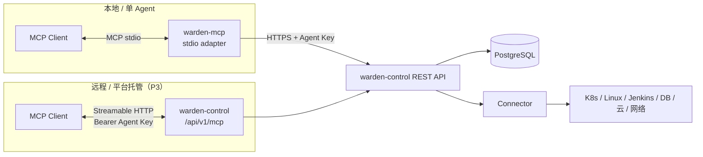

# MCP 接入设计

> **面向**：要给外部 Agent / MCP 客户端接 Warden 的维护者、集成方与安全评审者。
> **读完你能**：判断 MCP 该做什么、不该做什么，知道首期工具契约、审批语义、安全边界和落地顺序。
> **状态**：设计稿（2026-11-26）。P1 只读 stdio 适配器已在 `server/cmd/warden-mcp` 实现（尚未发布）；写工具与 Remote MCP 仍为设计。
> **相关**：[architecture](architecture.md#roadmap) · [api](api.md#execution) · [authorization](authorization.md) · [guides · 接入](guides.md#onboarding)

## 1. 背景与目标

Warden 已经提供面向外部 Agent 的 REST API：Agent 用独立 API Key 查询资源与动作、创建 Execution，经策略、审批、限时授权、HMAC 信封和 Connector 执行，最后落审计。MCP（Model Context Protocol）要做的是把同一条链路用 Agent 生态的标准协议暴露出来，让 Claude Desktop / Claude Code / 其他 MCP 客户端不必自己写 Warden 客户端。

目标：

- 让 MCP 客户端能发现「我能操作哪些资源、每个资源允许哪些动作、参数 Schema」；
- 让 MCP 客户端发起受策略与审批约束的执行，并查询结果；
- 保持 Warden 的核心价值：**Agent 永远拿不到长期凭据，也永远不能自己批准自己**；
- 开源用户可自行启用，不绑定托管平台。

明确不做：

- 不新增执行引擎，不绕过 Scope、Rego、审批、Grant、HMAC 或审计；
- 不提供任意 Shell、SQL、`kubectl` 或原始 HTTP 代理；MCP 只能调用动作目录里的结构化动作；
- 不把审批能力暴露给 Agent；审批仍由 Admin Web / SSO 上的人工完成；
- 不替代 REST API；MCP 只是适配层，REST 仍是权威接口；
- 首期不做远程 OAuth、MCP resources/prompts、动态一动作一工具。

## 2. 现有可复用能力

| MCP 所需能力 | 现有实现 | 状态 |
|---|---|---|
| Agent 身份与最小权限 | 每个 Agent 独立 API Key、Scope、租户/项目隔离、撤销与轮换 | 已实现 |
| 资源/动作发现 | `GET /resources`、`GET /resources/{id}/actions`、`parameter_schema` | 已实现 |
| 执行 | `POST /executions`、幂等键、状态机、查询、取消 | 已实现 |
| 策略与审批 | Rego 决策、`WAITING_APPROVAL`、AccessRequest、AccessGrant | 已实现 |
| 审计 | Execution / 审批 / 审计事件，`execution_id`、`trace_id` 串联 | 已实现 |
| 只读查询工具 | AI 助手已有 `query_resources` / `query_executions` / `query_audit_events`，服务端重校验 Scope | 已实现，可复用查询函数 |
| MCP 协议与传输 | P1 只读 stdio 适配器（`server/cmd/warden-mcp`） | P1 已实现（未发布）；Remote MCP 设计中 |

结论：MCP 不需要重做授权与执行，只需要一层**薄的、受同一套守卫约束**的协议适配。

## 3. 总体架构

### 3.1 两层形态

| 层 | 形态 | 适用场景 | 优先级 |
|---|---|---|---|
| 第一层 | `warden-mcp` stdio 适配器 | 本地 Claude Desktop / Claude Code / Cursor；快速验证工具契约 | **先做** |
| 第二层 | 控制面内置 Remote MCP（Streamable HTTP） | 多租户托管、远程 Agent、集中审计 | 验证后做 |



第一层是个**独立小二进制**，不进入控制面镜像，也不改变现有部署；第二层复用控制面，不新增服务。

### 3.2 为什么首期选 stdio

- 可直接接入本地 MCP 客户端，不依赖远程 MCP 的 OAuth 支持矩阵；
- 不改控制面部署、Nginx 与多租户基础设施；
- 让工具契约先被真实 Agent 使用验证，再决定远程端点的认证与限流细节；
- 开源用户可自行构建，不要求使用官方 ACR 镜像。

### 3.3 为什么不一个动作一个 MCP Tool

动作目录大且动态（一个资源类型几十个动作，连接器和能力还会升级）。MCP 客户端通常在连接时固定工具列表，一动作一工具会：

- 让模型上下文被工具描述占满；
- 让工具列表随 Connector 能力变化而失效，需要重启客户端；
- 让版本化（`action@v2`）与权限过滤难以表达。

因此采用**少量通用工具 + 发现**：先列资源和动作，再通过通用 `warden_request_action` 执行。后续如有高频场景，再增加少量经过策展的高层工具。

## 4. Transport 与认证

### 4.1 首期：stdio

配置示例（Claude Desktop / Claude Code 的 `mcpServers` 形式）：

```json
{
  "mcpServers": {
    "warden": {
      "command": "warden-mcp",
      "env": {
        "WARDEN_API_ENDPOINT": "https://warden.example.com/api/v1",
        "WARDEN_AGENT_API_KEY": "<agent-api-key>",
        "WARDEN_MCP_ALLOW_WRITES": "false"
      }
    }
  }
}
```

- API Key 只放在环境变量，不写入 MCP 工具参数、不打印日志；
- 适配器用现有 `Authorization: Bearer` 调用 REST，不引入第二套身份；
- 默认写工具关闭，只读工具可直接使用。

### 4.2 后续：Remote MCP

- 路径：`/api/v1/mcp`，复用现有 `/api` 反向代理与 TLS 终结，不新增外网路径；
- 传输：MCP Streamable HTTP；
- 认证：`Authorization: Bearer <agent-api-key>`，租户与 Scope 由该 Key 解析；
- 不新增「tenant_id」工具参数，避免客户端伪造租户；
- 远程 MCP 客户端若只支持 OAuth，后续再评估 OAuth 2.1 适配；首期 API Key 更务实；
- 远程端点默认关闭，用配置显式启用。

## 5. 工具契约

### 5.1 通用约定

- MCP 工具输入用 `snake_case`；适配器映射到 REST 的 camelCase（如 `resource_id` → `resourceId`）。
- 结果以 **JSON 文本**返回，便于任何 MCP 客户端解析；支持结构化 content 的客户端可额外获得结构化对象。
- 只返回必要字段：不返回凭据、Secret、注解中的敏感内容、原始日志行。
- 错误用 MCP `isError` + 结构化 JSON：

```json
{"error": {"code": "FORBIDDEN", "message": "没有该资源的执行权限"}}
```

错误码沿用 REST 语义：`INVALID_ARGUMENT`、`UNAUTHORIZED`、`FORBIDDEN`、`NOT_FOUND`、`CONFLICT`、`IDEMPOTENCY_CONFLICT`、`RATE_LIMITED`、`UNAVAILABLE`。

### 5.2 工具清单

| Tool | 作用 | 对应 REST | 默认 |
|---|---|---|---|
| `warden_list_resources` | 列出当前 Principal 可见资源 | `GET /resources` | 开启 |
| `warden_list_resource_actions` | 列出资源允许的动作与参数 Schema | `GET /resources/{id}/actions` | 开启 |
| `warden_get_execution` | 查询执行状态与结果 | `GET /executions/{id}` | 开启 |
| `warden_wait_execution` | 有界轮询等待执行 | 轮询 `GET /executions/{id}` | 开启 |
| `warden_request_action` | 发起一次受策略约束的执行 | `POST /executions` | **写开关 + Scope 双重条件** |
| `warden_cancel_execution` | 取消未派发/未终态执行 | `POST /executions/{id}/cancel` | 写开关 |

审批不存在于工具清单：Agent 不能调用 approve/reject，也没有任何绕过审批的参数。

### 5.3 `warden_list_resources`

输入：

```json
{
  "query": "checkout",
  "project_id": "proj-payments",
  "environment": "production",
  "resource_type": "kubernetes.deployment",
  "limit": 20,
  "offset": 0
}
```

规则：

- 所有过滤条件可选，但建议至少给一个，避免把整个资源目录灌进上下文；
- `limit` 1–50，默认 20；返回 `next_offset`；
- 返回 `id`、`name`、`resource_type`、`project`、`environment`、`status`、`available_action_count` 等摘要字段；
- 不返回 `metadata` / `annotations` / 任何凭据引用。

### 5.4 `warden_list_resource_actions`

输入：

```json
{"resource_id": "<resource-id>"}
```

输出：

```json
{
  "actions": [
    {
      "name": "deployment.update_image",
      "version": 2,
      "display_name": "更新镜像",
      "description": "更新 Deployment 容器镜像",
      "risk_level": "medium",
      "execution_mode": "async",
      "timeout_seconds": 120,
      "parameter_schema": {"type": "object", "properties": {"image": {"type": "string"}}}
    }
  ]
}
```

- `parameter_schema` 直接来自 ActionDefinition，客户端应先按其校验参数；
- 动作按资源类型与 Connector capability 过滤，不返回当前资源不可用的动作。

### 5.5 `warden_request_action`

输入：

```json
{
  "resource_id": "<resource-id>",
  "action": "deployment.update_image",
  "action_version": 2,
  "parameters": {"image": "registry.example.com/checkout:1.8.3"},
  "reason": "发布 checkout 1.8.3",
  "idempotency_key": "mcp-<stable-call-key>",
  "trace_id": "<optional-trace-id>"
}
```

规则：

- `action_version` 显式必填，避免「默认最新版本」在审批与审计中产生歧义；
- `reason` 必填（变更动作尤其如此）；
- `idempotency_key` 写动作必填；适配器把它映射为 `Idempotency-Key`，同一 Key 重试不会重复执行；
- 参数先按 `parameter_schema` 做客户端侧预检，服务端仍会再次校验；
- 适配器在请求中附加 `externalContext.source=mcp` 和一个关联 ID（如生成的 `taskId` 或调用方提供的 `agentId`），不伪造业务身份，也不把 `externalContext` 当授权依据。

返回：

```json
{
  "execution_id": "<execution-id>",
  "status": "WAITING_APPROVAL",
  "approval_url": "https://warden.example.com/<approval-page>",
  "poll_after_seconds": 5,
  "message": "已进入人工审批"
}
```

- 工具调用**立即返回**，不阻塞等待审批；
- `WAITING_APPROVAL` 时给出 Admin Web 审批链接；Agent 只能提示用户去审批，不能自行批准；
- 若策略直接放行，返回 `QUEUED` / `DISPATCHED` 等状态；
- 若策略拒绝，返回 `isError` 或明确失败状态，不泄露策略内部细节。

### 5.6 `warden_get_execution` 与 `warden_wait_execution`

`warden_get_execution` 输入 `execution_id`，返回：

```json
{
  "execution_id": "<execution-id>",
  "status": "SUCCEEDED",
  "terminal": true,
  "result": {"...": "已脱敏的结果"},
  "error_code": "",
  "error_message": "",
  "updated_at": "2026-11-26T00:00:00Z"
}
```

`warden_wait_execution` 输入：

```json
{"execution_id": "<execution-id>", "timeout_seconds": 30}
```

- `timeout_seconds` 1–60，默认 30；超时返回 `terminal: false`、当前状态和 `next_poll_seconds`；
- 不提供无限等待，避免 MCP 请求长时间挂起；
- 终态：`SUCCEEDED` / `FAILED` / `CANCELLED` / `EXPIRED` / `UNKNOWN`；非终态：`WAITING_APPROVAL` / `QUEUED` / `DISPATCHED` / `RUNNING`（`RUNNING` 当前为预留状态）。

### 5.7 `warden_cancel_execution`

输入 `execution_id`。沿用现有语义：只对 `WAITING_APPROVAL` / `QUEUED` 生效；已派发或终态返回 409 / `CONFLICT`，不伪成功。返回最新状态。

## 6. 审批语义

```text
Agent → MCP request_action
        ↓
PolicyDecision: ALLOW / DENY / REQUIRE_APPROVAL
        ↓ ALLOW                 ↓ REQUIRE_APPROVAL
QUEUED / DISPATCHED            WAITING_APPROVAL + approval_url
        ↓                              ↓
Connector 执行                  人工在 Admin Web 审批
        ↓                              ↓
SUCCEEDED / FAILED / UNKNOWN    AccessGrant → 执行
```

关键点：

- **审批是人的动作，不是 Agent 的工具**；MCP 不提供 approve/reject，也不接受「已批准」之类的参数；
- 审批链接指向 Admin Web；MCP 客户端只负责把链接展示给用户；
- 审批通过后由 Warden 现有的 Grant/任务分发链路继续执行，MCP 只做 `wait/get`；
- 生产变更的审批下限不可放宽，MCP 与 REST 完全一致。

## 7. 权限、多租户与审计

- **工具可见性按 Scope 过滤**：没有 `warden:executions:create` 的 Key 看不到 `warden_request_action`；没有 `warden:resources:read` 的 Key 看不到资源/动作工具；
- **租户来自 API Key**：不接受 `tenant_id`、`principal_id` 之类参数；所有查询与执行沿用现有 Tenant / Project scope 守卫；
- **结果按 Principal 可见范围**：复用现有查询函数与脱敏逻辑，不把 `metadata`、日志、凭据返回给 MCP；
- **审计**：Execution 记录 Principal、`trace_id`、`external_context`；MCP 适配器写入 `source=mcp` + 一个关联 ID（`agentId` 或生成的 `taskId`），便于在审计里区分来源。首期不新增数据库字段/迁移；
- **限流**：按 Principal + Tool 维度限流（建议读 60/min、写 10/min，最终值以压测与运营配置为准）；超限返回 `RATE_LIMITED`；
- **幂等**：写动作要求 `idempotency_key`，同一 Principal 下同 Key 重试复用既有 Execution；外部上下文不同时返回 `IDEMPOTENCY_CONFLICT`（沿用现有语义）。

## 8. 安全边界与红线

- MCP 调用必须走同一条 `CreateExecution` 链路：Scope → 项目范围 → Rego → 审批 → Grant → HMAC → Connector → 审计；
- 不提供任意脚本、SQL、`kubectl`、原始 HTTP；只能调用动作目录中的固定动作；
- 写工具默认关闭：`WARDEN_MCP_ALLOW_WRITES=false`，且仍需 Key 具备写 Scope；
- MCP 工具描述与返回内容都视为**不可信数据**；提示注入不能改变策略、审批或租户边界；
- 适配器不打印 API Key、Authorization Header、参数中的敏感字段；
- 远程端点必须 HTTPS，默认关闭，按 Key 限流；不做跨租户共享会话；
- 负向测试必须覆盖：越权工具不可见/不可调用、跨租户资源不可见、Agent 无法审批、重放不重复执行、敏感字段不出现在结果与日志。

## 9. 配置与部署

### 9.1 `warden-mcp` stdio

建议环境变量：

| 变量 | 必填 | 说明 |
|---|---|---|
| `WARDEN_API_ENDPOINT` | 是 | 如 `https://warden.example.com/api/v1` |
| `WARDEN_AGENT_API_KEY` | 是 | 该 Agent 的独立 Key |
| `WARDEN_MCP_ALLOW_WRITES` | 否 | 默认 `false`；开启后才暴露写工具 |
| `WARDEN_MCP_TIMEOUT_SECONDS` | 否 | 调 REST 的超时，默认 30 |
| `WARDEN_MCP_MAX_WAIT_SECONDS` | 否 | `wait_execution` 上限，默认 60 |

构建：

```bash
make server-build                 # 产出 server/bin/warden-mcp
# 或
go -C server build -o bin/warden-mcp ./cmd/warden-mcp
```

P1 只暴露 `warden_list_resources` / `warden_list_resource_actions` / `warden_get_execution` / `warden_wait_execution` 四个只读工具；没有写工具、没有审批工具。MCP 客户端配置见 §4.1，`command` 指向构建出的 `warden-mcp` 二进制。

不上控制面镜像，不改变现有 Compose / Helm / Nginx；开源用户自行构建即可。

### 9.2 Remote MCP

建议控制面配置：

| 变量 | 默认 | 说明 |
|---|---|---|
| `WARDEN_MCP_ENABLED` | `false` | 是否启用 `/api/v1/mcp` |
| `WARDEN_MCP_ALLOW_WRITES` | `false` | 是否暴露写工具 |
| `WARDEN_MCP_RATE_LIMIT_READ` | 待定 | 按 Principal 的读工具限流 |
| `WARDEN_MCP_RATE_LIMIT_WRITE` | 待定 | 写工具限流 |

首期与第二阶段不新增数据库迁移；若第三阶段需要独立的 MCP 审计通道字段，再单独评估迁移与 `audit_events.action` 枚举影响。

## 10. 分阶段落地

| 阶段 | 交付 | 验收 |
|---|---|---|
| P0 设计 | 本文；工具契约与安全边界；文档索引 | 已完成（本文已合入） |
| P1 只读 stdio | `server/cmd/warden-mcp` + `server/internal/mcp`：资源/动作发现、`get_execution`、`wait_execution`；无写工具 | 已实现（待发布）：MCP handshake、Scope 过滤、结果脱敏、等待轮询已有测试 |
| P2 写闭环 | `request_action`、`cancel_execution`；审批链接；幂等；审计 `source=mcp`；写开关 | 生产变更进 `WAITING_APPROVAL`；Agent 无法审批；重试幂等；审计可追溯 |
| P3 Remote MCP | `/api/v1/mcp` Streamable HTTP；Bearer Key；限流；租户隔离；可选 OAuth/通知 | 多租户负向测试；远程客户端接入；限流与降级可控 |

P1/P2 复用 AI 助手的只读查询函数与现有 Scope 校验，不另写一套查询逻辑。

## 11. 测试与验收

- **协议**：MCP 初始化、工具列表、调用、错误；协议版本锁定并在文档登记；
- **契约**：每个工具输入/输出与 REST 字段映射；`parameter_schema` 校验；
- **安全**：无 Scope 看不到工具；跨租户资源 404/403；Agent 不能审批；写开关关闭时写工具不可见；
- **执行**：`ALLOW` 直接执行、`REQUIRE_APPROVAL` 等待审批、`DENY` 拒绝；取消语义 409；
- **幂等**：同 Key 重试不重复执行；不同外部上下文返回冲突；
- **结果**：敏感字段、凭据、原始日志不出现；
- **远程（P3）**：限流、TLS、租户隔离、会话隔离；MCP Inspector 与至少一个真实客户端联调。

## 12. 开放问题

1. 远程 MCP 的认证：API Key 先行，还是直接做 OAuth 2.1？取决于目标客户端支持矩阵。
2. 审批等待：继续轮询 `wait_execution`，还是在 Remote MCP 支持后使用 notifications？
3. MCP 来源审计：`externalContext.source=mcp` + 生成关联 ID 是否足够，是否需要独立 `channel` 字段？
4. 是否为高频动作提供少量策展高层工具，而不是永远只有通用 `request_action`？
5. MCP resources / prompts 何时引入：资源目录作为 resources、运维手册作为 prompts？
6. `warden-mcp` 的发行方式：Go 二进制、GitHub Release 资产，还是 npm 包？
7. MCP 协议版本与 SDK：锁定哪个协议版本；使用官方 Go SDK 还是最小 JSON-RPC 实现。

## 13. 与现有接口的关系

- REST `/api/v1` 仍是权威接口与唯一执行入口；MCP 适配器只是调用它；
- Admin Web 的 AI 只读助手继续走服务端模型工具链（OpenAI 兼容 / Eino ADK），与 MCP 客户端互不替代；
- Connector 不实现 MCP Server：Connector 只做受控出站执行，MCP 的认证与审计边界在控制面。

## 14. 状态与下一步

当前状态：**P1 只读 stdio 适配器已实现（未发布）**；P2 写工具与 P3 Remote MCP 未实现。在 P1 验收前不启用任何写工具，也不部署 Remote MCP。下一步是 P2（`request_action` + 审批链接 + 幂等 + 审计来源）。
