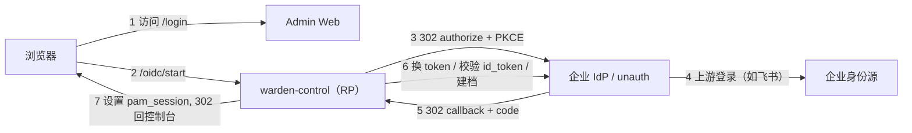

# 操作指南：接入企业单点登录（OIDC/SSO）

> **面向**：要启用飞书 / 企业 IdP 登录并给 SSO 用户配权限的管理员。
> **目标**：登录页出现 SSO 入口，用户能完成登录，管理员能在页面上指派权限。
> 变量取值查 [configuration.md](configuration.md)，权限规则查 [authorization.md](authorization.md)，接口细节查 [api.md](api.md)。

## 前置条件

- IdP 可访问 `/.well-known/openid-configuration`，且能给 Warden 注册 RP client。
- 如果 IdP 上游还接了飞书等企业身份源，**上游回调地址也必须加入该平台的白名单**（见「故障速查」）。
- 已有一套可用的 HTTPS 部署（本地 HTTP 联调除外），见 [installation.md](installation.md)。
- 保留内置 `admin` 密码登录作为 break-glass 通道。

## 拓扑与地址一致性



**最容易踩的坑是地址不一致**。OIDC 的 state / nonce / PKCE verifier 都是 host-only 的 HttpOnly Cookie：

- 浏览器访问、回调地址、`WARDEN_OIDC_REDIRECT_URL`、`WARDEN_PUBLIC_CONTROL_URL` 必须使用**同一个 host**（不要混用 `localhost` 与 `127.0.0.1`）；
- 回调 URI 必须与 IdP 注册值**逐字符一致**（协议、host、端口、路径、结尾斜杠）；
- 生产环境反向代理必须传 `X-Forwarded-Proto`，否则 Secure Cookie 在 HTTPS 站点上会异常。

本地联调推荐三端口拓扑（模板见 `scripts/oidc-local.env.example`）：

| 服务 | 地址 | 说明 |
|---|---|---|
| IdP（如 unauth） | `http://127.0.0.1:8080` | `OIDC_ISSUER` |
| warden-control | `http://127.0.0.1:8090` | `WARDEN_PORT=8090` |
| Vite / 浏览器入口 | `http://127.0.0.1:8081` | `WARDEN_WEB_PORT=8081`、`WARDEN_WEB_HOST=127.0.0.1`、`WARDEN_CONTROL_TARGET=http://127.0.0.1:8090` |

此时回调必须是 `http://127.0.0.1:8081/api/v1/auth/oidc/callback`，且 `WARDEN_PUBLIC_CONTROL_URL=http://127.0.0.1:8081`、`WARDEN_CORS_ORIGIN=http://127.0.0.1:8081`。

## 步骤 1：在 IdP 注册 RP client

| 项 | 值 |
|---|---|
| 授权模式 | Authorization Code |
| PKCE | **必须支持 S256**（Warden 强制，不提供降级） |
| redirect_uri | `https://<warden.example.com>/api/v1/auth/oidc/callback`（生产示例；本地见上表） |
| post_logout_redirect_uri | `https://<warden.example.com>/` |
| scope | `openid profile email` |
| id_token claims | 必须包含稳定的 `sub`；建议提供 `name` / `email` / `picture` |
| client_secret | 生成后只写入 Warden 的 Secret 文件，不要贴进文档或日志 |

**上游身份源白名单**：若 IdP 自身通过飞书等平台登录，还要把 IdP 的回调（例如 `https://<idp.example.com>/api/auth/callback`）加入该平台后台的重定向 URL 白名单。缺这一步会报 `20029 redirect_uri 请求不合法`，且错误发生在 IdP 侧，Warden 日志里看不到。

## 步骤 2：配置 warden-control

`WARDEN_OIDC_ISSUER` 是总开关：为空时 OIDC 完全禁用、登录页不显示 SSO 入口，行为与旧版一致。

```text
WARDEN_OIDC_ISSUER=https://<idp.example.com>
WARDEN_OIDC_CLIENT_ID=<client-id>
WARDEN_OIDC_CLIENT_SECRET_FILE=/etc/warden/secrets/oidc_client_secret
WARDEN_OIDC_REDIRECT_URL=https://<warden.example.com>/api/v1/auth/oidc/callback
WARDEN_OIDC_DEFAULT_TENANT_ID=platform
WARDEN_OIDC_DEFAULT_ROLE=user
```

要点：

- `WARDEN_OIDC_CLIENT_SECRET` 与 `_FILE` **不可同时设置**；生产用 `_FILE`。
- 启用时 `CLIENT_ID` / `CLIENT_SECRET` / `REDIRECT_URL` / `DEFAULT_TENANT_ID` 四项必须齐全，否则启动报错。
- `DEFAULT_TENANT_ID` 是租户 **slug**（外键指向 `tenants(slug)`），通常 `platform`。
- `DEFAULT_ROLE` 只允许 `user` / `tenant_admin`；**填 `platform_admin` 会让服务启动失败**——超级管理员只能在页面手工指派。
- Discovery 在首次请求时懒加载，启动不依赖 IdP 可用。

完整变量表见 [configuration.md](configuration.md)。本地联调可直接复制 `scripts/oidc-local.env.example` 到 `.secrets/oidc-local.env` 后 `source` 使用。

## 步骤 3：前端契约

Web **必须使用服务端下发的绝对 URL** 发起登录与登出，不要自己拼路径：

```text
GET /api/v1/auth/oidc/config
→ { "enabled": true,
    "login_url":  "https://<warden.example.com>/api/v1/auth/oidc/start",
    "logout_url": "https://<warden.example.com>/api/v1/auth/oidc/logout" }
```

四个公开端点：`config` / `start` / `callback` / `logout`。`start` 会生成 `oidc_state`、`oidc_nonce`、`oidc_verifier` 三个 HttpOnly Cookie（10 分钟），并带 `code_challenge_method=S256` 跳转 IdP；`callback` 校验 state、nonce、PKCE 与 id_token 后按 `(issuer, subject)` 建档，签发同一个 `pam_session` 并 302 回控制台；`logout` 走 RP-initiated logout，同时终止本地与 IdP 会话。

## 步骤 4：验证

```bash
BASE=https://<warden.example.com>

# 1) 开关与 URL
curl -sS "$BASE/api/v1/auth/oidc/config"

# 2) start 必须是 302，且带 PKCE 与三个 Set-Cookie
curl -sS -D - -o /dev/null "$BASE/api/v1/auth/oidc/start" | \
  grep -iE '^HTTP/|^location:|code_challenge_method|^set-cookie:' | sed -E 's/(set-cookie: [^=]+=)[^;]+/\1<redacted>/I'

# 3) 用 cookie jar 跟随完整 302 链（自动化只能到登录页，最后一步需真人完成）
curl -sS -L -c /tmp/oidc.cookies -b /tmp/oidc.cookies -o /dev/null -w '%{http_code}\n' \
  "$BASE/api/v1/auth/oidc/start"

# 4) 登录后检查身份字段
curl -sS -b /tmp/oidc.cookies "$BASE/api/v1/auth/me"
```

验收标准：

| 检查项 | 期望 |
|---|---|
| `/oidc/config` | `enabled: true`，`login_url` / `logout_url` 为绝对 URL |
| `/oidc/start` | 302 到 IdP authorize，含 `code_challenge_method=S256`、3 个 HttpOnly Cookie |
| 完整链路 | 无 `20029`、无 `INVALID_OIDC_STATE`、无 5xx |
| `/auth/me` | 有 `display_name`（IdP 名称，不是 `federated:<hash>`）、`auth_source=oidc`、`capabilities` |
| `/oidc/logout` | 302 到 IdP `end_session_endpoint`，会话被撤销、Cookie 被清除 |
| 密码登录 | 仍可用（break-glass） |

**真人验收不可省略**：用真实企业账号在浏览器点一次 SSO，确认顶栏展示名/头像、菜单范围，再点登出。curl 无法替代企业身份源的交互登录。

## 步骤 5：给 SSO 用户配权限

1. 首次登录自动建档，角色是 `user`（最小权限）。
2. 超级管理员进入「平台管理 → 账号与权限」，把目标账号改成 `tenant_admin` 或 `platform_admin`。
3. 变更会立即撤销该账号的全部活跃会话，**对方必须退出并重新 SSO 登录**才能拿到新 scope；刷新页面无效。
4. 每次变更写审计 `account.role_updated`，与角色变更在同一事务提交。

保护规则：内置 `admin` 不可修改、不能给自己降权、必须保留至少一个非内置 `platform_admin`、跨租户目标返回 404。完整说明见 [authorization.md](authorization.md)。

## 故障速查

| 现象 | 常见原因 | 处理 |
|---|---|---|
| 飞书 `20029` / `redirect_uri 请求不合法` | **IdP 上游**回调地址未加入飞书后台白名单 | 在飞书应用后台添加 `https://<idp.example.com>/api/auth/callback`；这是 IdP 侧配置，Warden 改不了 |
| `INVALID_OIDC_STATE` / state 校验失败 | 登录与回调 host 不一致（`localhost` vs `127.0.0.1`）、浏览器丢了 Cookie、代理未传 `X-Forwarded-Proto`、Secure Cookie 在本地 HTTP 下被丢弃 | 统一 host 与 `WARDEN_PUBLIC_CONTROL_URL` / `REDIRECT_URL`；本地设 `WARDEN_COOKIE_SECURE=false`；检查代理头。失败回调**不清 Cookie**，可直接重试 |
| `OIDC_PKCE_MISSING` | 回调缺 `oidc_verifier` Cookie 或 IdP 不支持 S256 | 确认同源、IdP 开启 PKCE；Warden 不会降级为无 PKCE 兑换 |
| `OIDC_INVALID_SUBJECT` | IdP 的 userinfo 实现把 `sub` 覆盖为空 | 在 IdP 侧补全 userinfo（例如正确实现 `SetUserinfoFromScopes`）。Warden 遇到空 `sub` 会拒绝，避免所有用户被合并成同一身份 |
| 首次 SSO 登录 500 / 建档失败 | 早期版本的 `ProvisionIdentity` 错误变量被覆盖、`pgx.ErrNoRows` 丢失 | 已修复；若旧部署仍遇到，先升级控制面 |
| 顶栏显示 `federated:<hash>` | 前端读了内部标识 `name` 而不是 `display_name` | 使用新版前端；`/auth/me` 已下发展示名、邮箱、头像 |
| 登录后菜单只剩 4 项 | 首次建档角色是 `user`；或改了角色但 JWT 未重签 | 由超管在页面提权 → 退出重新 SSO 登录 |
| 回调 404 / 401 | 回调落在了前端 SPA 而不是控制面，或路径与 IdP 注册值不一致 | 检查 `/api/` 反代、逐字符核对 redirect_uri |
| 登出后 IdP 会话仍在 | 用了 `/auth/logout` 而不是 `/auth/oidc/logout` | SSO 用户走 `/oidc/logout` |

更多排障见 [troubleshooting.md](troubleshooting.md)。

## 生产红线

1. `WARDEN_OIDC_DEFAULT_ROLE=user`，绝不配成 `platform_admin`。
2. client secret 用 `_FILE`，权限 600，不进镜像、日志或文档。
3. 全站 HTTPS，`WARDEN_COOKIE_SECURE=true`。
4. 保留内置 `admin` 密码登录作为应急通道。
5. 回调地址与登出回跳地址在 IdP 侧精确登记，变更前先备份 IdP 配置。

## 下一步

- [authorization.md](authorization.md)：权限模型与生效时机
- [api.md](api.md)：四个 OIDC 端点与账号接口
- [operations.md](operations.md)：配置变更与回滚
- [troubleshooting.md](troubleshooting.md)：完整错误码速查
